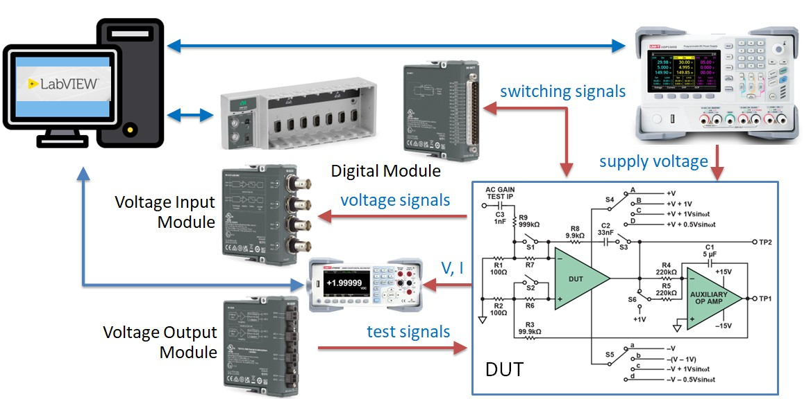
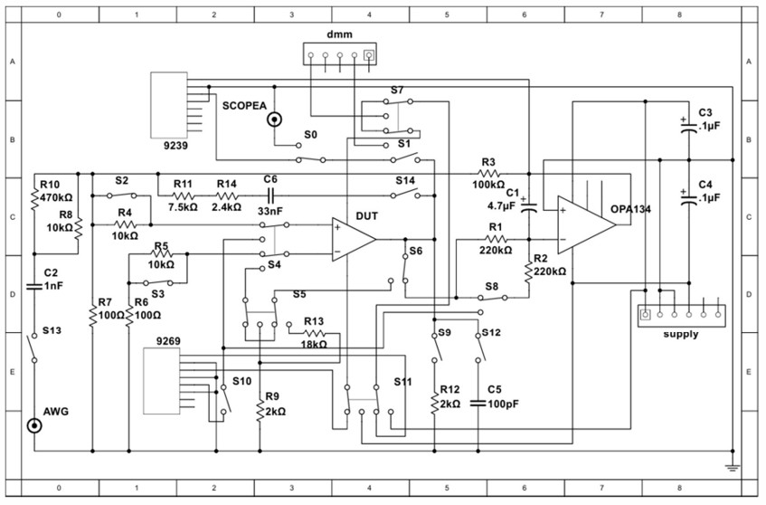

## Course outline {.smaller}

:::: {.columns}
::: {.column width=50%}
- [ ] **Day 1 LabVIEW + myRIO**
    - Automated Test Equipment
    - LabVIEW tutorials
    - Analog loopback with myRIO
    - **workshop**: frequency response test
- [x] **Day 2 Instrument drivers**
    - Programmable instruments
    - DAQmx and VISA/SCPI drivers
    - Instrument automation
    - **workshop**: LM321 $V_{OS}$ and $I_S$ test
:::
::: {.column width=50%}
- [ ] **Day 3 NI TestStand**
    - Sequences and action/test steps
    - Using code modules
    - Process models and callbacks
    - **workshop**: LM321 DC test
- [ ] **Day 4 Python for testing**
    - PyVISA and Streamlit libraries
    - CAN bus and CANopen
    - **workshop**: CANopen firmware test
:::
::::

## Instrument coordination: opamp test {.smaller}

\

## TSE opamp DIB &lrarr; instruments {.smaller}
:::: {.columns}
::: {.column width=75%}
\
:::
::: {.column width=25%}
#### Opamps 
- DUT: LM321
- AUX: OPA134

#### cDAQ
- NI-9477
- NI-9239
- NI-9269

#### Instrument
- UDP3305S
- UT8805E
- PicoScope 2206B
:::
::::
