## Electronics manufacturing flow {.smaller .scrollable}

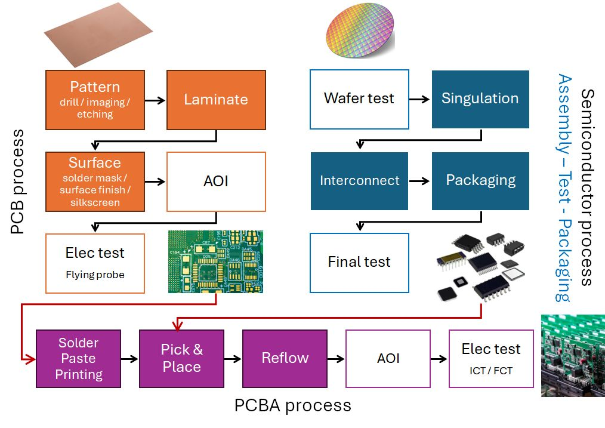\

## Automated Test Equipment (ATE) {.smaller}
Computer-controlled systems that automatically measure and evaluate functional, structural, or electrical performance on electronic devices

- Goals: **Usability** / **Reusability** / **Maintainability** / **Scalability**

:::: {.columns}
::: {.column width=67%}
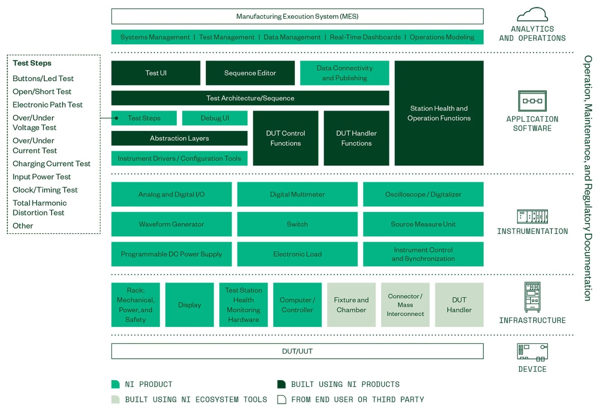\
:::
::: {.column width=33%}
#### [NI STS](https://www.ni.com/en/shop/electronic-test-instrumentation/what-is-the-semiconductor-test-system.html): Semiconductor Test System

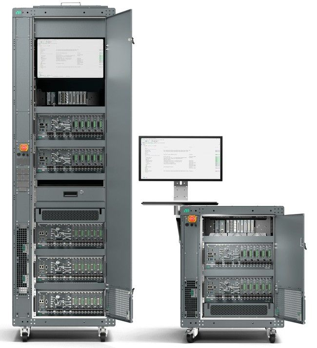\
:::
::::

## ATE for semiconductor products {.smaller}
:::: {.columns}
::: {.column width=45%}
#### [TERADYNE ETS-800](https://www.teradyne.com/products/ets-800/)
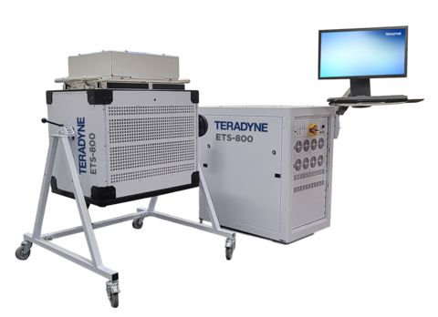\
:::
::: {.column width=55%}
#### ETS-800 D20: Two sectors, 20-slots
- HSD-64: 64 digital channels
    - 200 MValue/sec
    - -2V to +12V, 32mA PPMU
- APU-32A: floating 32 low-power VI channels
    - 30V to +80V, 200mA VI
- SPU-8112: floating 8 high power VI channels
    - &plusmn;100V, 2A DC
- QMS: 4 differential digitizer
    - 12-bit at 10 Msps, &plusmn;200V floating
- MCMUX: 64-channel MUX 
    - 200V, 2A
:::
::::

## ATE for PCB products^[[Understanding Bare Board PCB Testing](https://resources.pcb.cadence.com/blog/2022-understanding-bare-board-pcb-testing)] {.smaller}

:::: {.columns}
::: {.column width=45%}
#### Automated Optical Inspection (AOI)

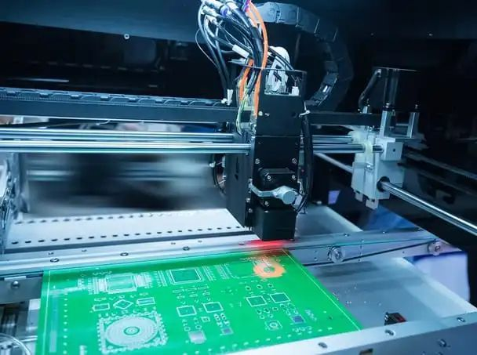\

:::
::: {.column width=55%}
#### Electrical testing &rarr; ICT or Flying probe

- Continuity Testing (Short Testing)
- Insulation Resistance Testing
- Impedance Testing: Time-domain reflectometry (TDR)

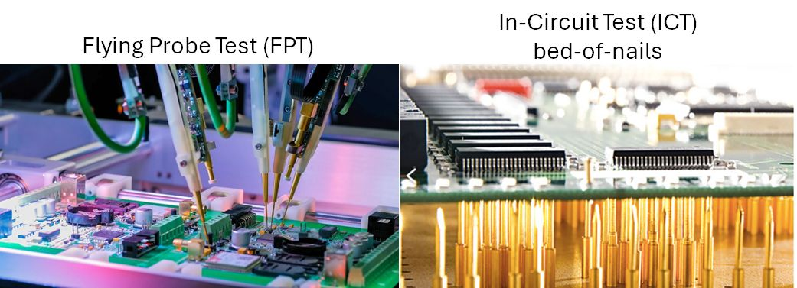\
:::
::::

## ATE for PCBA products^[[What Is PCBA Testing? Complete Guide to Inspection Methods, Process, and Quality Control](https://jlcpcb.com/blog/pcba-testing)] {.smaller}

:::: {.columns}
::: {.column width=50%}
#### Automated Optical Inspection (AOI)
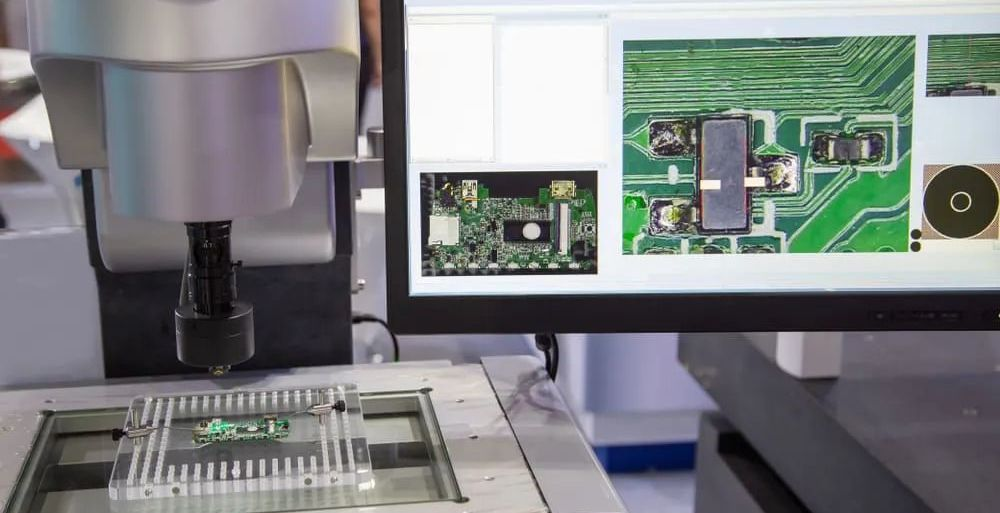{width=80%}\

#### PCB X-Ray Inspection
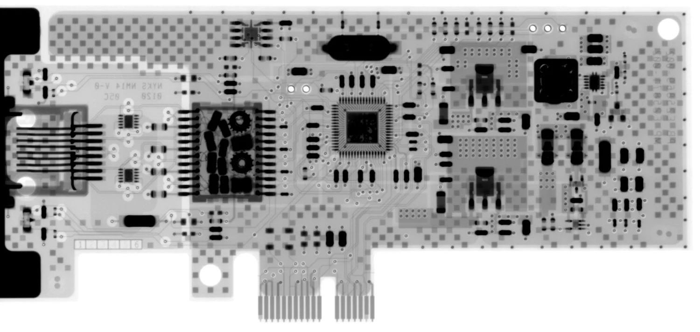{width=80%}\
:::
::: {.column width=50%}
#### Electrical testing
- Flying Probe Test (FPT) &rarr; PCB trace, component values
- In-Circuit Testing (ICT) &rarr; electrical signals at test points
- Functional Testing (FCT)
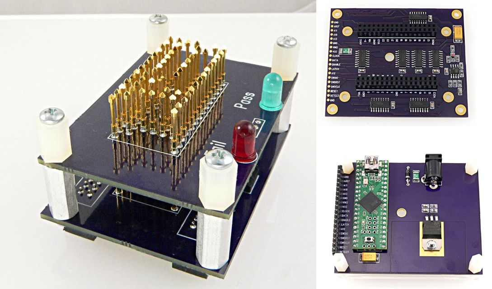\
:::
::::

## ATE for appliance products {.smaller}
**Requirements** &larr; Safety/Energy efficiency/Endurance/... standards 

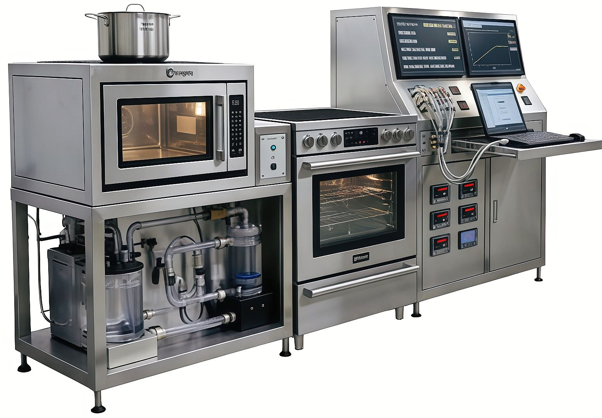{width=75%}\

## Electronic testing: terminology {.smaller}

:::: {.columns}
::: {.column width=50%}
- DUT (Device Under Test) / UUT (Unit Under Test): the device being tested
- DIB (Device Interface Board) / Load Board: the interface to the DUT
- DPS (Device Power Supplies): power supplies for the DUT
- PMU (Parametric Measurement Unit): equipment for measuring DUT DC characteristics
:::
::: {.column width=50%}
- VCC (+ ICC): TTL power supply
- VDD (+ IDD): CMOS power supply
- VSS: power supply return
- VIH / VIL: input voltages for logic 1/0
- VOH / VOL: output voltages for logic 1/0
- IOH / IOL: source/sink currents for logic 1/0
- IIH / IIL: leakage currents for logic 1/0
- IOZH / IOZL: leakage currents in the high-Z state for logic 1/0
:::
::::

## Digital logics vs electrical signals {.smaller}

:::: {.columns}
::: {.column width=70%}
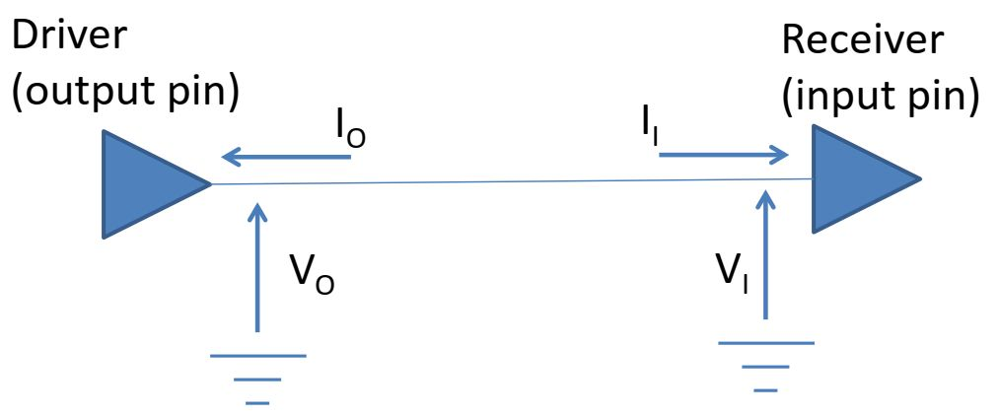\
:::
::: {.column width=30%}
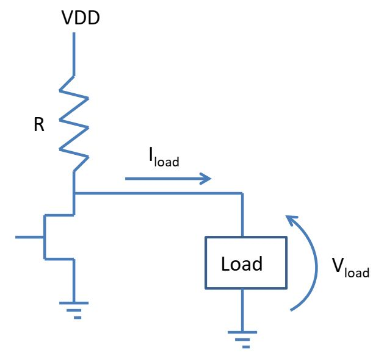\
:::
::::

:::: {.columns}
::: {.column width=25%}
| Logic | Voltage | 
| -- | ---- |
| Out = 1 | $V_O$ > $V_{OH}$ |
| Out = 0 | $V_O$ < $V_{OL}$ |
| In = 1 | $V_I$ > $V_{IH}$ | 
| In = 0 | $V_I$ < $V_{IL}$ | 
:::
::: {.column width=52%}
| Logic | Transistor | Voltage |
| -- | -- | ---- |
| Out = 1 | OFF | $V_{load}$ = $V_{DD} - I_{load} * R$ |
| Out = 0 | ON | $V_{load}$ &cong; 0 = $I_{load} * R$ |
:::
::: {.column width=23%}
#### Concepts

- Force voltage &rarr; sense current
- Force current &rarr; sense voltage
:::
::::

## Pin electronics^[[Understanding Key Differences between SMUs and PPMUs](https://www.ni.com/en/shop/electronic-test-instrumentation/source-measure-units/what-are-source-measure-units/understanding-key-differences-between-smus-and-ppmus.html)] {.smaller}
:::: {.columns}
::: {.column width=50%}
#### SMU (Source Measure Unit)
- Operating modes:
    - 2 quadrants (source only)
    - 4 quadrants (source and sink)
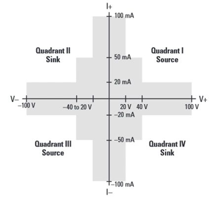{width=85%}\
:::
::: {.column width=50%}
#### PPMU (Pin Parametric Measurement Unit)
- Operating modes (2 quadrants):
    - Force voltage, measure current
    - Force current, measure voltage
- Less precision, less flexible current limiting &rarr; higher speed, more channels
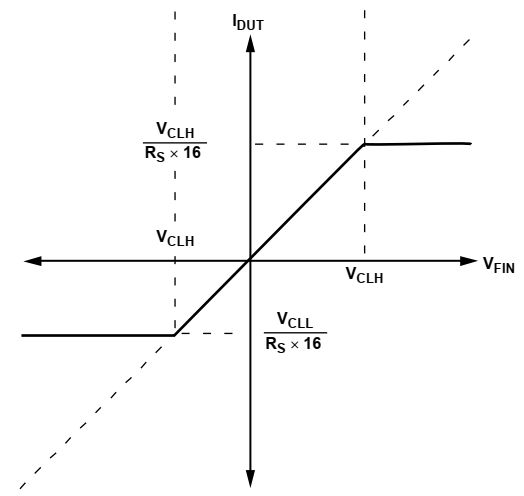{width=65%}\
:::
::::

## Microcontroller pin {.smaller}

#### Multiplexed I/O pin: ESD protection diodes

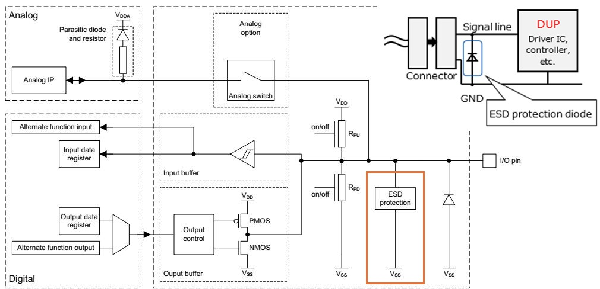\

## Open/short test {.smaller}
:::: {.columns}
::: {.column width=50%}
#### Die test: ESD diode
- Force current (e.g. +100 µA) into the pin
- Measure voltage: 
    - PASS: approximately 0.6–0.8 V
    - Short: close to 0 V
    - Open: rises to the voltage limit
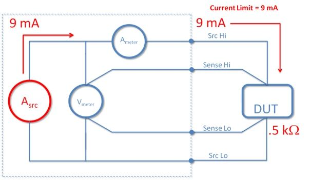\
:::
::: {.column width=50%}
#### PCB/PCBA test
- Measure between two test points
    - Effects of traces, solder and connections on the PCB
- Force voltage, measure current &rarr; resistance
    - Very low = short / very high = open
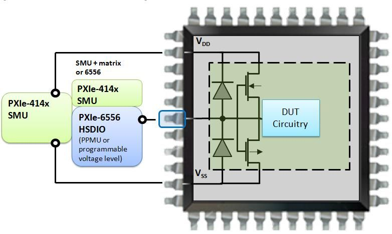\
:::
::::

## DC parametric test {.smaller}
:::: {.columns}
::: {.column width=20%}
#### IDD testing
:::
::: {.column width=80%}
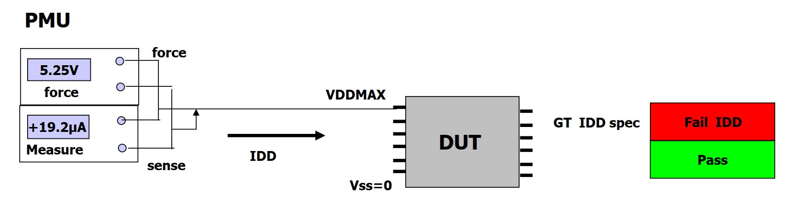\
:::
::::

:::: {.columns}
::: {.column width=20%}
#### VOL/IOL Testing
:::
::: {.column width=80%}
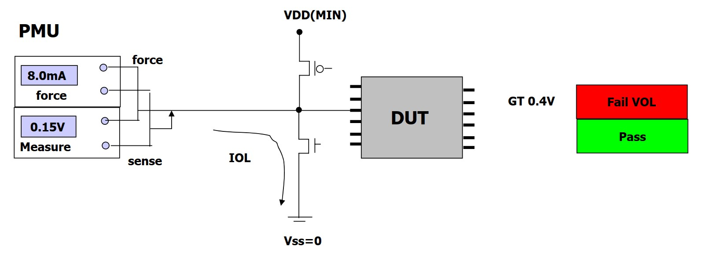\
:::
::::

## AC parametric test {.smaller}
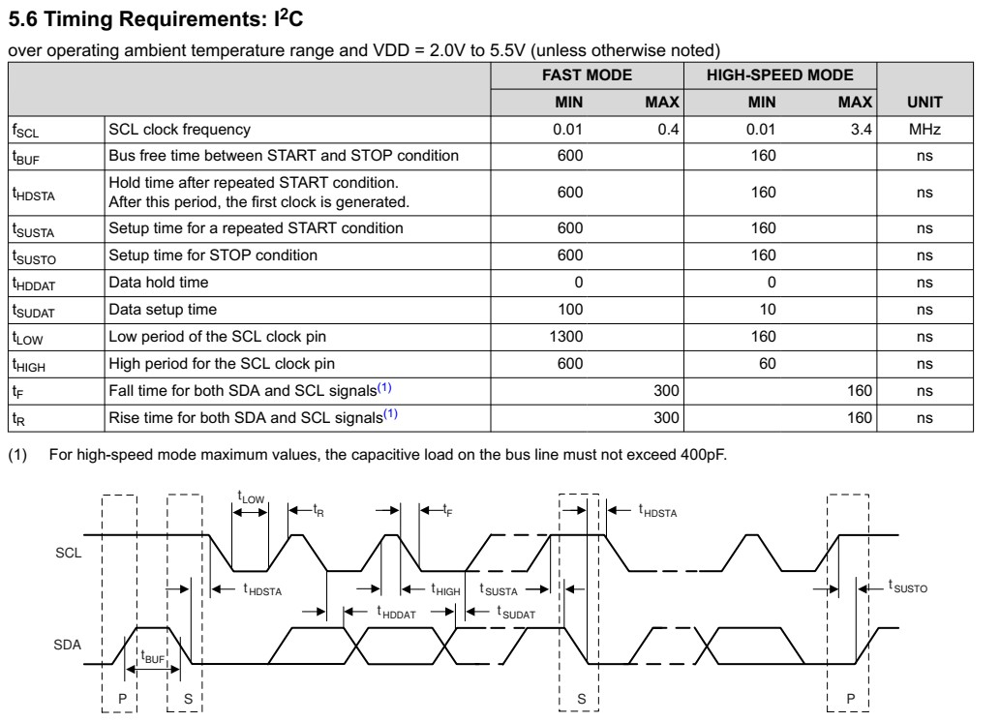{width=80%}\

## Functional testing: digital DUT {.smaller}
:::: {.columns}
::: {.column width=65%}
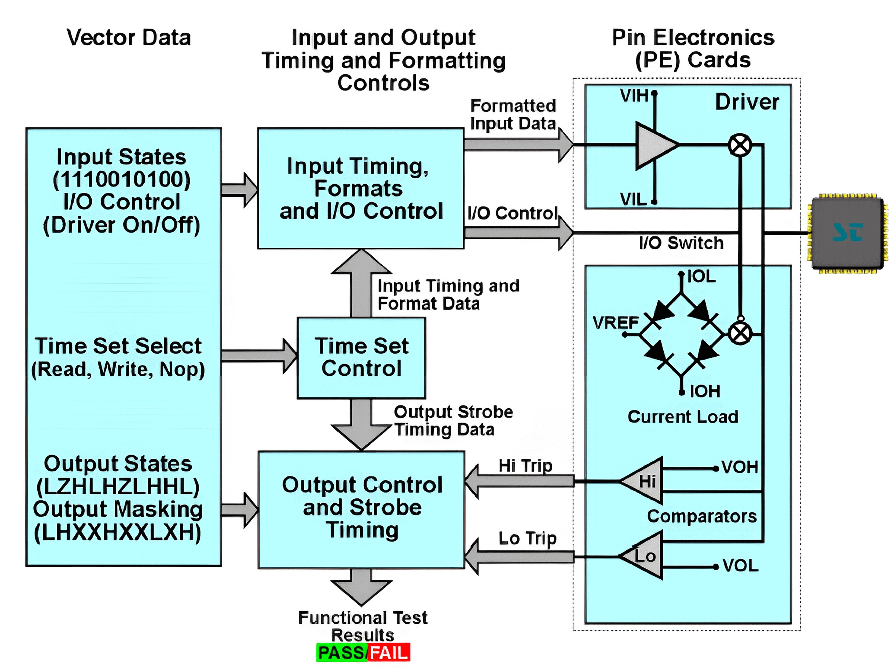\
:::
::: {.column width=35%}
#### Concepts
**Stimulus** &rarr; **DUT** &rarr; **Response**

- Drive digital inputs: **0 / 1**
- Compare outputs: **L / H / Z**
- Verify response at specified **timing**

#### Test vector
timing + input stimulus + expected response

| Time | IN1 | IN2 | OUT |
| ---: | :-: | :-: | :-: |
| $t_0$ | 0 | 0 | L |
| $t_1$ | 0 | 1 | H |
| $t_2$ | 1 | 0 | H |
| $t_3$ | 1 | 1 | Z |
:::
::::
