## 5. Automotive network {.smaller}
**Electronic Control Unit (ECU)**: embedded system in automotive electronics that controls one or more of the electrical systems or subsystems in a car or other motor vehicle.
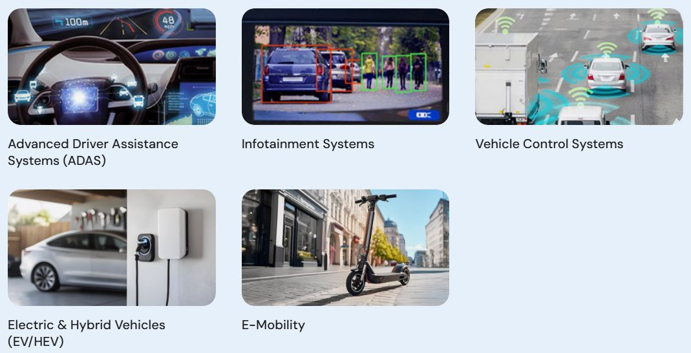\

## 5. ECUs in vehicle {.smaller}
:::: {.columns}
::: {.column width=50%}
#### Safety ECU
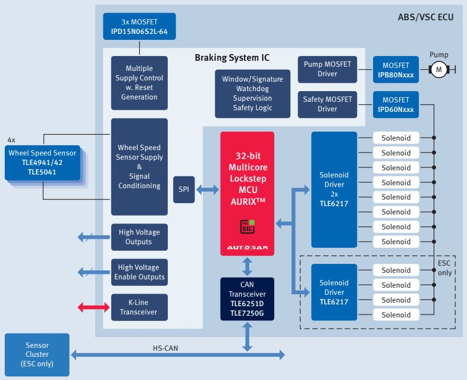\
:::
::: {.column width=50%}
#### Passenger ECU
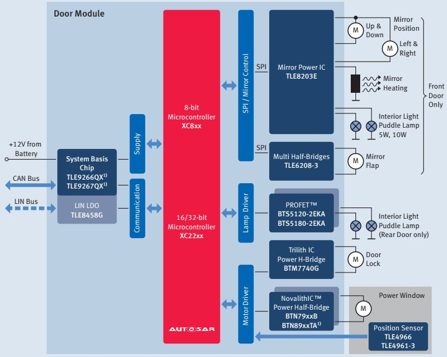\
:::
::::

## 5. ECUs in vehicle {.smaller}
:::: {.columns}
::: {.column width=50%}
#### Safety ECU
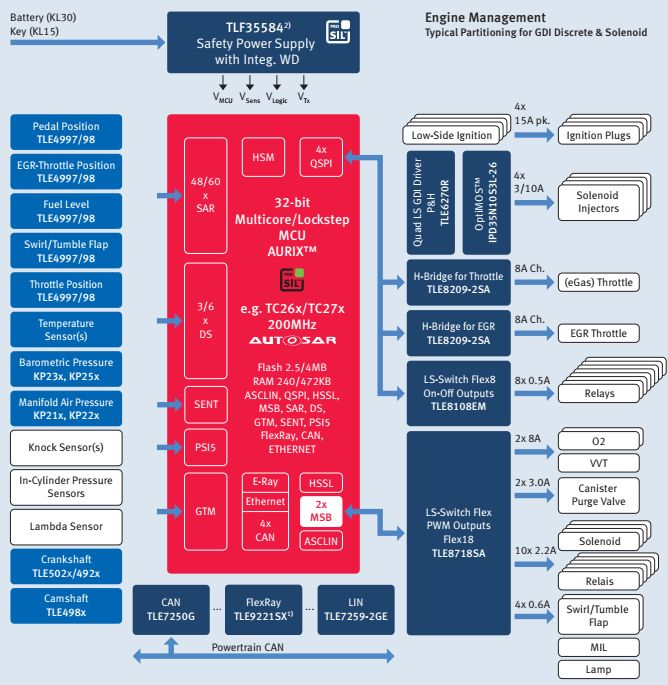\
:::
::: {.column width=50%}
#### Battery ECU
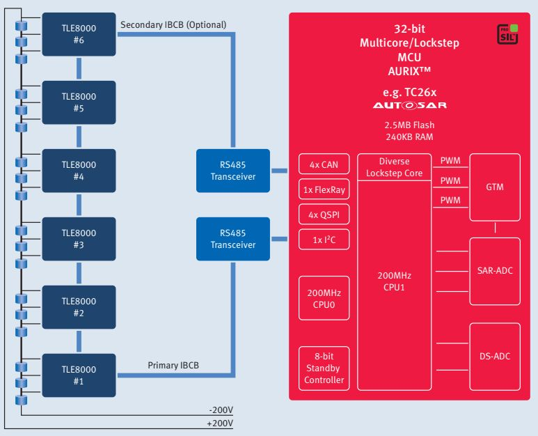\
:::
::::

## 5. In-vehicle network {.smaller}

:::: {.columns}
::: {.column width=30%}
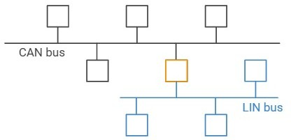\
:::
::: {.column width=70%}
#### Communication requirements
- Communication among many processors
- Commands/data must be delivered within a defined time frame
:::
::::

:::: {.columns}
::: {.column width=50%}
#### Controller Area Network (CAN)
- ISO 11898 standard
- Differential signalling
    - CAN transceiver &rarr; CANH/CANL pins
    - Twisted 5 V signal wires
- Asynchronous serial network
    - Broadcast communication
    - Priority mechanism based on message ID
:::
::: {.column width=50%}
#### Local Interconnect Network (LIN)
- ISO 17987 standard
- Single-wire signalling (12 V/24 V)
    - LIN transceiver &rarr; LIN pin
- Asynchronous serial network
    - 1 commander / 16 responder
:::
::::

## 5. In-vehicle network {.smaller}
:::: {.columns}
::: {.column width=50%}
#### CAN transceiver

- CAN controller &rarr; TXD, RXD pins
- CAN transceiver &rarr; CANH, CANL pins

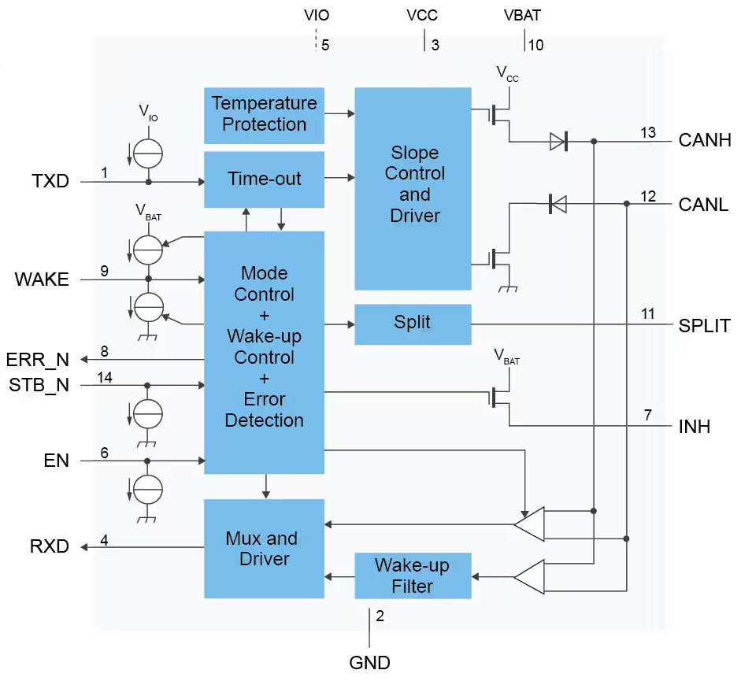\
:::
::: {.column width=50%}
#### LIN transceiver

- UART &rarr; TXD, RXD pins
- LIN transceiver &rarr; LIN pin

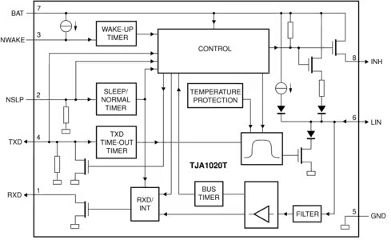\
:::
::::

## 5. CAN bus {.smaller}
A network of ECUs communicating by broadcast, emphasizing reliability and defined timing

:::: {.columns}
::: {.column width=50%}
- Arbitration mechanism based on message ID
:::
::: {.column width=50%}
- short message (8 byte/64 byte) 
:::
::::
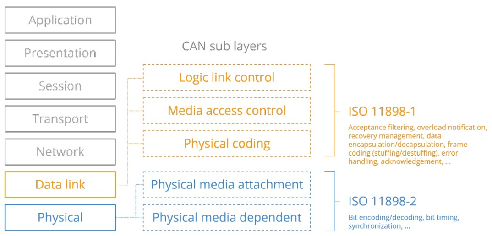\

## 5. CAN bus topology {.smaller}
:::: {.columns}
::: {.column width=35%}
#### Components^[[The CAN topology](https://www.hms-networks.com/tech-blog/blogpost/hms-blog/2024/06/18/the-can-topology-from-the-bus-topology-to-the-tree-topology-and-beyond)]

- **Node**: a device that transmits or receives CAN frames
- **Repeater**: regenerates signals between compatible CAN bus segments
- **Bridge**: forwards selected frames between CAN networks
- **Gateway**: connects CAN to another network or protocol
:::
::: {.column width=65%}
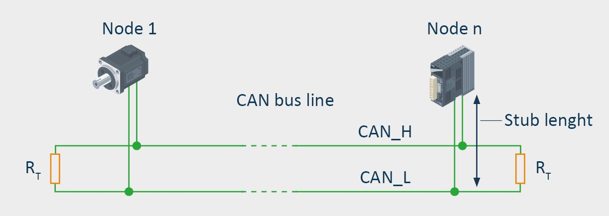\
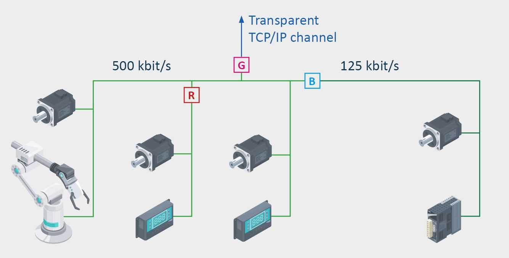\
:::
::::

## 5. CAN bus signaling {.smaller}

- Twisted-pair signal wires (CANH-CANL) + 120 $\Omega$ termination
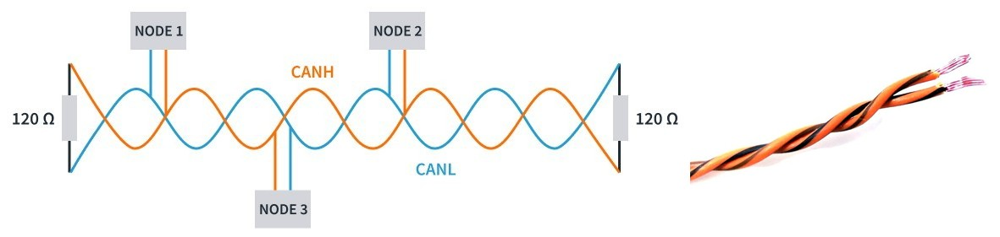{width=90%}\
- CAN logical states: Dominant (logic 0), Recessive (logic 1)

:::: {.columns}
::: {.column width=60%}
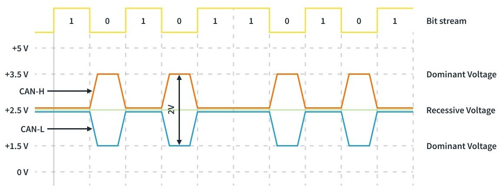\
:::
::: {.column width=40%}

- Transmit **1**, sense **0** &rarr; lost arbritation
- Bit **0** &rarr; higher priority
:::
::::

## 5. CAN sniffer: USB2CANFD {.smaller}
The [USB2CANFD](https://github.com/WeActStudio/WeActStudio.USB2CANFDV1) board transmits/detects CAN messages using commands over USB serial

:::: {.columns}
::: {.column width=40%}
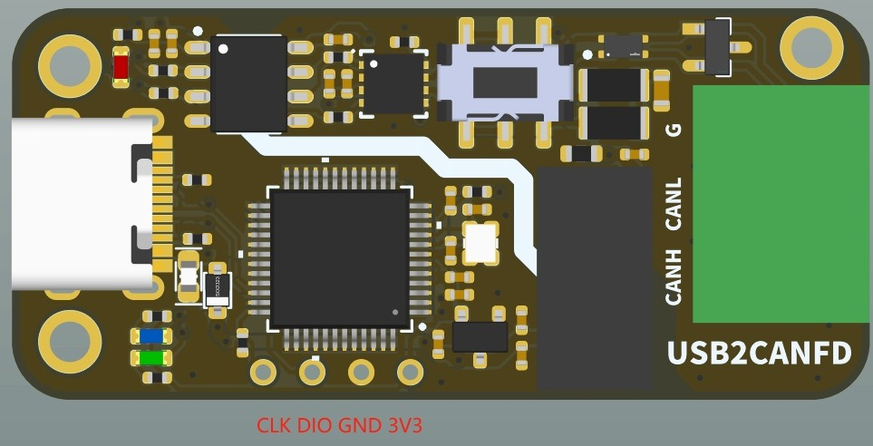\
:::
::: {.column width=60%}
- STM32G0B1CBT6 microcontroller
- Firmware: [SLCAN](https://github.com/mac-can/SerialCAN)
- Used with [python-can](https://python-can.readthedocs.io/en/stable/) or [CANgaroo](https://github.com/Schildkroet/CANgaroo)
:::
::::

:::: {.columns}
::: {.column width=45%}

| Commands | Purpose |
| :-- | :----- |
| `S8`&#8629; | Set the data rate to 1 Mbps |
| `Y1`&#8629; | Set the FD data segment rate to 1 Mbps |
| `O`&#8629; | Open the CAN communication channel |
| `C`&#8629; | Close the CAN communication channel |
:::
::: {.column width=55%}

| Commands | Purpose |
| :-- | :----- |
| `tIIILDD...`&#8629; | Send a data frame with ID and data |
| `rIIIL`&#8629; | Send a remote frame with ID and length |
| `dIIILDD...`&#8629; | Send a CAN-FD frame with ID and data |
| `bIIILDD...`&#8629; | Send a remote frame with ID and length |
:::
::::

## 5. CANgaroo {.smaller}
[Open-source CAN bus analyzer](https://github.com/Schildkroet/CANgaroo): SLCAN, candleLight, Vector, Kvaser, PEAK PCAN, ...

- [DBC](https://docs.openvehicles.com/en/latest/components/vehicle_dbc/docs/dbc-primer.html): describes CAN payload signals and their conversion into physical values

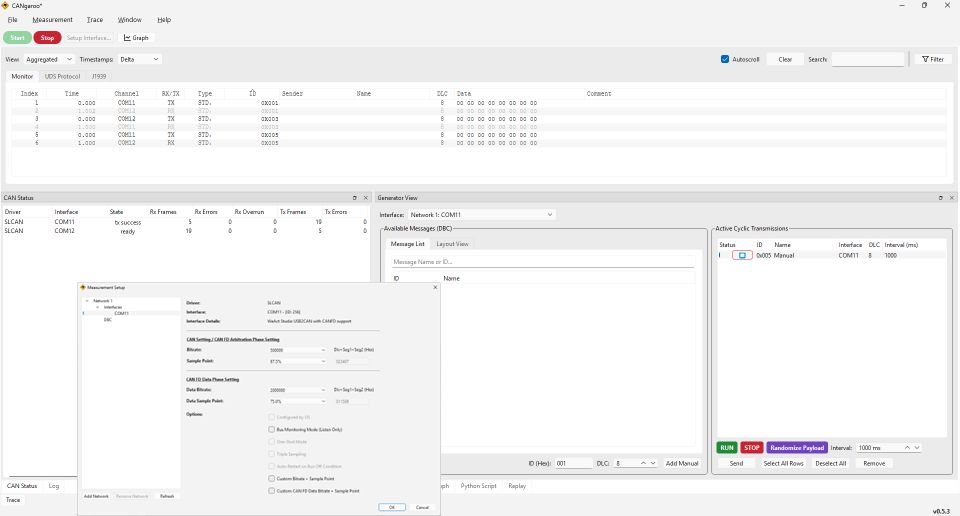{width=80%}\

## 5. CAN sniffer: oscilloscope {.smaller}
Inspect the 0/1 states of CANH/CANL signals using an oscilloscope^[[How to Simplify the Test of CAN Bus Networks Using the Right Oscilloscope](https://www.digikey.com/en/blog/how-to-simplify-the-test-of-can-bus-networks)]
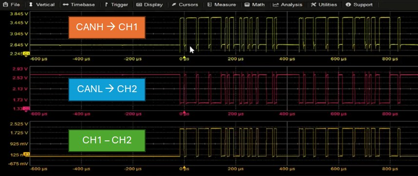\

## 5. Practice: CAN sniffer {.smaller}
#### Inspecting CAN messages with the USB2CANFD board
1. Connect CANH/CANL/GND wires between the USB2CANFD boards
2. Download, extract and run CANgaroo
    - Check the COMxx connection
3. In Generator View, click Add Manual
    - Enter the CAN message data

#### Inspecting CANH-CANL signals
1. Connect probes to measure the CAN bus differential signal
    - Connect CH1 to CANH
    - Connect CH2 to CANL
    - Display Math - SUBTRACT
2. Use USB2CANFD to send a CAN message

## 5. CAN messages {.smaller}
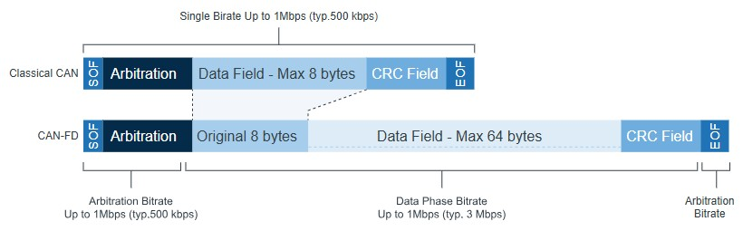\

| Fields | Length | Purpose |
| -- | -- | :------ |
| ID | 11/29 bit | Arbitration among nodes for network access^[A node that first transmits an ID bit of **1** &rarr; has lower priority and waits] |
| data field | $\le$ 8/64 byte | data frame (data), remote frame (none/RTR=1) |
| CRC | 15/17/21 bits | Calculated from the preceding bits |

## 5. CAN data/remote frame {.smaller}
#### CAN 2.0 frame

- Up to 8 data bytes, with a bit rate of up to 1 Mbit/s
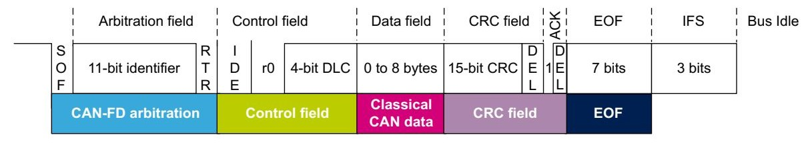\

#### CAN-FD frame
- Data: 0-8/12/16/.../64 bytes; the bit rate during the data field can increase to 8 Mbps
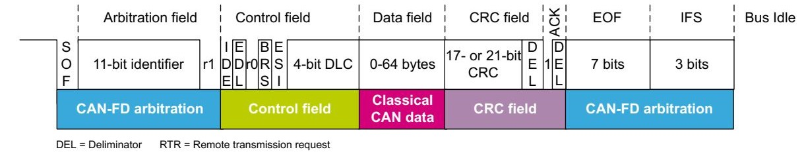\

## 5. CAN bus reliability^[[The CAN Bus Protocol Tutorial](https://kvaser.com/can-protocol-tutorial/)] {.smaller}

| Techniques | Purpose | Methods | 
| :-- | :---- | :-------- | 
| Bit Stuffing | Clock synchronization | After five consecutive logic 0 or 1 bits, one inverted bit is inserted |
| CRC | Frame integrity | Checks the transmitted bit sequence |
| ACK | Confirm message reception | Recessive state in the ACK bit |
| Error frame | Request message retransmission | Send 6 consecutive bits + 8 recessive bits (error delimiter) |
| Termination | Reduce reflections at cable ends/DC level at 2.5 V | Connect a 120 $\Omega$ resistor at each end |
| Cable length | Reduce threshold problems in $V_{CANH} - V_{CANL}$ | Cable < 40 m at 1 Mbps, < 100 m at 500 kbps, ... |

## Q&A
1. Why not use UART for communication between ECUs instead of CAN bus or LIN bus?
2. Why is CAN arbitration necessary for an automotive network?
3. Does switching to CAN-FD affect ECUs in older vehicles?
