## Problem-based learning #1 {.smaller}

:::: {.columns}
::: {.column width=55%}
#### [ADS1115](https://www.ti.com/product/ADS1115) ADC module as DUT

- 16-bit Delta-Sigma: up to 860 Samples/sec
- 2 differential inputs or 4 single-ended inputs
- Programmable Gain Amplifier (PGA): ±256mV to ±6.144V
- Supply voltage: up to 5.5V
- Comparator &rarr; ALERT/RDY pin
:::
::: {.column width=45%}
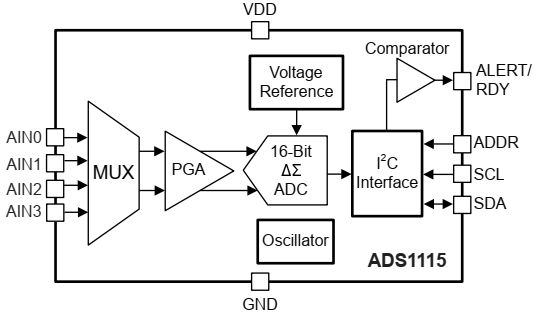{height=190px}\
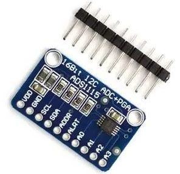{height=230px}\

:::
::::

## ADS1115 schematics {.smaller}
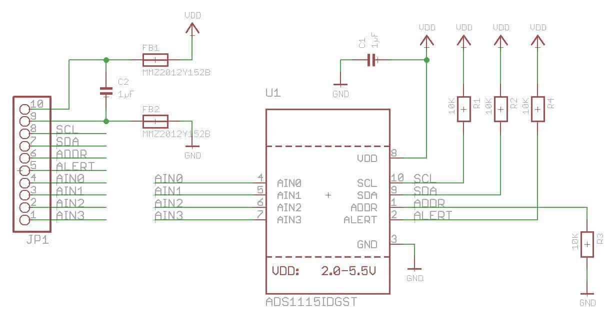\

## ADS1115 operations {.smaller}
:::: {.columns}
::: {.column width=50%}
#### Multiplexer (MUX): 
- Single-ended, differential
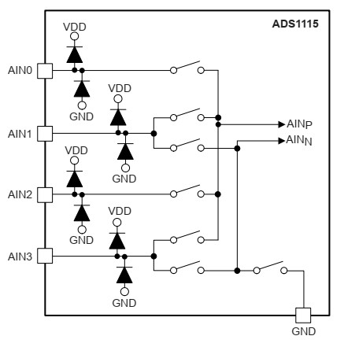\
:::
::: {.column width=50%}
#### Programmable Gain Amplifier (PGA):
- $LSB = \frac{FSR}{2^{16}}$
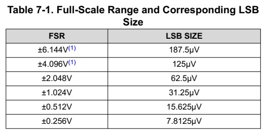\
:::
::::

## I2C write &rarr; ADS1115 {.smaller}
- I2C bus: half-duplex, master-slave (7-bit dev address + R/W bit)
- I2C device: registers for control/status/data
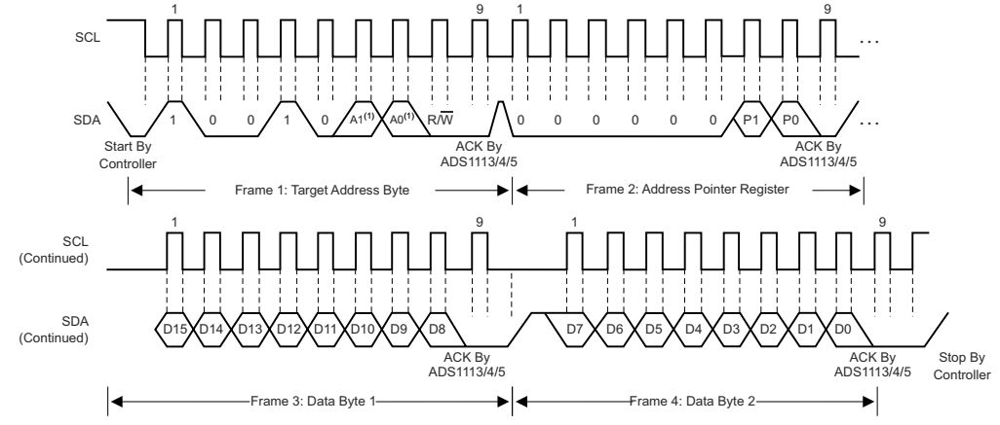\

## I2C read &larr; ADS1115 {.smaller}
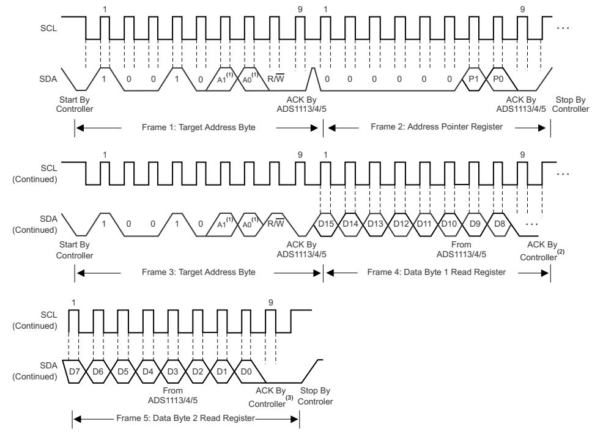{width=70%}\

## Programming ADS1115 {.smaller}
:::: {.columns}
::: {.column width=50%}
#### Configure modes
- write(device address+W) + address pointer + (MSB/LSB) payload
:::
::: {.column width=50%}
#### Read data
- write(device address+W) + address pointer
- read(device address+R) + 2-byte payload
:::
::::

#### Device address (7-bit) depends on ADDR
- GND (1001000) or VDD (1001001)

#### Address Pointer
| Register | Address  | Function  |  
| -- | -- | ------- |
| Conversion  | 00b | Latest 16-bit conversion result |
| Config | 01b | Mode, input, data rate, range and comparator settings |
| Low Thres | 10b | Lower threshold &rarr; ALERT |
| High Thres | 11b | Upper threshold &rarr; ALERT |

## LabVIEW + myRIO &lrarr; ADS1115 {.smaller}
:::: {.columns}
::: {.column width=50%}
#### ADDR pin to Device Address
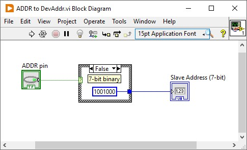{width=70%}\
:::
::: {.column width=50%}
#### Address Pointer to 8-bit
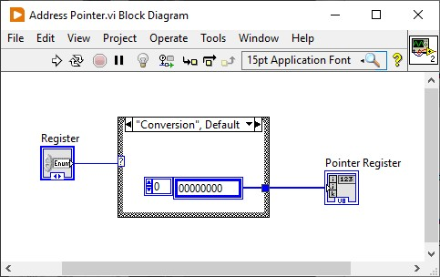{width=70%}\
:::
::::

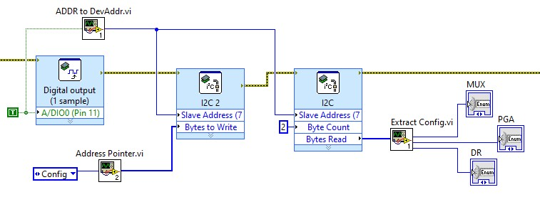{height=235px}\

## LabVIEW + myRIO &lrarr; ADS1115 {.smaller}
:::: {.columns}
::: {.column width=60%}
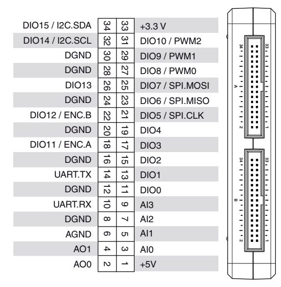{height=420px}\
:::
::: {.column width=40%}
#### Pin interfaces
| myRIO | ADS1115 | 
| -- | -- |
| +3.3 V supply | VCC |
|8 (DGND) | GND |
| 32 (DIO14/I2C.SCL) | SCL |
| 34 (DIO15/I2C.SDA) | SDA |
| 11 (DIO0) | ADDR |
| 13 (DIO1) | ALRT |
| 2 (AO0) | A0 |
| 4 (AO1) | A1 |
:::
::::

Use 3.3 V pull-ups on SCL, SDA and ALERT/RDY. Keep analog inputs within GND–VDD. [ADS1115 datasheet](https://www.ti.com/lit/ds/symlink/ads1115.pdf)

## ADS1115 test plan {.smaller}

**AO0 → AIN0; AO1 → AIN1.** VDD = 3.3 V; common ground.

**Guided example:** ADDR selection and Config readback. **Practice:** one differential reading.

| State | Stimulus / action | Expected result |
| --- | --- | --- |
| **Setup** | Open HW; both AO = 0 V | Initial outputs at 0 V |
| **Main: ADDR demo** | ADDR LOW/HIGH; read Config | Responds at 0x48, then 0x49 |
| **Main: Config demo** | ADDR LOW; set/read MUX, PGA, mode | Setting fields match |
| **Main: ADC practice** | AO0 = 2.5 V; AO1 = 0.5 V; read AIN0 − AIN1 | +2.0 V within the defined tolerance |
| **Cleanup** | Both AO = 0 V; close HW | Also runs on Stop/error |

**ADC practice:** select AIN0 − AIN1, PGA **±4.096 V** → settle → start single-shot → wait until ready → read and convert to volts.

## Pattern: [state machine](https://www.ni.com/en/support/documentation/supplemental/16/simple-state-machine-template-documentation.html) {.smaller}
Programming architecture that allows dynamic flow to **states** depending on values from previous states or user inputs

- **Enum** or **String** selects the state; a **Shift Register** passes it to the next iteration
- **Case Structure** inside a **While Loop**

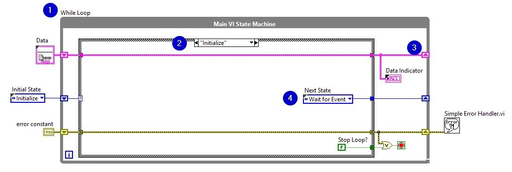\

## LabVIEW + myRIO practice {.smaller}
#### Extend the ADDR/Config example: read AIN0 − AIN1 once

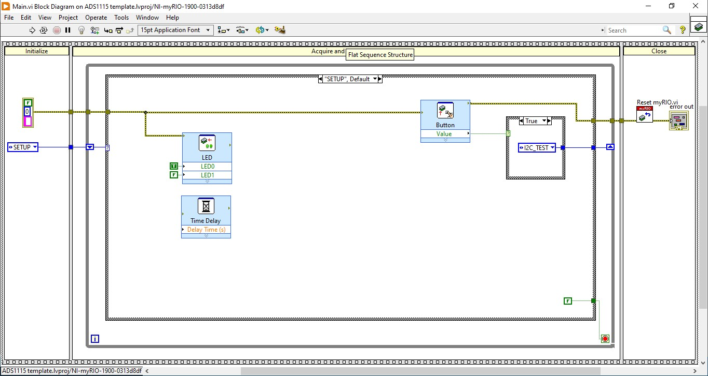\
