## LM321 opamp: [datasheet](https://www.ti.com/lit/ds/symlink/lm321.pdf) to spec {.smaller}
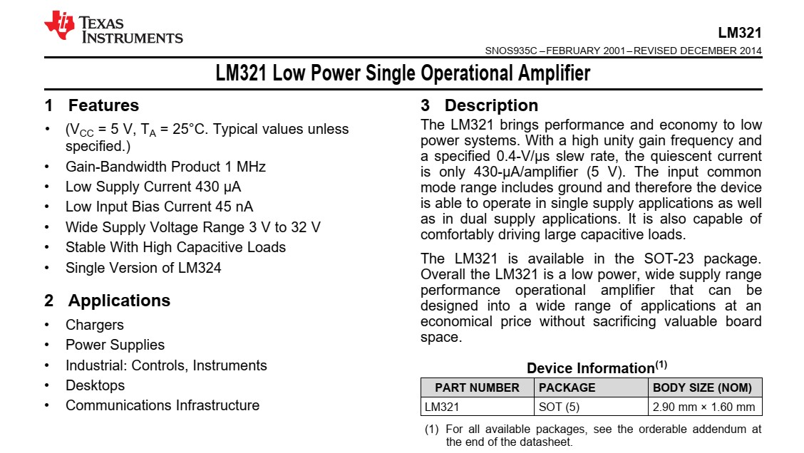\

## DUT + DIB = null detection {.smaller}
:::: {.columns}
::: {.column width=50%}
- **OPA134 AUX opamp**:
    - integrate (110k$\Omega$ - 4.7$\mu F$) $V_{out}$ as feedback $V_F$
:::
::: {.column width=50%}
- **LM321 DUT opamp**:
    - $\approx V_F$/1000 from voltage divider (100 k$\Omega$ - 100 $\Omega$) as offset voltage
:::
::::
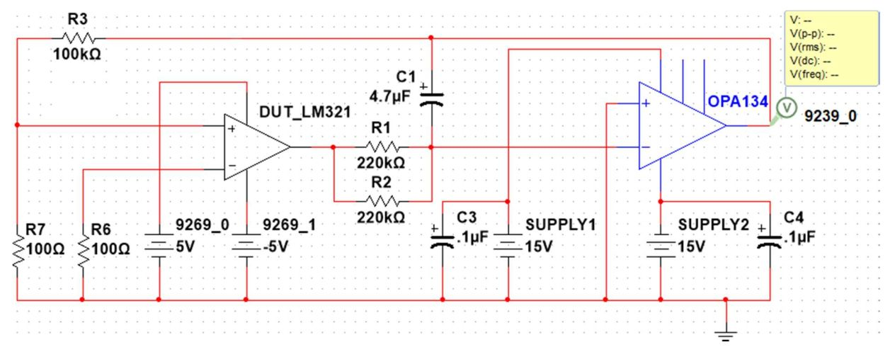\

## Instruments &lrarr; opamp DIB {.smaller}
:::: {.columns}
::: {.column width=50%}
#### cDAQ-9177 chassis
- NI-9239 measures voltage
- NI-9269 generates test voltages
- NI-9477 controls signal-path relays
:::
::: {.column width=50%}
#### Instruments
- UNI-T UT8805E measures current
- UNI-T UDP3305S supplies power
- PicoScope 2206B observes signals above 1 kHz in this exercise
:::
::::
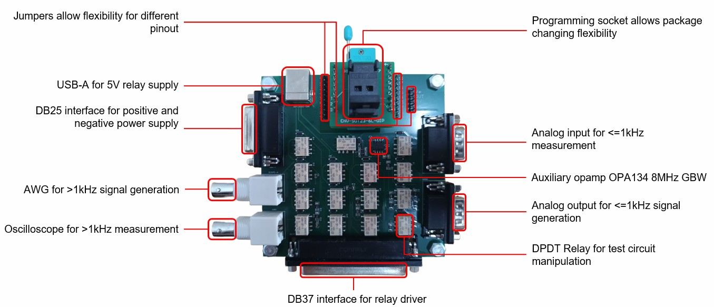{width=80%}\

## $V_{OS}$ measurement {.smaller}
:::: {.columns}
::: {.column width=50%}
1. **UDP3305S**: supply AUX opamp
2. **NI-9269**: supply DUT opamp 
:::
::: {.column width=50%}
3. **NI-9239**: measure scaled $V_{OS}$
:::
::::
\

## $I_{S}$ measurement {.smaller}

:::: {.columns}
::: {.column width=50%}
1. **UDP3305S**: supply AUX opamp
2. **NI-9269**: supply DUT opamp
:::
::: {.column width=50%}
3. **NI-9477**: select measurement path
4. **UT8805E**: measure $I_{S}$
:::
::::
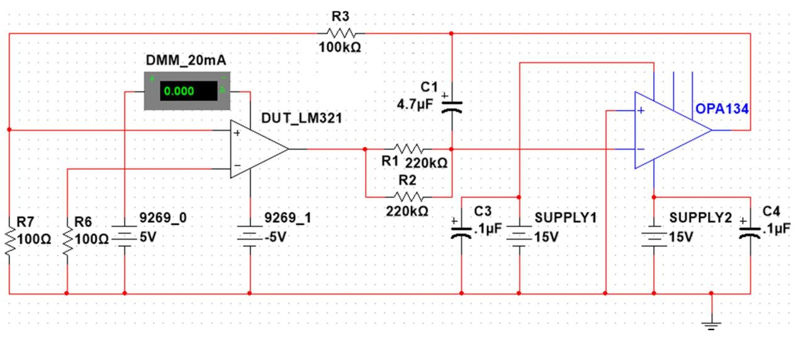\

## Power/signal interfaces {.smaller}
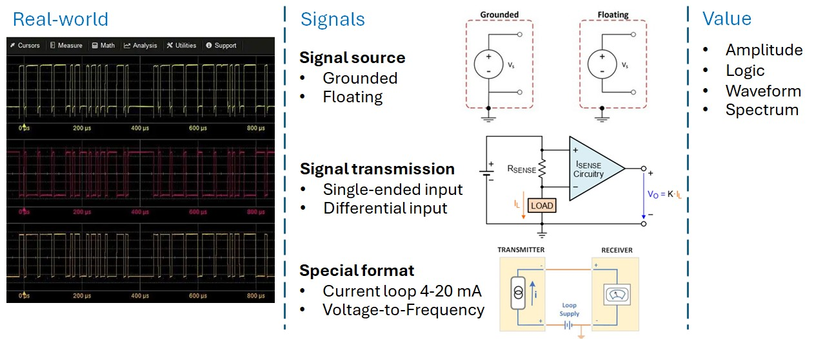\

## UDP3305S prog. power supply {.smaller}
:::: {.columns}
::: {.column width=40%}
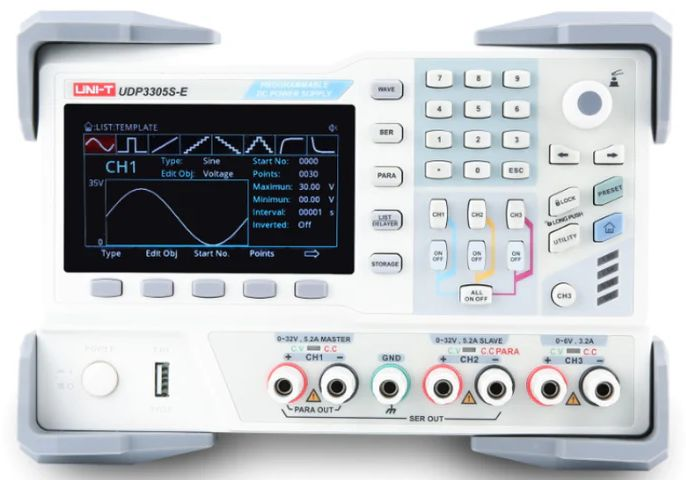\
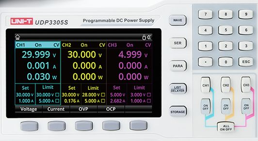\
:::
::: {.column width=60%}
#### 4-channel programmable DC power supply
- Total power 328 Watts 
    - CH1/CH2: 0–30V at up to 5A
        - Parallel 10A or series 60V
        - Bipolar ±30V
    - CH3: 0–6V/3A logic-level channel
    - CH4: fixed 5V/2A USB
- Floating grounds &rarr; 4 channels
- SCPI over LAN, RS-232, USB
:::
::::

## $I_{S}$ measurement: UDP3305S {.smaller}
:::: {.columns}
::: {.column width=45%}
\
\
:::
::: {.column width=55%}
#### AUX opamp supply: ±15V
1. Set 15 V: select CH1/CH2
    - Press the Voltage softkey
    - Enter 15 on the numeric keypad
    - Select the V unit softkey
2. Turn CH1/CH2 ON

#### Shutdown
1. Turn CH1/CH2 OFF
2. Set 0 V: select CH1/CH2
    - Press the Voltage softkey
    - Enter 0 on the numeric keypad
    - Select the V unit softkey
:::
::::

## UT8805E Digital Multimeter {.smaller}
:::: {.columns}
::: {.column width=42%}
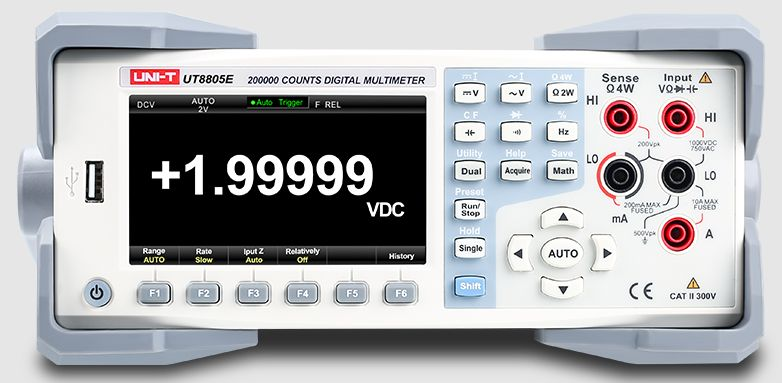\
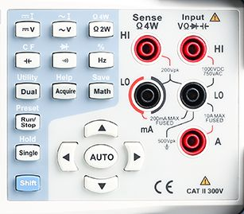\
:::
::: {.column width=58%}
#### True-RMS digital multimeter
- Resolution 200000 count (5.5 digit)
- Basic measurements：
    - DC voltage: 200mV, 2V, 20V, 200V, 1000V
    - DC current: 200μA, 2mA, 20mA, 200mA, 2A, 10A
    - AC voltage: RMS 200mV, 2V, 20V, 200V, 750V
    - AC current: RMS 2mA, 20mA, 200mA, 2A, 10A
    - Resistance: 200Ω, 2kΩ, 20kΩ, 200kΩ, 2MΩ, 10MΩ, 100MΩ
    - Capacitance: 2nF, 20nF, 200nF, 2μF, 20μF, 200μF, 2mF
    - Continuity test: fixed 2kΩ
:::
::::

## $I_{S}$ measurement: UT8805E {.smaller}
:::: {.columns}
::: {.column width=50%}
\
\
:::
::: {.column width=50%}
#### DC current measurement: 20 mA
1. Select DC current mode
    - Press Shift
    - Press dcV/**dcI**
2. Select the 20 mA range
    - Press F1 Range
    - Use the up/down arrow keys to adjust the range

#### Shutdown
1. Select DC voltage mode
    - Press **dcV**/dcI
2. Select AUTO range
    - Press F1 Range, then AUTO
:::
::::

## LabVIEW &lrarr; hardware {.smaller}
:::: {.columns}
::: {.column width=32%}
#### [NI-DAQmx](https://www.ni.com/en/support/documentation/supplemental/06/getting-started-with-ni-daqmx--main-page.html)
- NI instrument driver that controls DAQ systems
- Library of VIs, functions, classes, attributes, and properties to configure, control, stream data

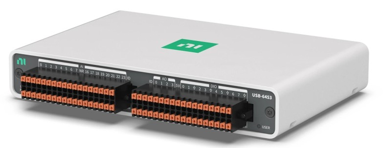{width=75%}\
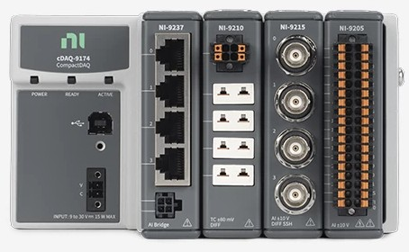{width=75%}\
:::
::: {.column width=32%}
#### [NI-VISA](https://www.ni.com/en/support/documentation/supplemental/06/ni-virtual-instrument-software-architecture.html)
- Virtual Instrument Software Architecture 
- Instrument driver and software API used to configure, program, and control instruments
- Interfaces: USB, Ethernet, GPIB, Serial.

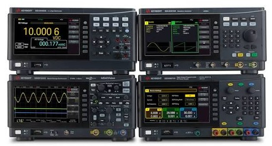\
:::
::: {.column width=32%}
#### [NI-PXI](https://www.ni.com/en/shop/pxi/introduction-to-the-pxi-architecture.html)
- HW/SW platform built for test automation
- Synchronize across multiple modules or chassis
- PXI embedded controller = PC inside PXI

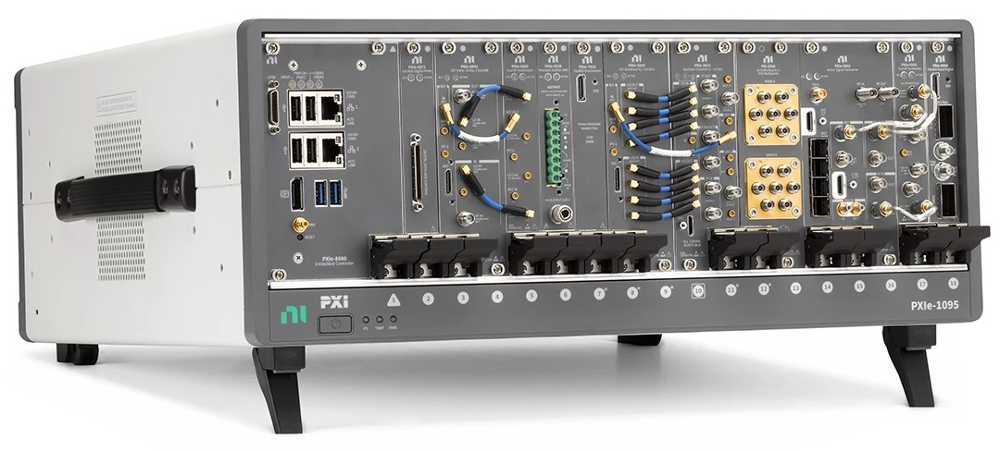\
:::
::::

## NI MAX {.smaller}
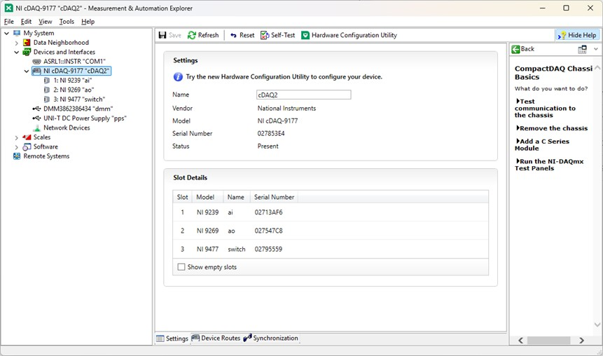\

## CompactDAQ {.smaller}
Data acquisition platform with chassis connecting I/O modules to a PC over USB/Ethernet and built-in **timing** and **synchronization** 

:::: {.columns}
::: {.column width=50%}
#### cDAQ-9177 chassis
- 8 slots for cDAQ modules
- Timing resolution: 50 ppm of sample rate
- FIFO buffer for analog and digital I/O channels
:::
::: {.column width=50%}
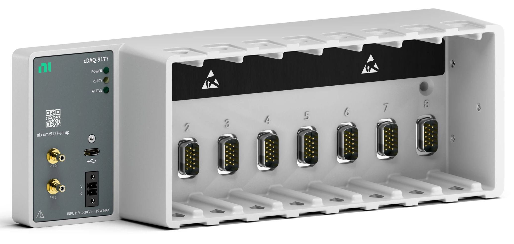\
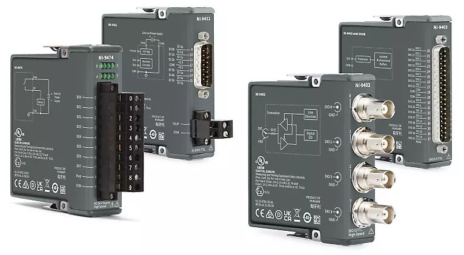{width=75%}\
:::
::::

## cDAQ modules {.smaller}
:::: {.columns}
::: {.column width=32%}
#### NI-9239

- 4-channel ±10 V differential analog input
- 24-Bit Delta-Sigma ADC
- Simultaneous 50 kS/s/ch
- 250 Vrms channel-to-channel isolation 

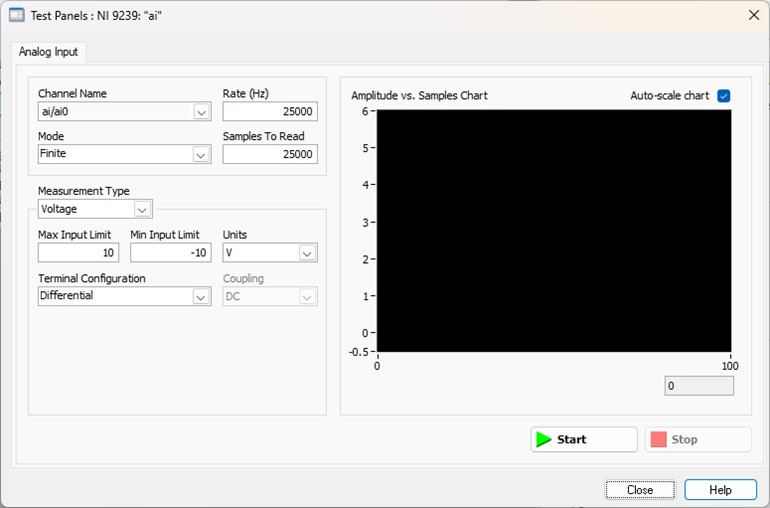\
:::
::: {.column width=32%}
#### NI-9269

- 4-channel ±10 V isolated analog output
- 16-bit R-2R DAC
- Simultaneous 100 kS/s/ch
- 250 Vrms channel-to-channel isolation

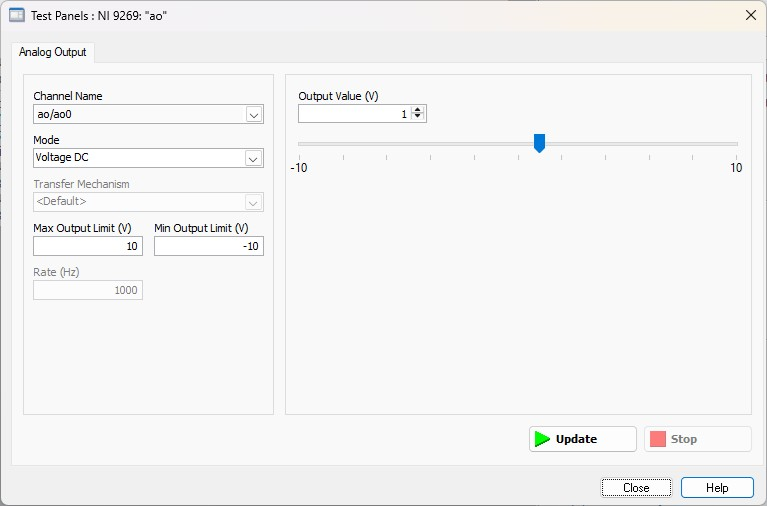\
:::
::: {.column width=32%}
#### NI-9477

- 32-channel (sinking output) digital
- 5 V - 60 V  logic level
- 20 A of current/module (max 1 A/channel)

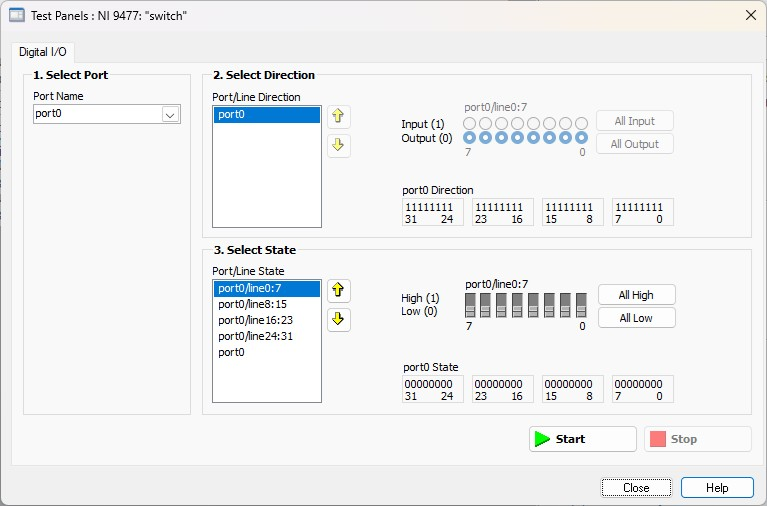\
:::
::::

## cDAQ connectivity {.smaller}
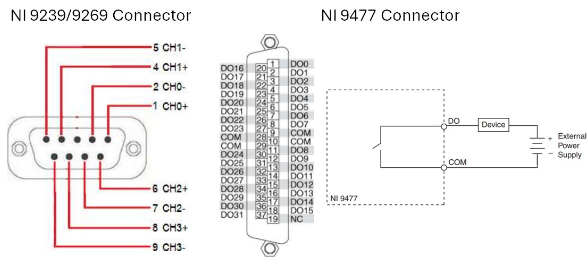\

## $I_{S}$ measurement: NI-9477 {.smaller}

:::: {.columns}
::: {.column width=50%}
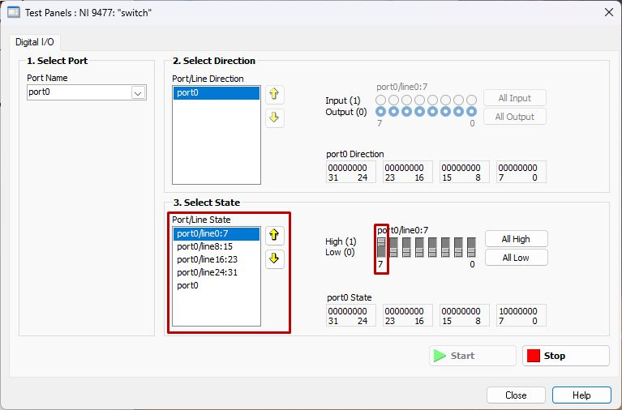\
:::
::: {.column width=50%}
#### Relay selection: S7 ON
1. Open the NI-9477 Test Panel in NI MAX
2. Turn line7 on

#### Shutdown
1. Turn line7 off
:::
::::

## $I_{S}$ measurement: NI-9269 {.smaller}

:::: {.columns}
::: {.column width=50%}
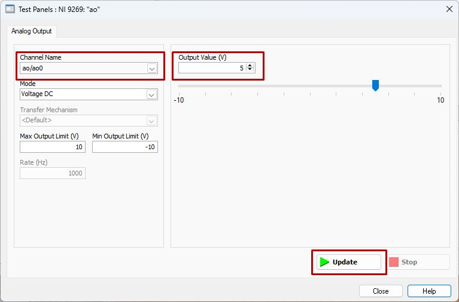\
:::
::: {.column width=50%}
#### DUT opamp supply: ±5V 
1. Open the NI-9269 Test Panel in NI MAX
2. Set Voltage to 5 V
    - Select channels **ao/ao0** and **ao/ao1**
    - Set Output Value to 5 V
    - Press Update

#### Shutdown
1. Set Voltage to 0 V
    - Select channels **ao/ao0** and **ao/ao1**
    - Set Output Value to 5 V
    - Press Update
:::
::::

## $V_{OS}$ measurement: NI-9239 {.smaller}
:::: {.columns}
::: {.column width=50%}
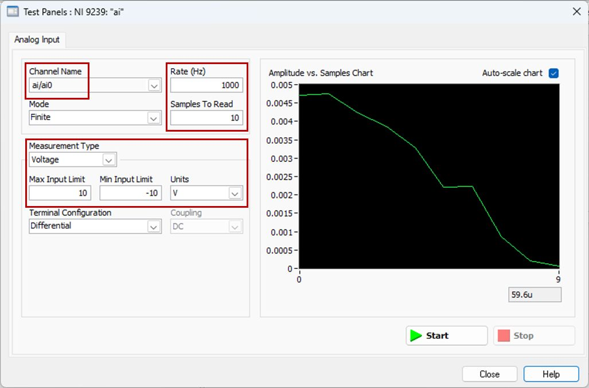\
:::
::: {.column width=50%}
#### Voltage range: ±10V
1. Open the NI-9239 Test Panel in NI MAX
2. Configure voltage measurement
    - Select channel **ai/ai0**
    - Select **Finite**, a sampling rate of **1000 Hz**, and **10 samples**
    - Set the measurement range to −10 V through +10 V
    - Press Start

#### Shutdown
1. Close the Test Panel
:::
::::
