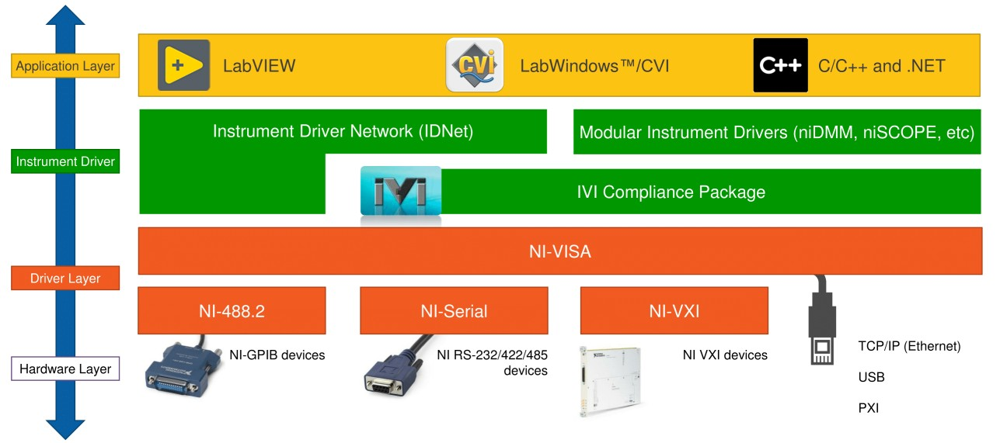
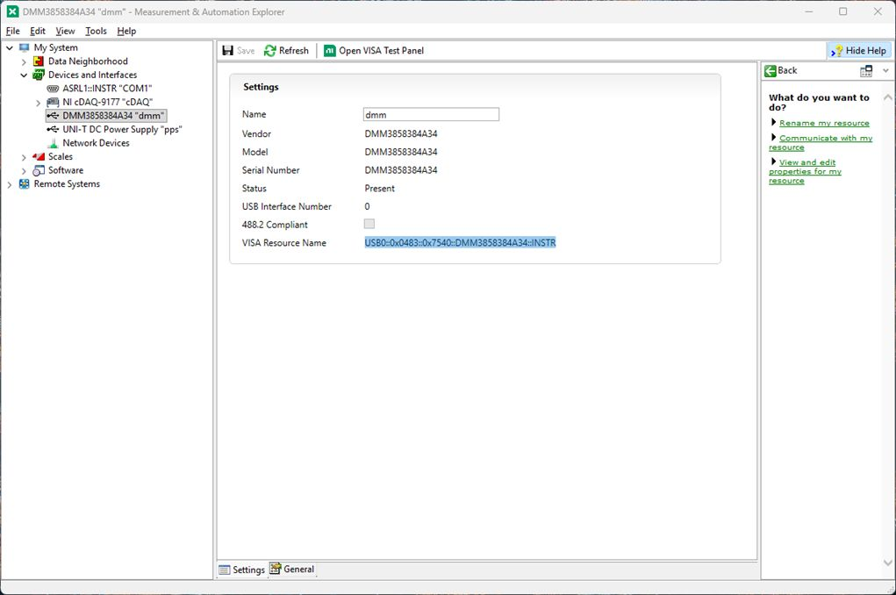
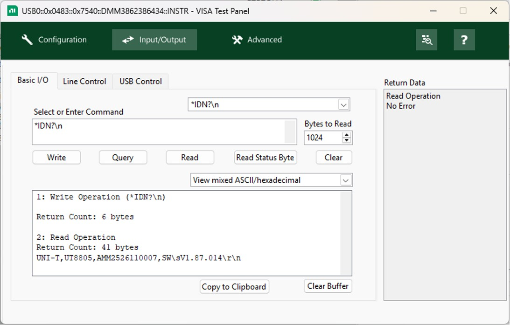
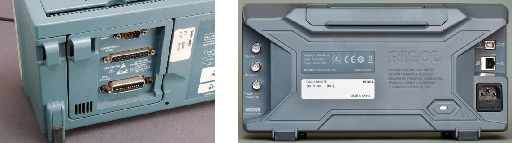
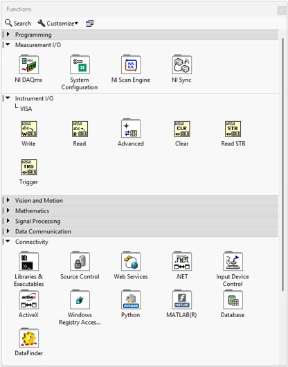
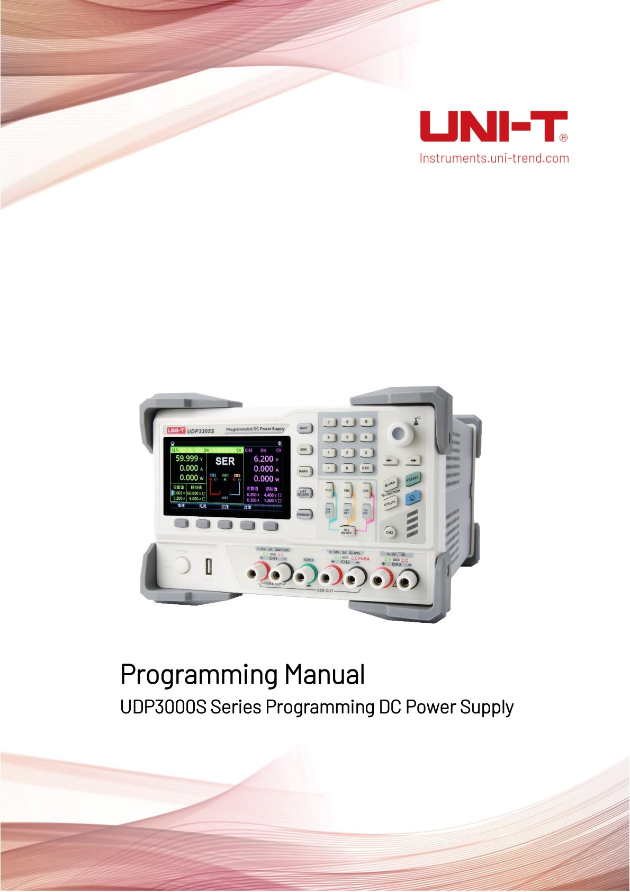
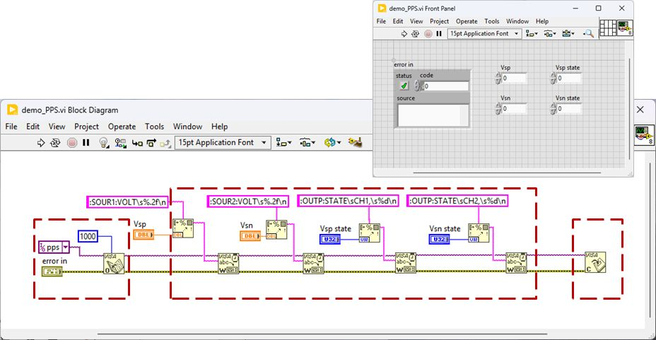
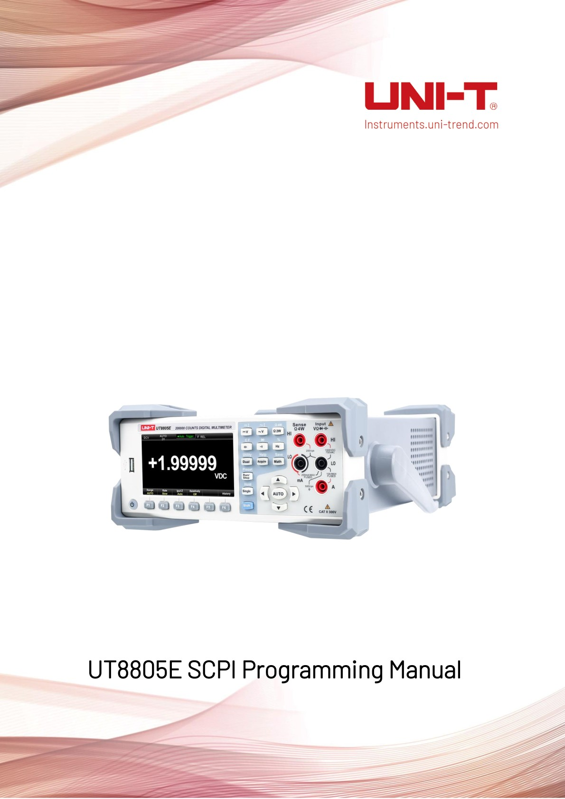
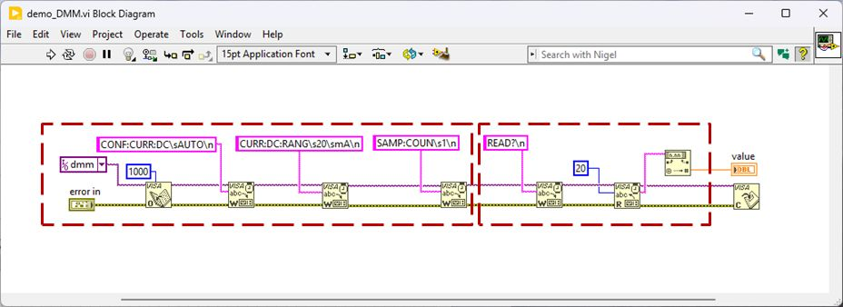

## NI-VISA &lrarr; instrument {.smaller}
Instrument driver that provides a **software interface** for configuring, programming, and troubleshooting **instrumentation systems** across multiple **communication buses**

\

## NI MAX {.smaller}

:::: {.columns}
::: {.column width=70%}
\
:::
::: {.column width=30%}
#### Devices and Interfaces

- Discovered devices and interfaces: resource names
- Optional alias for a resource name

#### Test Panel

- UI for testing communication

:::
::::

## NI MAX &rarr; VISA Test Panel {.smaller}

:::: {.columns}
::: {.column width=60%}
\
:::
::: {.column width=40%}
#### VISA Test Panel
- **Write**: send a command
- **Query**: send a query command and receive its response
- **Read**: retrieve data from the instrument buffer

#### SCPI commands: terminate with `\n` as required by the instrument

- **\*IDN?** requests instrument identification
- **\*RST** resets the instrument
:::
::::

## SCPI protocol {.smaller}
[**Standard Commands for Programmable Instruments**](https://en.wikipedia.org/wiki/Standard_Commands_for_Programmable_Instruments) is a standard for controlling programmable test and measurement devices

{width=75%}\

- ASCII strings sent over physical layer (GPIB, RS232C, USB, Ethernet)
    - Commands as tree structure separated with **:**
    - Support Abbreviating (capital chars) and Concatenating (**;**)
    - Query commands end with **?**
- Example: `MEASure:VOLTage:DC?;:MEAS:CURR:AC?`

## SCPI cmd &lrarr; NI-VISA &lrarr; instrument {.smaller}
:::: {.columns}
::: {.column width=40%}
\
:::
::: {.column width=60%}
- Access the instrument using a **VISA reference**
    - Verify the **interface/name** in NI MAX
- Instrument programming sequence
    1. Open the connection with **VISA Open**
    2. Configure with **VISA Write** and retrieve readings with **VISA Read**
        - Set strings to **`'\'` Codes Display**
        - Convert using **Format Into String** and **Fract/Exp String to Number**
    3. Close the connection with **VISA Close**
:::
::::

## Programming [UDP3305S](https://uni-trendus.com/products/udp3305s-e) {.smaller}
:::: {.columns}
::: {.column width=40%}
\
:::
::: {.column width=60%}
#### Power-supply command sequence
1. `:SOURce:Mode {NORMal|SER|PARA}`
    - `:SOURce:Mode NORMal` selects normal output mode
2. `[:SOURce#]:VOLTage[:LEVel][:IMMediate][:AMPLitude]`
    - `:SOURce1:VOLTage 2.0` sets CH1 to 2.0 V
3. `:OUTPut[:STATe] [CH1|CH2|CH3|SER|PARA|ALL,] {0|1|OFF|ON}`
    - `:OUTPut:STATe CH1, ON` enables CH1 output
:::
::::

## UDP3305S SCPI tutorial {.smaller}
#### Build a VI to control the AUX opamp supply

- Refactor into SubVIs: `pps_connect`, `pps_ctrl` and `visa_close`

\

## Programming [UT8805E](https://uni-trendus.com/products/UT8805E) {.smaller .scrollable}
:::: {.columns}
::: {.column width=40%}
\
:::
::: {.column width=60%}
#### Immediate voltage measurement
1. `MEASure[:VOLTage]:{AC|DC}? [{<range>|AUTO|MIN|MAX|DEF}]`
    - `MEAS:VOLT:AC? 20` measures AC voltage using the 20 V range

#### Multiple voltage readings
1. `CONFigure[:VOLTage]:{AC|DC}
[{<range>|AUTO|MIN|MAX|DEF}]`
    - `CONF:VOLT:AC 20` configures AC voltage measurement using the 20 V range
2. `SAMPle:COUNt {<count>|MIN|MAX|DEF}SAMPle:COUNt? [{MIN|MAX|DEF}]`
    - `SAMP:COUN 2` requests two readings
3. `READ?`
    - `READ?` retrieves the voltage readings
:::
::::

## UT8805E SCPI tutorial {.smaller}
#### Build a VI to select current measurement mode and read a value

- Refactor into SubVIs: `dmm_connect` and `dmm_read`

\

