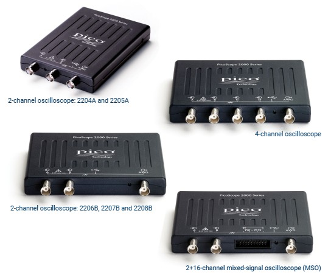
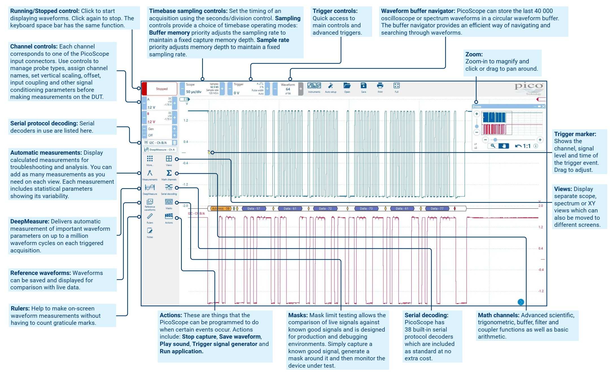
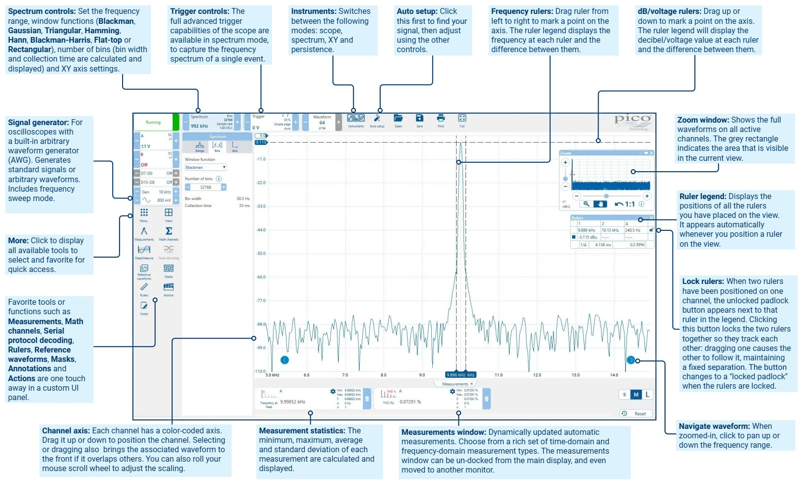
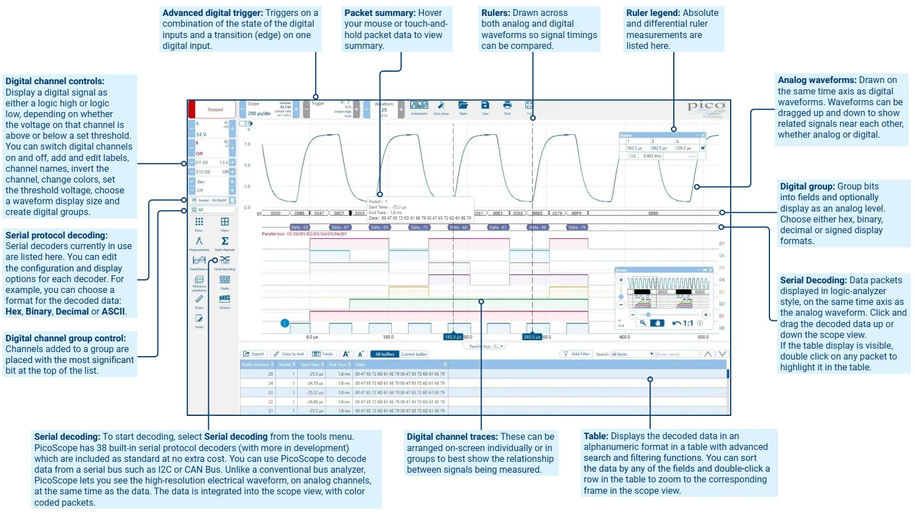
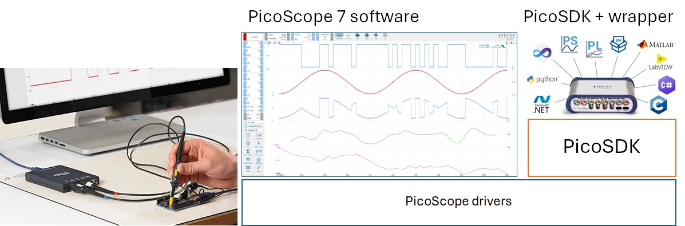
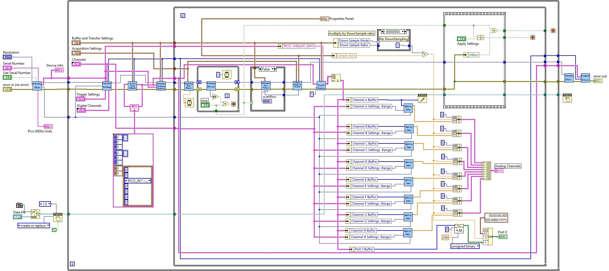

## PicoScope 2206B {.smaller}
:::: {.columns}
::: {.column width=47%}
\
:::
::: {.column width=53%}
#### Specifications
- 50 MHz bandwidth, 8-bit ADC, 32 MB capture memory
- AWG 1 MHz bandwidth
- Input range: ±20 mV, ±50 mV,..., ±10 V, ±20 V
- Timebase: 2 ns/div, ..., 5000 s/div
- Sampling rate: 500 MS/s
    - 9.6 MS/s (USB streaming)
    - 31 MS/s (PicoSDK)
- Triggers: edge, pulse width, rise/fall time, interval, ...
:::
::::

## PicoScope 7 {.smaller}
\

## PicoScope 7 {.smaller}
\

## PicoScope 7 {.smaller}
\

## Proprietary SDKs {.smaller}
[PicoSDK](https://www.picotech.com/library/our-oscilloscope-software-development-kit-sdk) is the driver to access PicoScope hardware functionalities, including ADC block and streaming capture and the built-in function generator.
- LabVIEW Driver is the .DLL wrapper for PicoSDK

\

## PicoSDK wrapper for LabVIEW {.smaller}
\

## Programming [PicoScope 2206B](https://github.com/picotech/picosdk-ni-labview-examples/tree/master/ps2000a) {.smaller}
:::: {.columns}
::: {.column width=50%}
#### Sampling mode
- **Block mode**: sample at MAX sampling rate/{1,2,4,...}, store in memory until full, then transfer to the computer
- **Streaming mode**: acquire and transfer samples to the computer continuously
    - **Compatible streaming**: low sampling rate, no trigger support
    - **Fast streaming**: high sampling rate, trigger support
- **ETS (Equivalent Time Sampling) mode**: sample over multiple triggered cycles, store in memory until full, then transfer to the computer
:::
::: {.column width=50%}
#### PicoSDK block-mode sequence
1. **PicoScope2000aOpen.vi** opens the device
2. **PicoScope2000aSetDataBuffers.vi** assigns data buffers
3. **PicoScope2000aSettings.vi** configures channels, timebase and trigger
4. Enter the acquisition loop
    1. **PicoScope2000aRunBlock.vi** starts acquisition
    2. **PicoScope2000aIsReady.vi** checks readiness
    3. **PicoScope2000aGetValues.vi** retrieves samples
5. **PicoScope2000aStop.vi** stops acquisition
6. **PicoScope2000aClose.vi** closes the device
:::
::::
