## Product reqs &rarr; Test implementation {.smaller}

:::: {.columns}
::: {.column width=65%}
| Product / Manufacturing | Test Engineer |
| --- | ---- |
| Product specification | Requirement analysis |
| Test specification | Test plan |
| Fixture | Fixture design |
| Test program | Software development: **LabVIEW** / **TestStand**  |
| Test platform  | Fixture + instrumentation integration |
| DUT measurement | Execute test & validate results |
| PASS / FAIL / Bin | Report & database |
:::
::: {.column width=35%}
#### Fixture examples

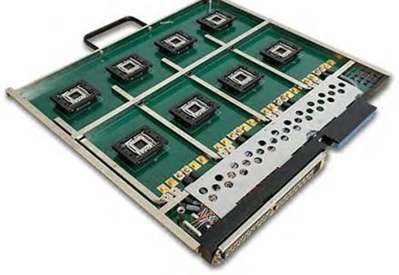\

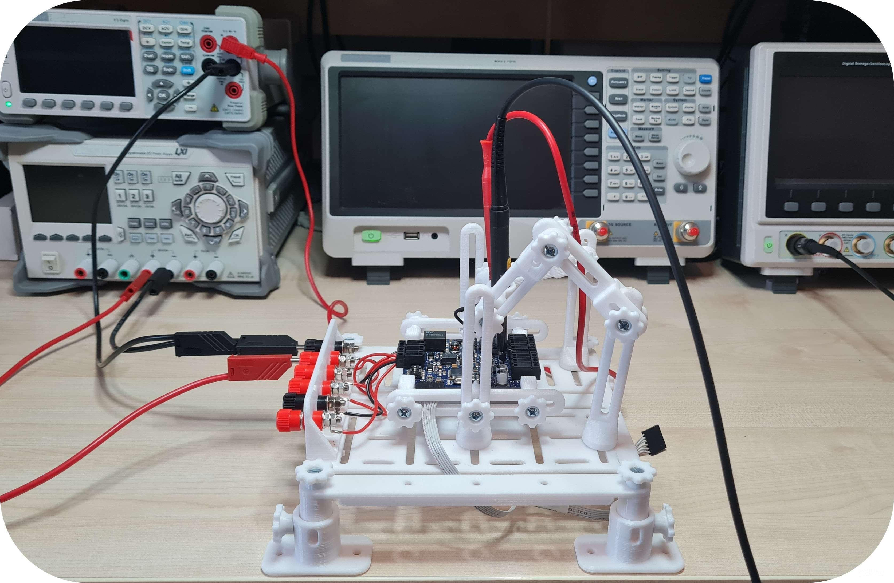\

:::
::::

## Why LabVIEW? {.smaller}

:::: {.columns}
::: {.column width=50%}
#### Hardware interfacing
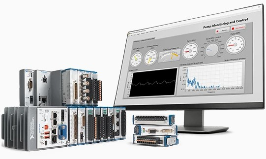\
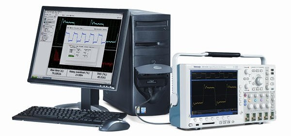\

:::
::: {.column width=50%}
#### Virtual Instrument &rarr; UI
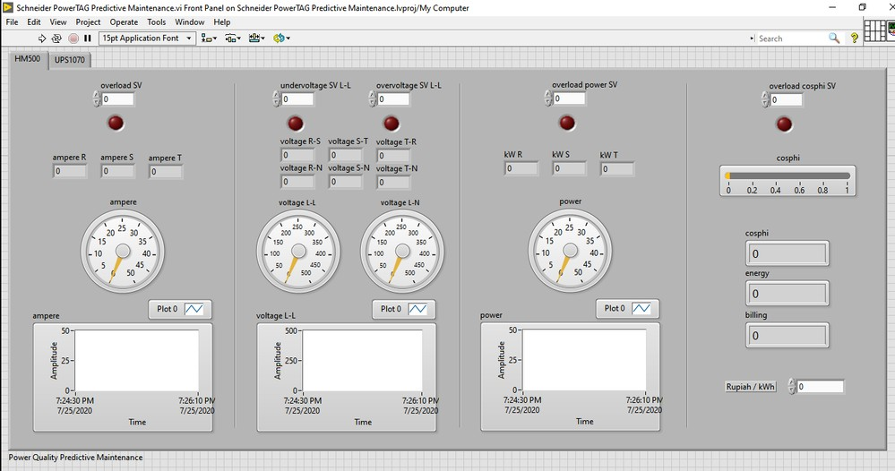\
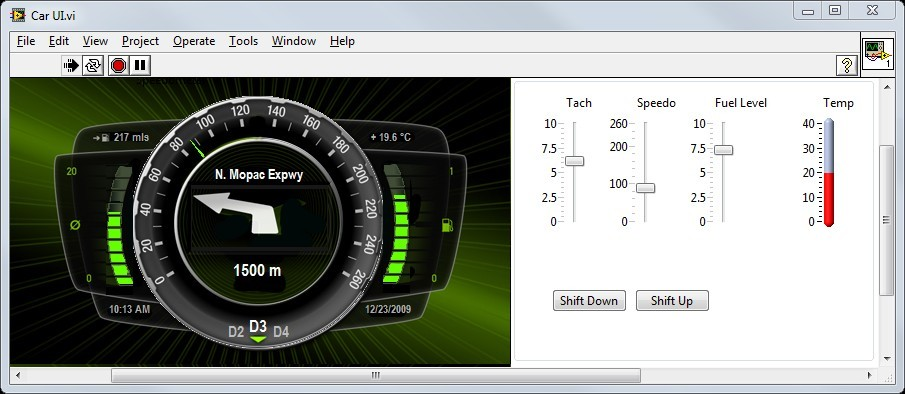\
:::
::::

## Tester = fixture + instr. + LabVIEW {.smaller}
:::: {.columns}
::: {.column width=32%}
#### NI-DAQmx
- NI instrument driver that controls DAQ systems
- Library of VIs, functions, classes, attributes, and properties to configure, control, stream data

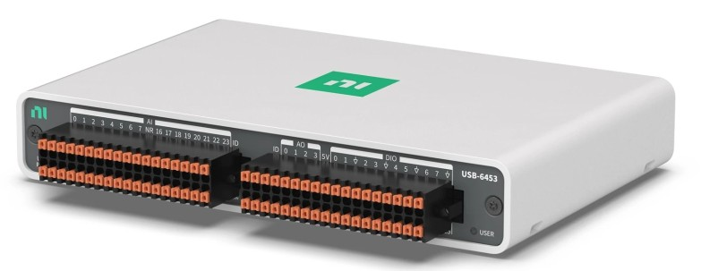{width=75%}\
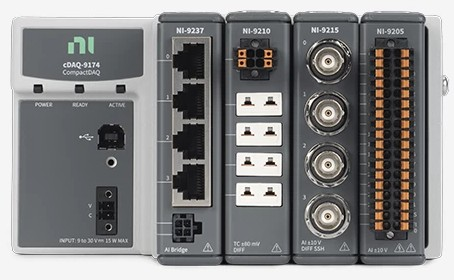{width=75%}\
:::
::: {.column width=32%}
#### NI-VISA
- Virtual Instrument Software Architecture 
- Instrument driver and software API used to configure, program, and control instruments
- Interfaces: USB, Ethernet, GPIB, Serial.

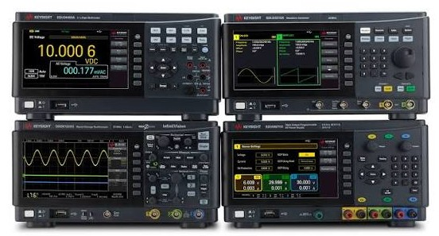\
:::
::: {.column width=32%}
#### NI-PXI
- HW/SW platform built for test automation
- Synchronize across multiple modules or chassis
- PXI embedded controller = PC inside PXI

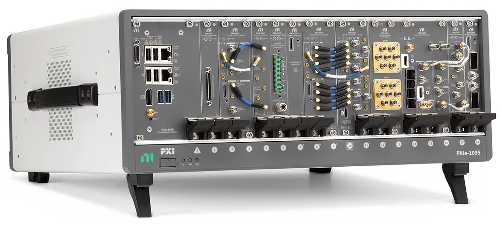\
:::
::::

## Measurement & Automation Explorer {.smaller}
**NI MAX** configures and inspects instruments, DAQ and PXI hardware.
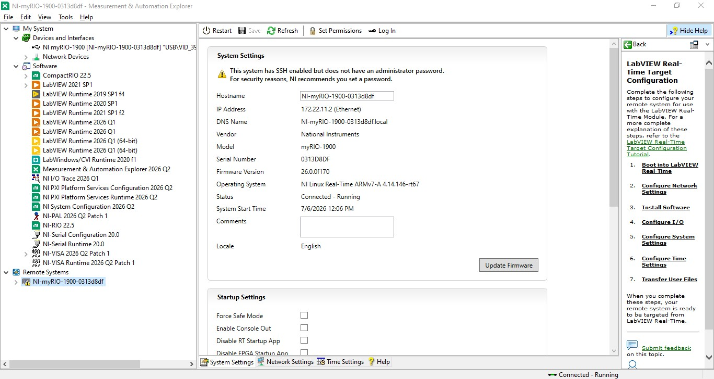\

## LabVIEW {.smaller}
:::: {.columns}
::: {.column width=50%}
#### Front panel: user interface
- Contains Controls (commands/data inputs) and Indicators (outputs)
- Supports interactive operation

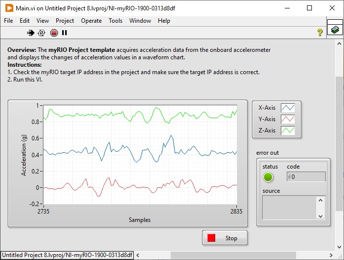\
:::
::: {.column width=50%}
#### Block diagram: program code
- Graphical programming: drag, drop and connect
- Execution &rarr; dataflow programming
    - Wait for inputs → process → pass results onward
    - Independent loops can run in **parallel**
- Arrange the diagram from **left** to **right** for readability

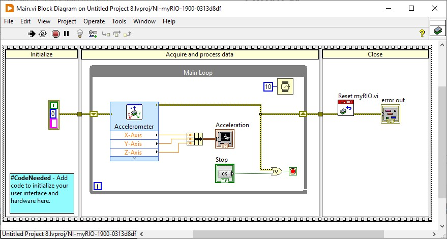\
:::
::::

## LabVIEW quick tutorial #1 {.smaller}
#### Build a VI to plot random values

- Delay loop + array + waveform chart/graph
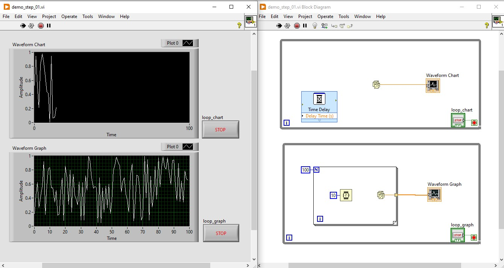\

## LabVIEW terminology {.smaller}
:::: {.columns}
::: {.column width=50%}
- **Data types:**
    - **Numeric**: orange (DBL/SGL), blue (INT/UINT/enum)
    - **Boolean**: green
    - **Array**: thick wire (1D), double wire (2D)
    - **String** and **Cluster**: pink
- **Control flow:**
    - **While**: operates according to a condition
    - **For**: N iterations or auto-index over the input data
    - **Case structure**: if-else, switch-case
- **SubVI:**
    - **Connector Pane**: Required, Recommend, Optional
:::
::: {.column width=50%}
- **Timing:**
    - **Loop + delay**: simple but imprecise
    - **Timed loop**: timing accuracy/resolution
    - **Blocking wait**: wait for hardware data
- **Data passing:**
    - **Shift register**: carry data between loop iterations
    - **Local variable**: shared access
    - Synchronization functions
- **UI programming:**
    - **Event structure**: handle UI events
    - **Property node**: update UI properties
:::
::::

## Debugging LabVIEW {.smaller}
:::: {.columns}
::: {.column width=65%}
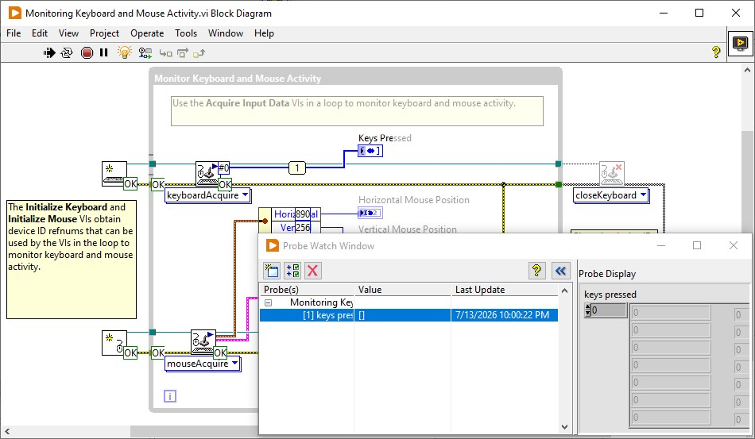\
:::
::: {.column width=35%}
#### Highlight Execution
- Show dataflow through the nodes

#### Probe
- Inspect values passed between nodes

#### Breakpoint / Step
- Stop when execution reach the node
- Execute one node at a time while stepping
:::
::::

## LabVIEW quick tutorial #2 {.smaller}

#### Build an N-point moving average filter

- Shift register + bundle cluster + sub VI

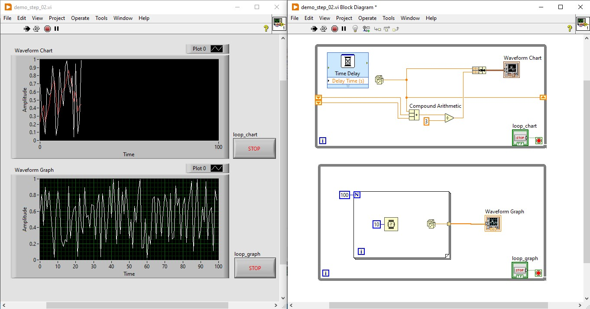\

## Processing in LabVIEW {.smaller}

:::: {.columns}
::: {.column width=50%}
#### Mathematics
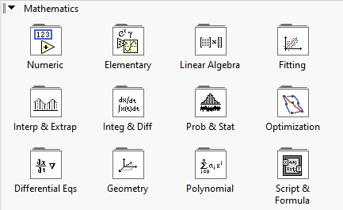\
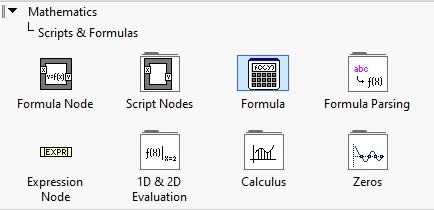\
:::
::: {.column width=50%}
#### Signal processing
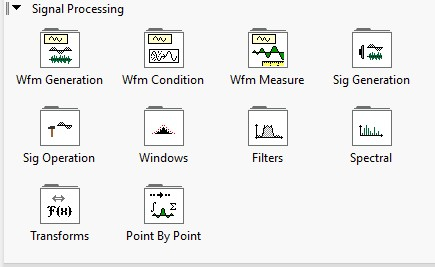\
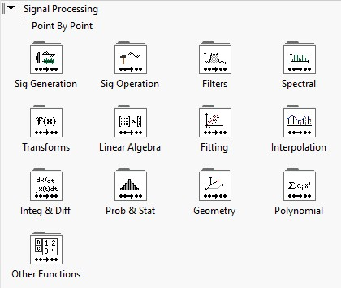\
:::
::::

## Processing in LabVIEW {.smaller}

:::: {.columns}
::: {.column width=50%}
#### Data/status operations
- Local/Global/Shared variables
- Feedback node
- Property nodes
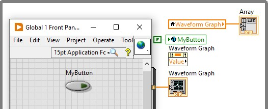\

#### File operations
- Spreadsheet files
- TDMS files
:::
::: {.column width=50%}
#### Programmable UI
- **Event structure**: executed when user did something with UI
- **Property node**: method to access internal status/data of UI components

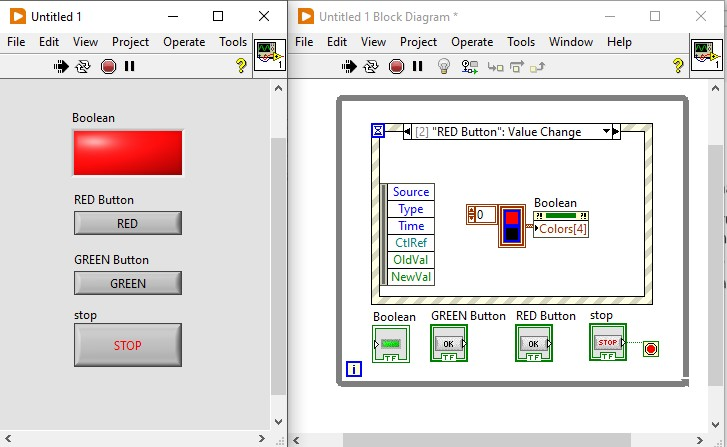\
:::
::::

## LabVIEW synchronization {.smaller}
:::: {.columns}
::: {.column width=50%}
- **Notifier**: send event &rarr; wait on event
    - Broadcast mechanism (one-to-many)
- **Queue**: enqueue msg &rarr; dequeue
    - FIFO behavior
:::
::: {.column width=50%}
#### Resource protection
- **Semaphore**: acquire &larr; wait for release

#### Wait for every task
- **Rendezvous**: wait on &rarr; continue together

:::
::::
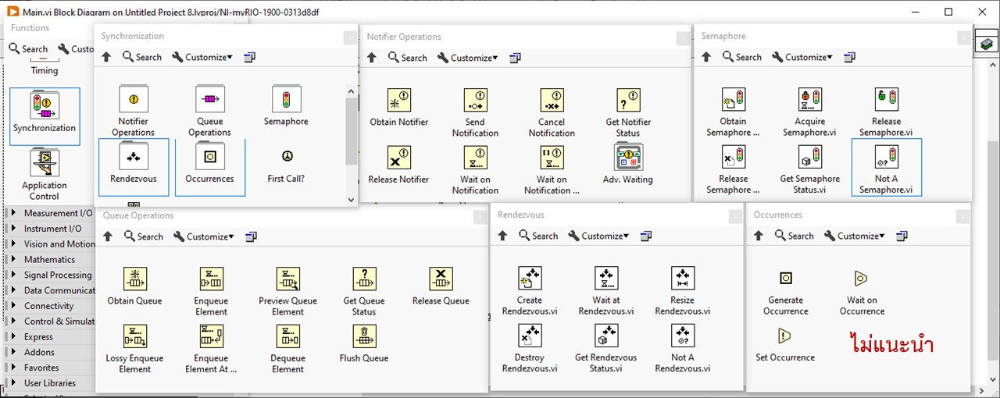{width=80%}\

## LabVIEW quick tutorial #3 {.smaller}
#### Build a UI loop to control acquisition timing

- Event Structure + notifier + property node

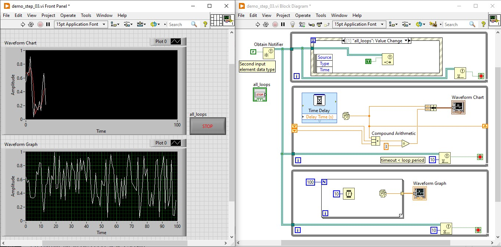\

## Pattern: [state machine](https://www.ni.com/en/support/documentation/supplemental/16/simple-state-machine-template-documentation.html) {.smaller}
Programming architecture that allows dynamic flow to **states** depending on values from previous states or user inputs

- Use an **Enum** or **String** as the state; carry it to the next iteration with a shift register
- Place a **Case structure** inside a **While loop**

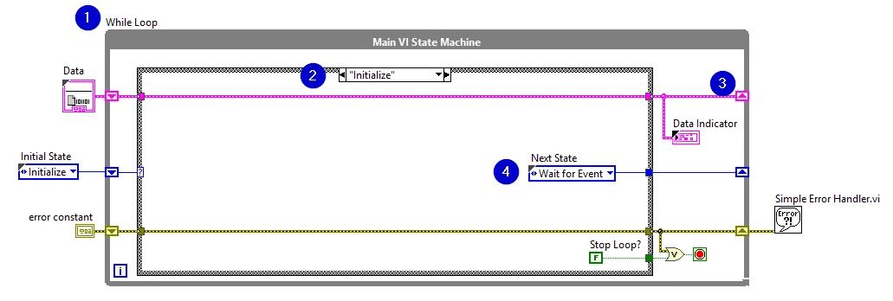\

## Pattern: [producer/consumer](https://www.ni.com/en/support/documentation/supplemental/21/producer-consumer-architecture-in-labview0.html) {.smaller}
Data sharing architecture between multiple loops running at different rates. 

:::: {.columns}
::: {.column width=40%}
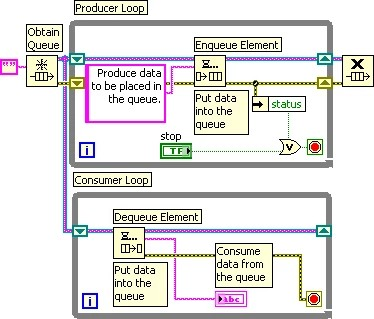\
:::
::: {.column width=60%}
- Queue
- Loops with similar/different timing
    - Data producing loops: **enqueue**
    - Data consuming loops: **dequeue**
:::
::::

## Pattern: [Actor Framework](https://www.linkedin.com/pulse/masterclass-labview-architectures-mastering-actor-framework-zhang-mqvvf/) {.smaller}
:::: {.columns}
::: {.column width=30%}
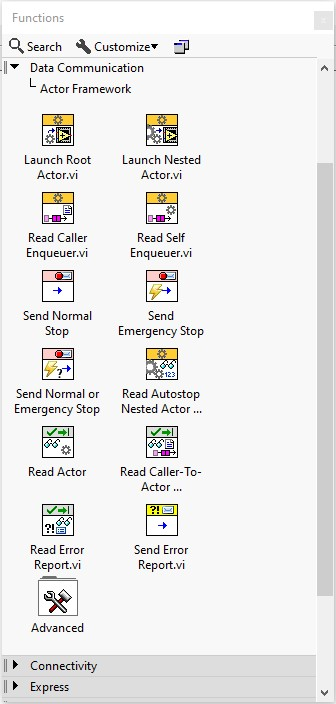\
:::
::: {.column width=70%}
Set of **reusable** classes that provide common state and message handling functions for **concurrent** operations.

- **Actor** class: by-value object with encapsulated state
    - Binded with queue as tree architecture
- **Message** class: 
    - Inherited **Do.vi**

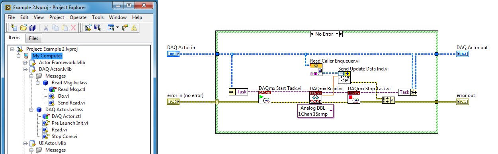\
:::
::::
