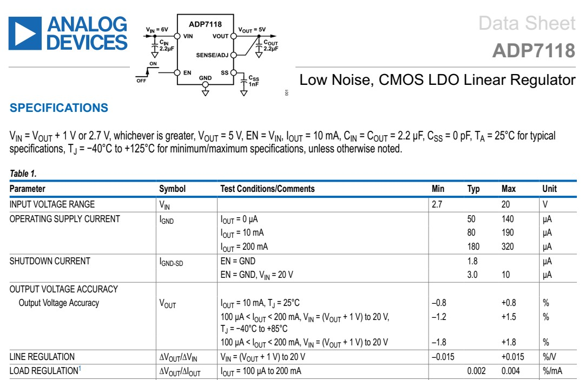

## [ADP7118](https://www.analog.com/media/en/technical-documentation/data-sheets/adp7118.pdf) {.smaller}
\

## Test plan {.smaller}

| 1.8V model | Conditions | Min | Max |
| -- | ---- | - | - |
| EN pin (leakage current) | Vin = EN = 2.8 V, Iout = 0 | - | 1 µA  |
| Output voltage accuracy | Vin = 2.8 V, Iout = 10 mA, TJ = 25 °C | 1.7856 V | 1.8144 V |
| Line regulation | Vin swept 2.8 → 20 V, Iout = 10 mA | - | 4.64 mV ($\Delta Vout$) |
| Load regulation | Vin = 2.8 V, Iout 100 µA → 200 mA | - | 14.39 mV ($\Delta Vout$) |
| Quiescent current | Vin = 2.8 V, Iout = 0 | - | 140 µA |