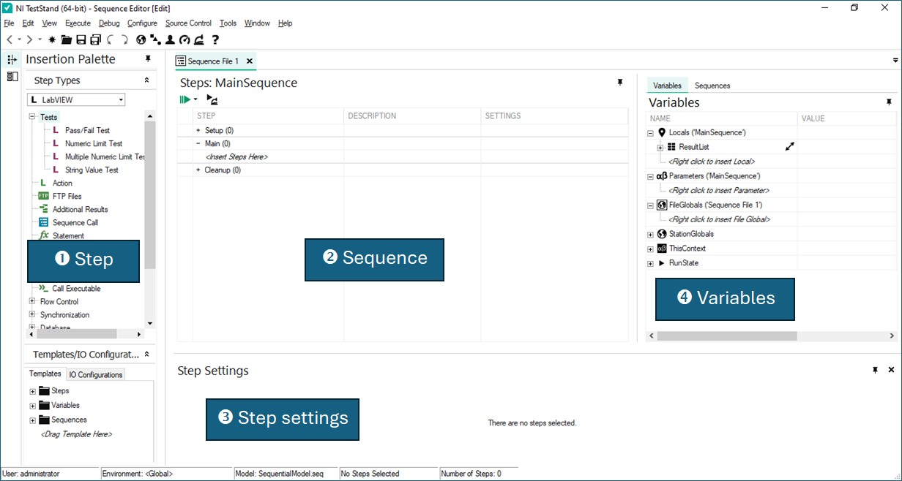
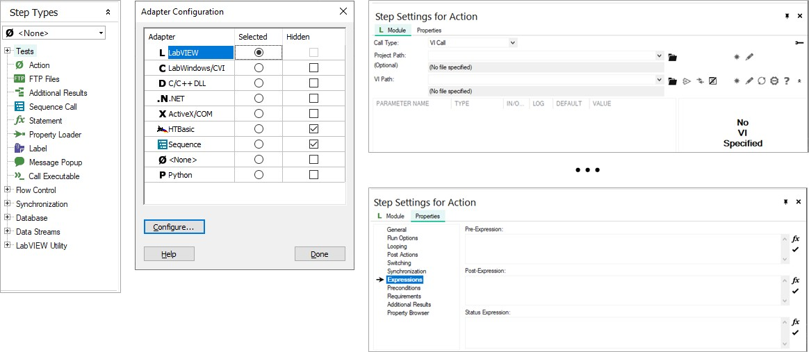
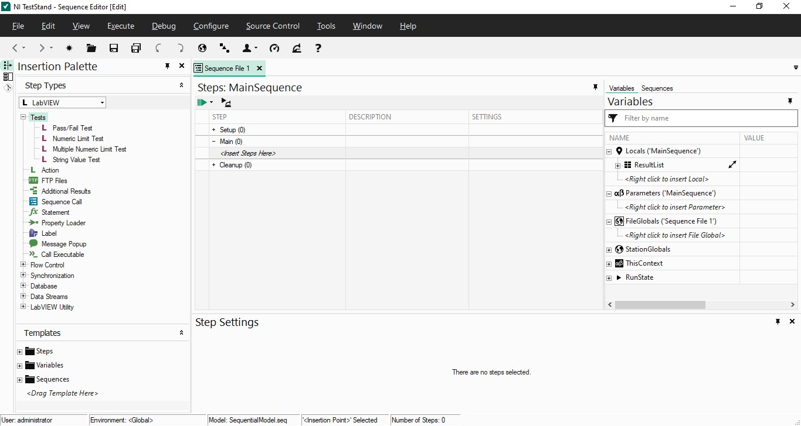
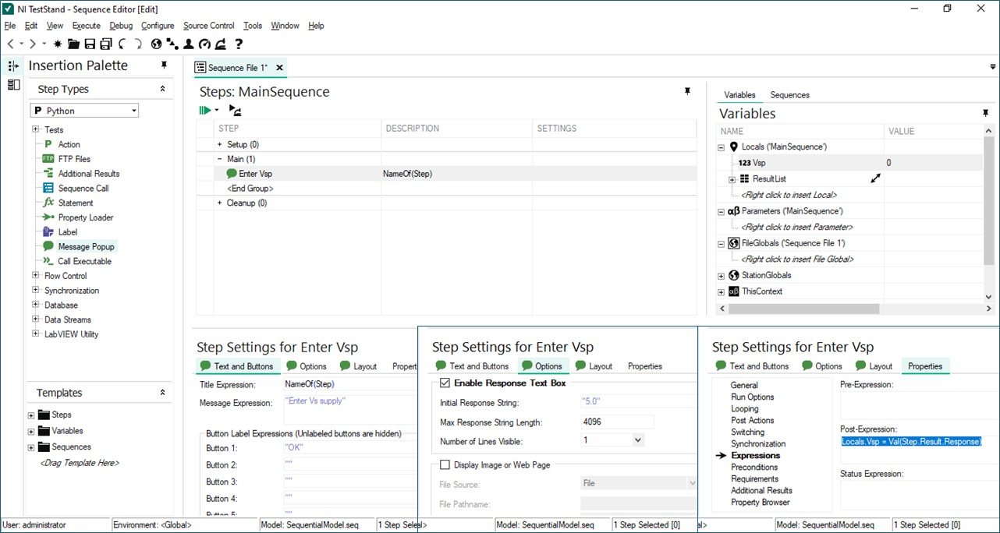
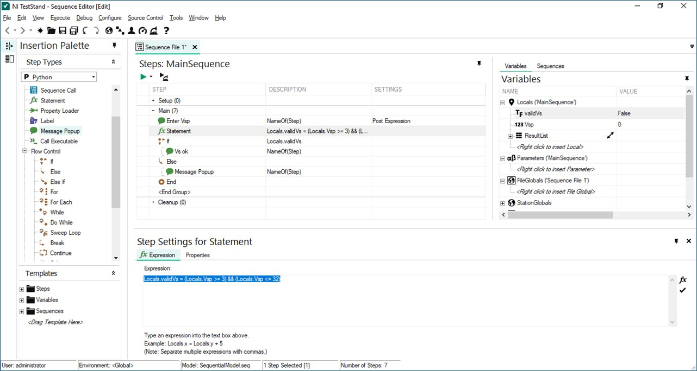
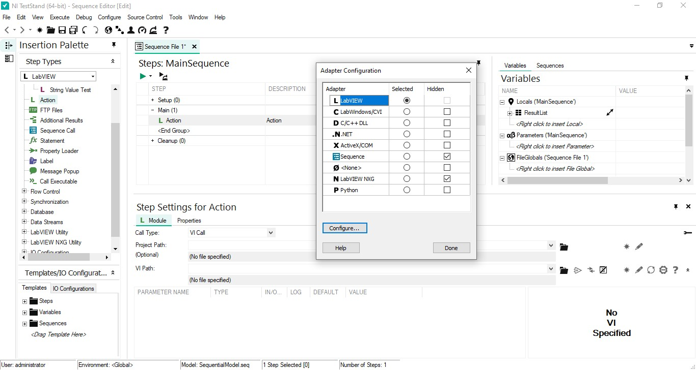
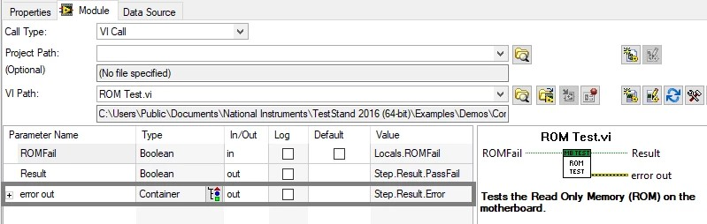
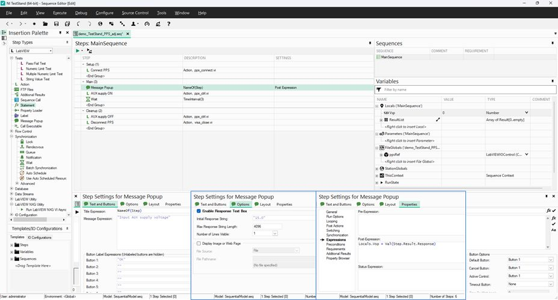
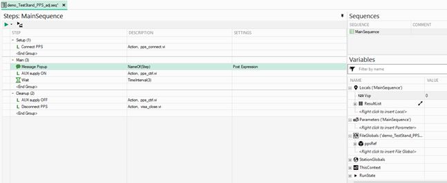
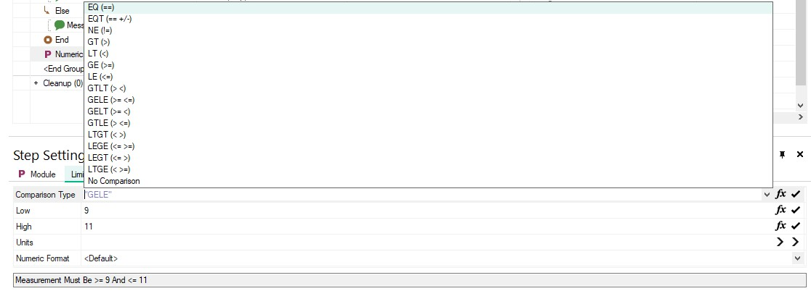

## NI TestStand: UI {.smaller}
\

## NI TestStand: Step {.smaller}

**Step** = adaptor + properties

- **Statement**: C/C++-like expressions (except `str+str` and using `,` to separate expressions)
- **Sequence Call**: a group of steps that performs a specific reusable task

\

## NI TestStand: dev workflow {.smaller}
:::: {.columns}
::: {.column width=70%}
\
:::
::: {.column width=30%}
#### MainSequence
1. Add steps
    - Setup group
    - Main group
    - Cleanup group
2. Declare variables
    - Locals
    - FileGlobals
    - StationGlobals
3. Invoke code modules
    - Parameters
4. Run
:::
::::

## TestStand tutorial: basics {.smaller}
#### Build a sequence to accept and validate $V_S$
:::: {.columns}
::: {.column width=65%}
\
:::
::: {.column width=35%}
1. Add a **Message Popup** to the **Main group** displaying "Enter Vs supply"
    - Enable **Enable Response Text Box** to obtain `Step.Result.Response`
2. Add `Vsp` as a **Locals** variable
    - Set Properties > Expressions > Post-Expression:
`Locals.Vsp = Val(Step.Result.Response)`
2. Use Breakpoint + Step Over to inspect `Locals.Vsp`
:::
::::

## TestStand tutorial: basics {.smaller}
#### Build a sequence to accept and validate $V_S$

:::: {.columns}
::: {.column width=65%}
\
:::
::: {.column width=35%}
4. Add `validVs` as a Boolean **Locals** variable
5. Add a **Statement**: `Locals.validVs = (Locals.Vsp >= 3) && (Locals.Vsp <= 32)`
6. Add **If-Else-End** flow control using `Locals.validVs` as the condition
    - **True**: Message Popup "Vs OK"
    - **False**: Message Popup "Vs not in range"
:::
::::

## Code modules {.smaller}
**Program module** with one or more functions that perform a specific test or other action. 

- **Module adapters** (menu **Configure** > **Adapters**) load and call code modules, pass parameters to code modules, and return values and status from code modules.
{width=80%}\

## TestStand &lrarr; code modules^[[TestStand Code Module Development Best Practices](https://www.ni.com/en/support/documentation/supplemental/09/teststand-code-module-development-best-practices.html)] {.smaller}
:::: {.columns}
::: {.column width=50%}
#### Parameters

- **Pass-by-reference**: two-way data exchange
- Pass-by-value
:::
::: {.column width=50%}
#### Variables: scope

- **Locals**: within sequence
- **FileGlobals**: within sequence file
- **StationGlobals**: within machine
:::
::::

\

## TestStand tutorial: PPS control {.smaller}
#### Build a sequence to power the AUX opamp for 3 seconds, then turn it off

1. Add a **Message Popup**, `Locals.Vsp` and `FileGlobals.ppsRef`
{width=90%}\

## TestStand tutorial: PPS control {.smaller}
#### Build a sequence to power the AUX opamp for 3 seconds, then turn it off

:::: {.columns}
::: {.column width=60%}
\
:::
::: {.column width=40%}
2. Add an action to the **Setup group**
    - VI `pps_init` &rarr; `FileGlobals.ppsRef`
3. Add actions to the **Main group**
    - VI `pps_ctrl` &larr; `Locals.Vsp`
    - Add a 3-second **Wait** from Synchronization
4. Add actions to the **Cleanup group**
    - Call `visa_close`
5. Observe the UDP3305S display while running MainSequence
:::
::::

## Test steps {.smaller}

:::: {.columns}
::: {.column width=47%}
- **Pass/Fail Test**: evaluates `Step.Result.PassFail`
- **Numeric Limit Test**: compares `Step.Result.Numeric` with limits
:::
::: {.column width=53%}
- **Multiple Numeric Limit Test**: compares the `Step.Result.Measurement` array with limits
- **String Value Test**: evaluates `Step.Result.String` using string or regular-expression conditions
:::
::::
\

