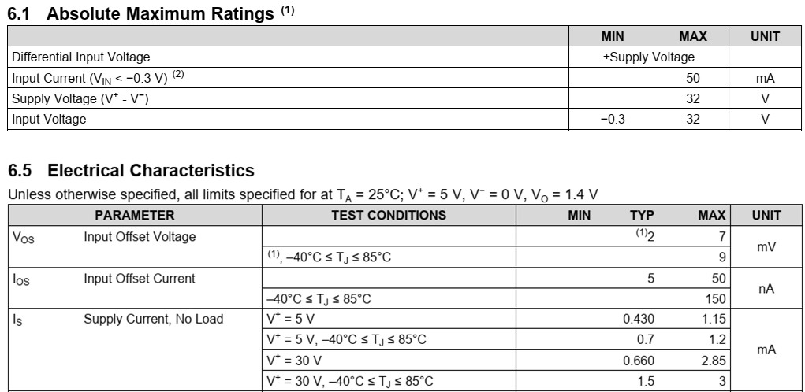
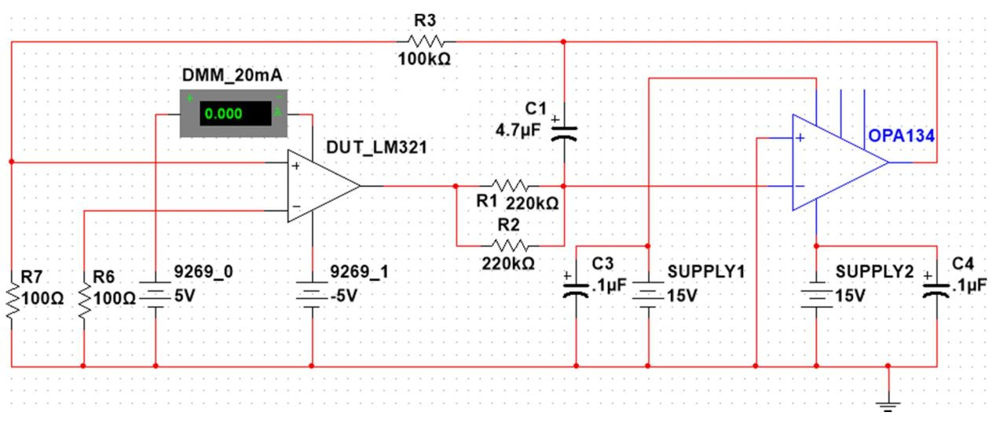
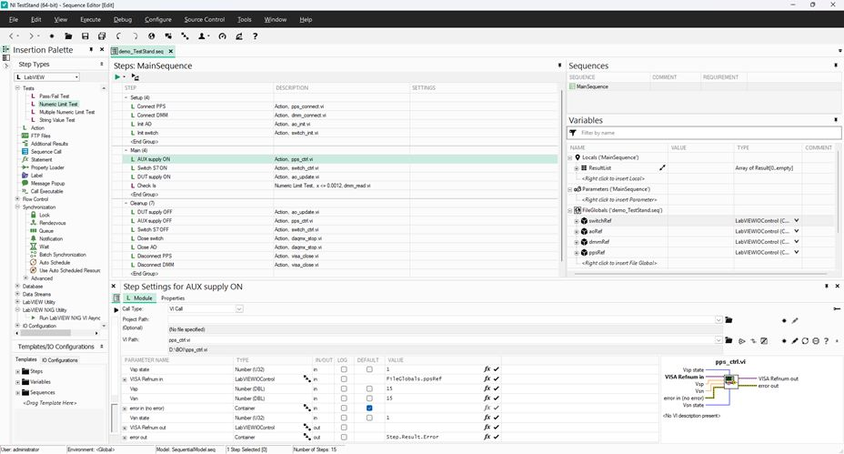

## LM321 specification {.smaller}

\

## $I_{S}$ measurement {.smaller}

:::: {.columns}
::: {.column width=50%}
1. **UDP3305S**: supply CH1 (15 V) / CH2 (15 V)
2. **UT8805E**: measure DC current using the 20 mA range
:::
::: {.column width=50%}
3. **NI-9477**: control switch S7
4. **NI-9269**: supply AO0 (5 V) / AO1 (5 V)
:::
::::
\

## TestStand practice: $I_{S}$ measurement {.smaller}

| Group | Code modules | Function | Variables | 
| :- | :- | :---- | :-- |
| **Setup** | `pps_connect`   `dmm_connect`   `switch_init`   `ao_init` | Connect UDP3305S   Connect UT8805E   Connect NI-9477   Connect NI-9269 | &rarr; `FG.ppsRef`^[VISA/DAQmx resources use the [`LabVIEWIOControl` type](https://knowledge.ni.com/KnowledgeArticleDetails?id=kA03q000000YGp8CAG&l=en-TH)]   &rarr; `FG.dmmRef`^[LC means Locals, FG means FileGlobals, SG means StationGlobals]   &rarr; `FG.switchRef`   &rarr; `FG.aoRef` |
| **Main** | `pps_ctrl`   `switch_ctrl`   `ao_update`   Numeric Limit Test (`dmm_read`) | Supply AUX ±15 V   Turn S7 on   Supply DUT ±5 V   Test $I_{S}$ < 1.2 mA | |
| **Cleanup** |`visa_close`   `daqmx_stop` | Close the VISA connection   Close the DAQmx connection | &larr; ...   &larr; ... |

## TestStand practice {.smaller}
\

## TestStand practice: sequence call {.smaller}

| Group | Code modules | Function | Variables | 
| :- | :-- | :--- | :-- |
| **Setup** | ... | ... | ... |
| **Main** | `pps_ctrl`   `ao_update`   Call `I_S_test` | Supply AUX ±15 V   Supply DUT ±5 V   Test $I_{S}$ < 1.2 mA | ... |
| **Cleanup** | ... | ... | ... |

 

:::: {.columns}
::: {.column width=20%}
#### Sub-sequence: "I_S test"
:::
::: {.column width=75%}

::: {style="border: 2px solid black; padding: 10px; display: inline-block;"}

| Group | Code modules | Function | 
| :- | :--- | :--- |
| **Setup** | `switch_ctrl` | Turn S7 on |
| **Main** | Numeric Limit Test (`dmm_read`) | Test $I_{S}$ < 1.2 mA |
| **Cleanup** | `switch_ctrl` | Turn S7 off |

:::

:::
::::
