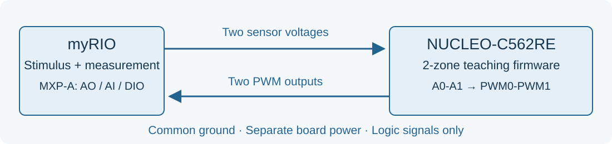

## Course outline {.smaller}

:::: {.columns}
::: {.column width=50%}
- [x] **Day 1 LabVIEW + myRIO**
    - Automated Test Equipment
    - LabVIEW tutorials
    - Analog loopback with myRIO
    - **workshop**: thermal-controller test
- [ ] **Day 2 Instrument drivers**
    - Programmable instruments
    - DAQmx and VISA/SCPI drivers
    - Instrument automation
    - **workshop**: LM321 $V_{OS}$ and $I_S$ test
:::
::: {.column width=50%}
- [ ] **Day 3 NI TestStand**
    - Sequences and action/test steps
    - Using code modules
    - Process models and callbacks
    - **workshop**: LM321 DC test
- [ ] **Day 4 Python for testing**
    - PyVISA and Streamlit libraries
    - CAN bus and CANopen
    - **workshop**: CANopen firmware test
:::
::::

## Training tools {.smaller}
:::: {.columns}
::: {.column width=50%}
#### [NI LabVIEW](https://www.ni.com/en/shop/labview)

- Graphical programming environment
- Connect to instruments via DAQmx, VISA, PXI, camera
- Use engineering analysis functions

#### [NI myRIO](https://www.ni.com/en/shop/engineering-education/portable-student-devices/myrio-student-embedded-device/what-is-myrio.html) as DAQ hardware
{width=75%}\

:::
::: {.column width=50%}

#### [NI TestStand](https://www.ni.com/en/shop/electronic-test-instrumentation/application-software-for-electronic-test-and-instrumentation-category/what-is-teststand)
- Manage validation and production tests
- Build, organize, and monitor test sequences
- Support NI LabVIEW, C/C++, .NET, and Python as test code 

#### [TSE](https://ece.engr.tu.ac.th/) automated test experiment
\

:::
::::

## Training tools {.smaller}
:::: {.columns}
::: {.column width=50%}
#### [PyVISA](https://www.pyvisa.com/docs) for instrument coordination
- Connect to VISA-compatible instruments
- Support USB, Ethernet, GPIB, and RS-232

#### [Streamlit](https://docs.streamlit.io/) as web-based UI
- GUI rapid prototyping
- Control front-end interaction with Python

{width=75%}\

:::
::: {.column width=50%}

#### [PicoScope 2206B](https://www.picotech.com/oscilloscope/2000/picoscope-2000-overview) as digitizer
- Sample rate 500 MSample/s, memory depth 32 MSample
- Bandwidth 50 MHz

#### [NUCLEO-C562RE](https://www.st.com/en/evaluation-tools/nucleo-c562re.html) as DUT/stimulator
- STM32C562RE 512KB flash/128KB RAM
- FDCAN with CAN transceiver

\

:::
::::

## Problem-based learning #1 {.smaller}

:::: {.columns}
::: {.column width=50%}
#### Thermal-controller PCB as DUT
- **NUCLEO-C562RE**: two cooling zones.
- A0 → PWM0 and A1 → PWM1.
- Verify thresholds, hysteresis and channel mapping.
:::
::: {.column width=50%}
#### myRIO as tester
- MXP-A AO0/AO1: simulate two sensors.
- MXP-A AI0/AI1: verify the stimulus.
- MXP-A DIO0/DIO1: observe PWM outputs.
:::
::::

{width=100%}\

## Problem-based learning #2 {.smaller}

:::: {.columns}
::: {.column width=75%}
#### [LM321](https://www.ti.com/product/LM321) operational amplifier as DUT

- 3V < supply voltage < 30V
- Bandwidth: 1 MHz, slew rate: 0.5 V/µs
- Offset voltage: 7 mV, bias current: 0.25 µA

:::
::: {.column width=25%}
\
:::
::::

:::: {.columns}
::: {.column width=75%}
#### Servo-loop configuration
\
:::
::: {.column width=25%}
\
:::
::::

## Problem-based learning #3 {.smaller}

:::: {.columns}
::: {.column width=55%}
#### NUCLEO-C562RE as DUT
- Emulate ICP DAS CAN-2054 device 
- CANopen protocol (partial)

#### NUCLEO-C562RE as stimulator
- Implement SLCAN protocol (partial)
- API wrapper for CANopen protocol (partial)
:::
::: {.column width=45%}
#### PicoScope 2206B
- Capture CANH (CH1) and CANL (CH2) waveforms
- Decode CAN message from CH1-CH2 waveform
:::
::::
{width=75%}\

## Further learning {.smaller}
- [LabVIEW Community Edition](https://www.ni.com/en/shop/labview/select-edition/labview-community-edition.html) is an edition for self-directed learning
- [Getting Started with the LabVIEW Hobbyist Toolkit](https://knowledge.ni.com/KnowledgeArticleDetails?id=kA00Z0000019TmpSAE&l=en-TH): a package for connecting LabVIEW to Arduino and Raspberry Pi boards
- [Element 14 LabVIEW Challenge Blogs](https://community.element14.com/products/devtools/ni-labview/b/labview-challenge-blogs): introduces a hardware abstraction layer for connecting microcontrollers
- [PyVISA](https://pyvisa.readthedocs.io/en/latest/): a Python library for controlling instruments through NI VISA
- [nidaqmx](https://nidaqmx-python.readthedocs.io/en/stable/): a Python library for reading/generating signals through NI DAQmx

