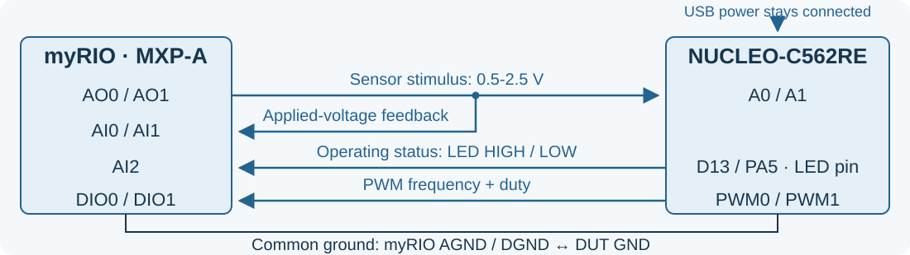
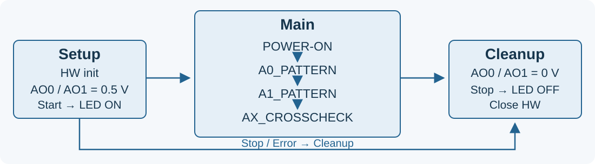

## Thermal-controller PCBA test {.smaller}

**Verify two independent cooling channels on NUCLEO-C562RE.**

:::: {.columns}
::: {.column width=50%}
#### Sensor and operating modes
- A0 → PWM0; A1 → PWM1.
- **0.5-2.5 V = 0-100 °C**: $T_i = 50(V_i - 0.5)$.
- Both inputs at **0.5 V**: start operation, **LED ON**.
- Both inputs at **0 V**: stop operation, **LED OFF**; both PWM LOW.
:::
::: {.column width=50%}
#### Fan control while running
- $T_i \geq 40$ °C: selected fan ON.
- $T_i \leq 35$ °C: selected fan OFF.
- Between thresholds: retain the last state.
- ON: **1 kHz, 50% duty**; OFF: steady LOW.
:::
::::

USB stays connected. LED means the **D13/PA5 logic level**, not a power-rail measurement. This teaching firmware is motivated by [Adafruit EMC2101 fan controller](https://www.adafruit.com/product/4808).

## Test bench: myRIO + NUCLEO {.smaller}

{width=100%}\

| myRIO MXP-A AO | NUCLEO input | NUCLEO PWM output | myRIO MXP-A input |
| --- | --- | --- | --- |
| AO0 | A0 / PA0 | PWM0: D3 / PB3 | DIO0 |
| AO1 | A1 / PA1 | PWM1: D5 / PB4 | DIO1 |

AI0/AI1 monitor the stimulus; **AI2 reads D13/PA5**. Common ground; limit AO to **0-3.0 V**. [NUCLEO pinout](https://www.st.com/resource/en/user_manual/um3615-stm32c5.pdf)

## Test program: state machine {.smaller}

{width=100%}\

- **Setup:** initialize HW, then set AO0/AO1 = 0.5 V to start the DUT.
- **Main:** POWER-ON → A0_PATTERN → A1_PATTERN → AX_CROSSCHECK.
- **Cleanup:** AO0/AO1 = 0 V; verify LED OFF, then close resources.
- Stop/error also reaches Cleanup. USB power stays connected; firmware controls RUN/STANDBY.

## Test plan {.smaller}

| State | Stimulus | Result |
| --- | --- | --- |
| **Setup** | HW init; AO0 = AO1 = 0 V | LED OFF |
| **POWER-ON** | Hold both inputs at 0.5 V | LED ON; both PWM LOW |
| **A0_PATTERN** | Apply P to AO0; AO1 = 0.5 V | PWM0 duty: 0/0/50/50/0% |
| **A1_PATTERN** | Apply P to AO1; AO0 = 0.5 V | PWM1 duty: 0/0/50/50/0% |
| **AX_CROSSCHECK** | Apply P to AO0, then AO1; hold the other at 0.5 V | Opposite PWM stays LOW |
| **Cleanup** | AO0 = AO1 = 0 V | LED OFF; PWM LOW; close HW |

**P = 1.10 → 1.25 → 1.40 → 1.25 → 1.10 V.** Reset both inputs to 0.5 V before each subtest. Apply defined settling, measurement limits and LED timeouts.
