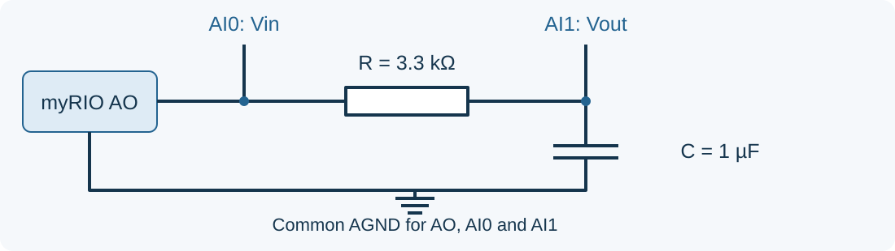
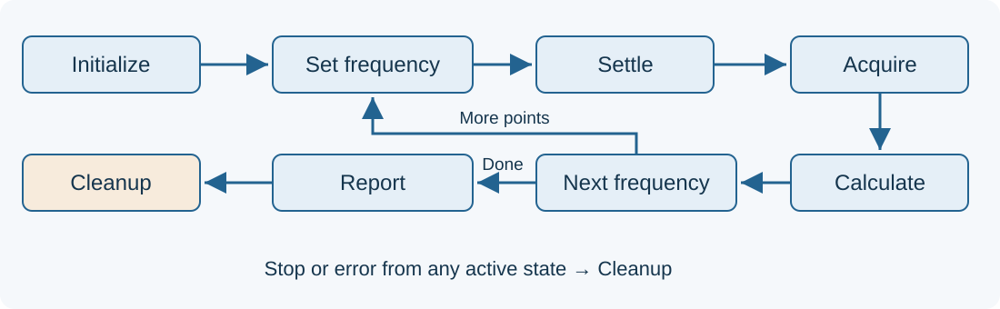

## RC filter characterization {.smaller}

**How can we measure the frequency response of a circuit automatically?**

\

:::: {.columns}
::: {.column width=50%}
#### Techniques
- Swept-sine test
- Multitone test
- **Stepped-sine sweep test**
:::
::: {.column width=50%}
#### Stimulating signals
- **Sine signal (DAC)**: peak/rms detection
- PWM signal (TIM): peak of fundamental frequency
:::
::::

## Measurement planning {.smaller}

:::: {.columns}
::: {.column width=50%}
#### Circuit evaluation

- R = **3.3 kΩ**, C = **1 µF**
- Predicted cutoff: $f_c = 1/(2\pi RC) \approx 48\ \text{Hz}$
- Frequency range: **5–500 Hz** 
    - logarithmic spacing
- Capture period: 
    - 5 - 10 cycles
:::
::: {.column width=50%}
#### Stepped-sine sweep test

1. Set frequency, then generate sine waveform
2. Wait for circuit/signal to settle.
3. Acquire Vin and Vout over capture period.
4. Subtract with DC offset, then compute RMS
5. Calculate and store:

$$G_{dB}(f)=20\log_{10}\left(\frac{V_{out}(f)}{V_{in}(f)}\right)$$
:::
::::

## Test program: state machine {.smaller}

\

- State machine = **Enum (state) + Case Structure (decision) + While Loop**, 
    - State and results in shift registers.
- Polling style: waveform generation and acquisition timing end in each state.
- Error handling: return **0V** on acquisition failure or invalid amplitude.

**Design task:** settling time, acquisition length and data passed between states.

## Workshop: freq. response test {.smaller}

| Requirements | Features |
| -- | ---- |
| UI | - Input: start / stop frequency   - Frequency-response plot (gain dB - freq log) |
| Operation | - Find measurement settings   - Substract offset, then compute RMS   - Automatic sweep with Start, Stop and error handling   - Estimate cutoff frequency|
| Measurement record | Frequency, Vin amplitude, Vout amplitude and gain |
