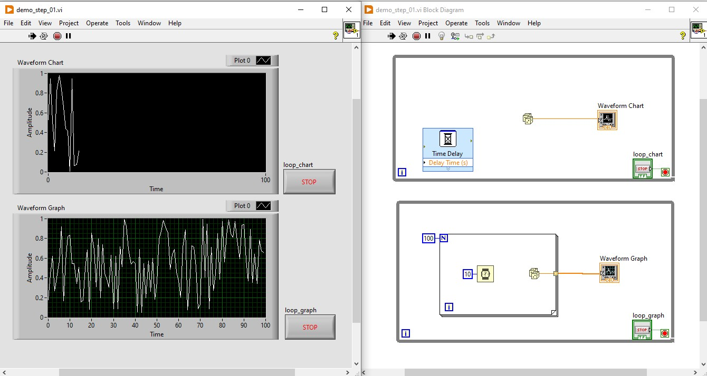
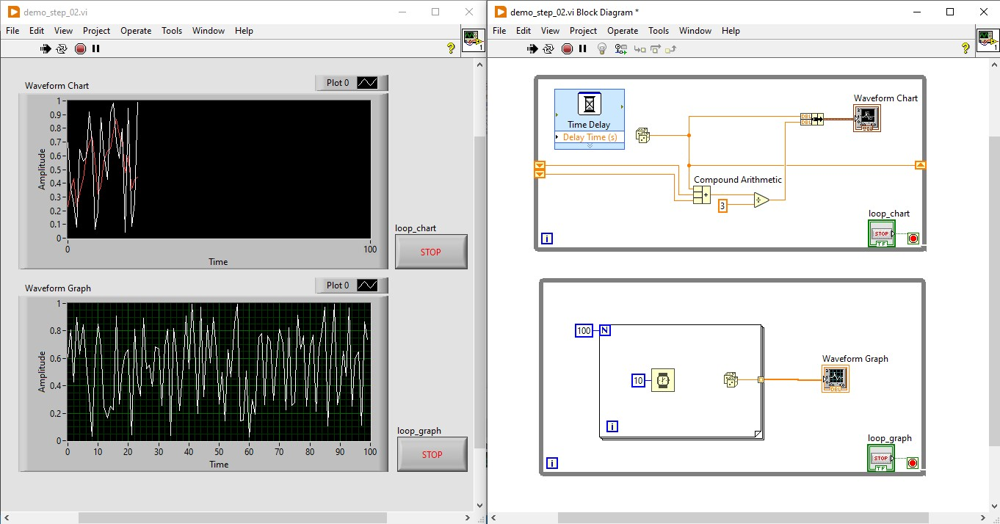
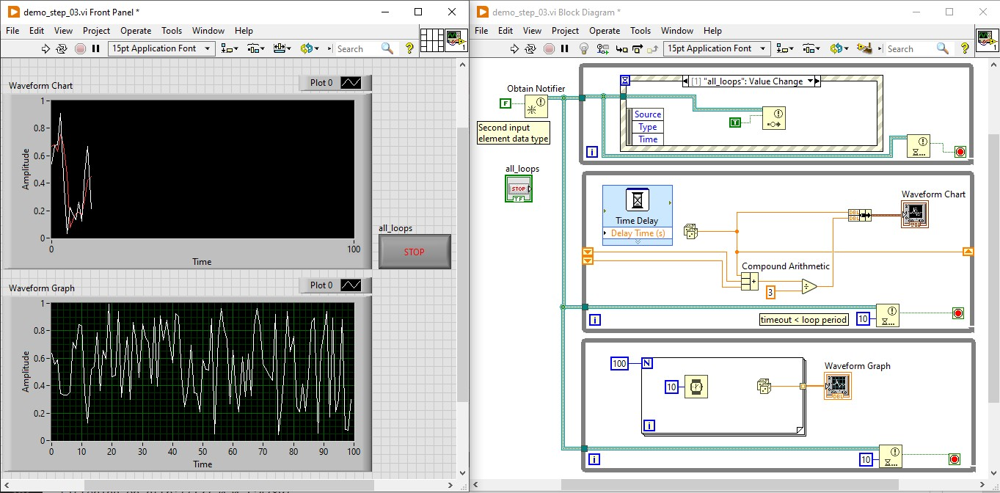
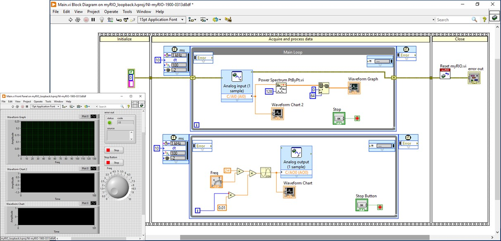

Practical guide. Follow each section in order. Use the original figures as block-diagram references.

## LabVIEW quick tutorial 1

**Plot random values**

**Goal:** Create parallel loops to display individual samples on a chart and a batch of samples on a graph.

{width=90%}

Figure 1. Upper loop: one sample per chart update. Lower loop: 100 samples per graph update.

### 1. Create a new VI

1.1  Open LabVIEW and create a Blank VI on My Computer. Save it as QT1_Random_Display.vi.

1.2  Use Ctrl+E to switch between the Front Panel and Block Diagram.

1.3  On the Front Panel, select View > Controls Palette. On the Block Diagram, select View > Functions Palette. Pin the palettes open if needed.

1.4  Use Ctrl+H to display Context Help. Use Search in the palette when a block is difficult to find.

### 2. Build the loop for individual samples

2.1  On the Block Diagram, find **While Loop** in the Structures group. Select it and drag a rectangular loop boundary.

2.2  Click Search in the Functions Palette. Search for Random and place **Random Number (0-1)** inside the loop.

2.3  On the Front Panel, find **Waveform Chart** in the Graph or Graphs group. Place the chart, then return to the Block Diagram.

2.4  Move the chart terminal inside the **While Loop**. Use the Wiring tool to connect **Random Number (0-1)** to the chart terminal.

2.5  Search for **Time Delay** and place it inside the loop. Set the delay to 0.10 s for this exercise.

2.6  Right-click the loop condition terminal and create a Boolean control. Name it loop_chart and use Stop if True.



### 3. Build the loop for a batch of samples

3.1  Create a second **While Loop** below the first one. Place a **For Loop** inside it.

3.2  Right-click the **For Loop** N terminal, create a numeric constant and enter 100.

3.3  Place **Random Number (0-1)** and **Wait (ms)** inside the **For Loop**. Create a constant of 10 for the Wait input.

3.4  On the Front Panel, add a **Waveform Graph**. Place its diagram terminal outside the **For Loop** but inside the second **While Loop**.

3.5  Wire the random value through the **For Loop** boundary to the graph. Right-click the output tunnel and enable indexing so it produces a 1D array.

3.6  Create a separate Boolean control for the outer **While Loop** condition. Name it loop_graph.

### 4. Run and adjust the VI

4.1  Click Run. The chart updates one value at a time; the graph updates after each 100-sample batch.

4.2  Change the chart delay to 0.20 s and run again. Notice the slower chart update rate.

4.3  Stop loop_chart and confirm that loop_graph continues. Stop the second loop; it may finish its current **For Loop** batch first.

4.4  Save the VI. Use the Stop controls during normal operation rather than Abort Execution.

**Note:** Palette group names vary by LabVIEW version. Search by the function name if the illustrated group is unavailable. A plain array graph displays sample indices unless its axis is configured for time.



## LabVIEW quick tutorial 2

**Build a moving average**

**Goal:** Use a **shift register**, arithmetic and a SubVI to smooth the chart data.

{width=100%}

Figure 2. The upper loop shows a three-point moving average. The lower graph loop is unchanged.

### 1. Prepare the VI

1.1  Open QT1_Random_Display.vi and save a copy as QT2_Moving_Average.vi.

1.2  Keep the lower graph loop unchanged. Work on the upper chart loop.

### 2. Store the previous samples

2.1  Right-click the upper **While Loop** boundary and select Add **Shift Register**.

2.2  Expand the left shift-register terminal downward to expose two previous values, as shown in the reference figure.

2.3  Wire the current random value to the right shift-register terminal.

2.4  For repeatable startup, create a zero constant outside the loop for each left terminal. This initialization is added for this exercise.



### 3. Calculate the average

3.1  Search for **Compound Arithmetic**. Place it inside the loop and configure it for addition with three inputs.

3.2  Wire the current value and the two previous values to the three inputs.

3.3  Search for **Divide**. Wire the sum to its numerator and a constant of 3 to its denominator.

3.4  The output is the mean of the current sample and the two previous samples.

### 4. Display raw and filtered values

4.1  Search for **Bundle**. Configure it with two inputs: the raw sample and the average.

4.2  Wire the resulting two-element cluster to the **Waveform Chart**.

4.3  Run the VI. Use the chart plot legend to give the traces different names and colors.

4.4  Notice the smoother trace and its delay. Zero initialization affects the first two average values.

### 5. Create and reuse a SubVI

5.1  Stop both loops. Select only the addition and division code, leaving the **shift register** in the main VI.

5.2  Select Edit > Create SubVI, or create a blank SubVI manually. Save it as **MA3_Calculate.vi**.

5.3  Assign connector-pane inputs for current, previous_1 and previous_2, and an output for mean. Create a readable icon.

5.4  Reconnect the SubVI in the main loop. Confirm the input and output assignments using Context Help.

5.5  Try inputs 1, 2 and 3 in the SubVI: the mean should be 2. Run the main VI again and save both files.

**Note:** The reference figure implements three points. To extend it to N points, store only the latest N samples and define how the filter handles startup.



## LabVIEW quick tutorial 3

**Control parallel loops from the UI**

**Goal:** Use an **Event Structure** and a notifier to stop both worker loops with one UI control.

{width=100%}

Figure 3. Top: UI event loop. Middle: chart loop. Bottom: graph loop. One notifier carries the shared Stop request.

### 1. Prepare the shared Stop control

1.1  Open QT2_Moving_Average.vi and save a copy as QT3_UI_Stop.vi.

1.2  Add a Boolean Stop button on the Front Panel. Name it all_loops.

1.3  Search for **Obtain Notifier**. Place it before the loops and wire a Boolean False constant to the element data type input.

1.4  Branch the notifier reference to the UI loop and both worker loops.

### 2. Build the UI event loop

2.1  Create a third **While Loop** above the worker loops. Place an **Event Structure** inside it.

2.2  Right-click the **Event Structure** boundary and add the all_loops: Value Change event.

2.3  Place the all_loops terminal inside its event case. This also allows a latch-action button to reset when read.

2.4  Search for **Send Notification**. In the event case, wire the notifier reference and send True as the notification.

2.5  Arrange for the UI loop to stop after handling this event. Do not place the acquisition code inside the event case.



### 3. Receive Stop in both worker loops

3.1  Search for **Wait on Notification**. Place one instance inside each worker loop and wire the shared notifier reference.

3.2  Set timeout in ms to 10. Set ignore previous to False so a Stop sent before the wait can still be received.

3.3  Wire a received True to each worker loop Stop condition. Combine it with an existing local Stop control using **OR** if that control is retained.

3.4  Continue running on an ordinary timeout. Treat an actual notifier error separately from a timeout.

3.5  Use Context Help to confirm the wait function and terminals in the installed LabVIEW version.

### 4. Run and release the notifier

4.1  Run the VI and press all_loops. Confirm that both workers stop.

4.2  Notice that the graph loop may finish its current batch first. A 10 ms notifier timeout does not make the batch interruptible.

4.3  Place **Release Notifier** after all loops have finished. Enforce this order with data dependencies or a **sequence structure**.

4.4  Make sure the error path also terminates all loops, including the UI loop. Save and run again.

**Note:** The reference figure demonstrates shared Stop. A timing-control event or **Property Node** is an optional extension, not a block shown in this diagram. A notifier wait timeout is not a precise loop period.



## myRIO quick tutorial 1

**Generate and acquire an analog signal**

**Goal:** Build analog loopback with parallel **Timed Loops** and view a time trace and power spectrum.

{width=100%}

Figure 4. The diagram uses C/AO0, C/AI0, two **Timed Loops** and **Power Spectrum PtByPt.vi**.

### 1. Create the target VI

1.1  Open a LabVIEW myRIO project and connect to the configured station target.

1.2  Create a VI under the myRIO target, not My Computer. Save it as QT4_myRIO_Loopback.vi.

1.3  Open the Controls and Functions palettes. Use Search to locate the blocks shown in the figure.

### 2. Connect analog loopback

2.1  Keep the analog output disabled while wiring. Use the connector C breakout and the myRIO pinout.

2.2  Connect C/AO0 to C/AI0+. Connect C/AI0- to the specified AGND reference.

2.3  Confirm the wiring and selected channels with the instructor or station guide before enabling output. Do not infer pin numbers from the block diagram.



### 3. Build the output loop

3.1  Reproduce the Initialize, Acquire and Close organization in the reference figure. Place two parallel **Timed Loops** in Acquire.

3.2  For each **Timed Loop**, select the 1 kHz timing source and request 10 ticks per iteration: nominally 10 ms.

3.3  In the output loop, multiply iteration i by 0.01 to obtain time t in seconds.

3.4  Use **Multiply** and **Sine** blocks to calculate sin(2 x pi x f x t). Start with f = 2 Hz and a 1 V peak sine at zero offset.

3.5  Search for **Analog Output** and configure one-sample output on C/AO0. Wire the sine value to it and to a waveform chart.

### 4. Build acquisition and spectrum display

4.1  In the input loop, place **Analog Input** and configure one-sample input on C/AI0. Wire its output to a waveform chart.

4.2  Search for **Power Spectrum PtByPt.vi**. Wire the input samples to it. Follow the figure with a 128-sample analysis length and nominal sample rate 100 Hz; confirm terminal names in Context Help.

4.3  Use **Array Subset** to display the first 64 spectrum elements on a **Waveform Graph**, as shown.

4.4  Set the graph frequency scale for the configured rate and length. At 100 samples/s and 128 points, the bin spacing is 0.78125 Hz.

### 5. Run, adjust and stop

5.1  Run at 2 Hz, then change to 5 Hz. Observe the input waveform and a spectrum feature near the selected frequency.

5.2  Allow at least the initial 128-sample window to fill: nominally 1.28 s. Check actual loop timing and late iterations.

5.3  Stop both loops using their Stop controls. Write AO0 = 0 V after the output loop finishes.

5.4  Reset or close myRIO resources only after both loops have ended. Include output-off handling on the error path, then save the VI and project.

**Note:** These settings follow connector C. Do not apply the bipolar sine unchanged to MXP A/B outputs. Requested timing is not a hardware timing guarantee; the two loops are not synchronized sample pairs. This is direct loopback, without the RC circuit.

## References

- Original tutorial figures: `LV_01_recap.md` and `myRIO_01_overview.md` in the Day 1 training materials.
- [NI myRIO-1900 user guide and pinouts](https://download.ni.com/support/manuals/376047c.pdf)

Use Context Help for block terminals and the installed version of each function.
