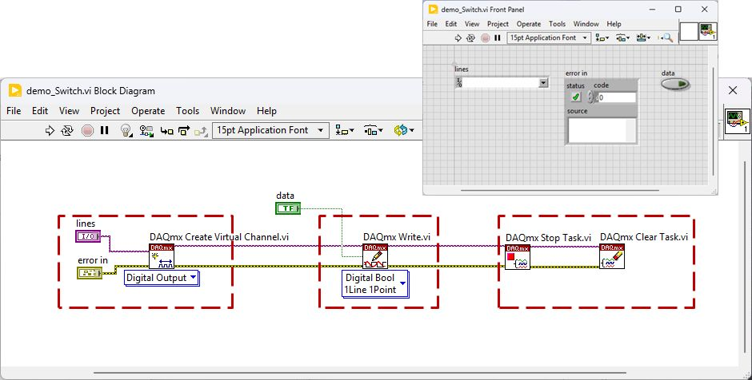
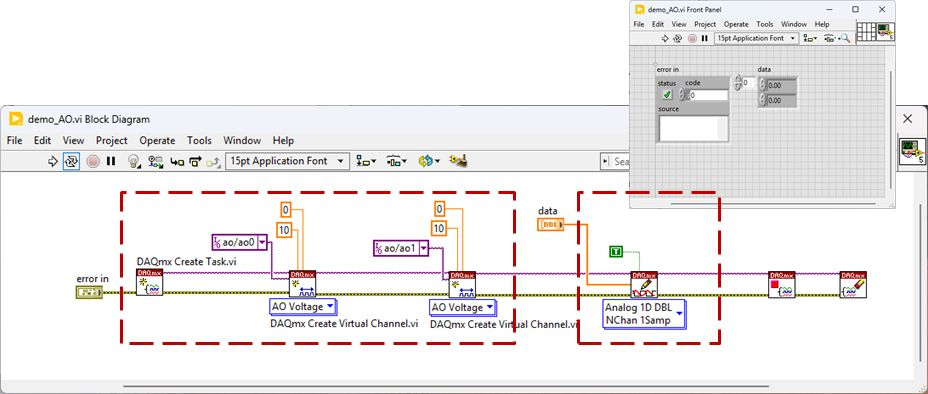
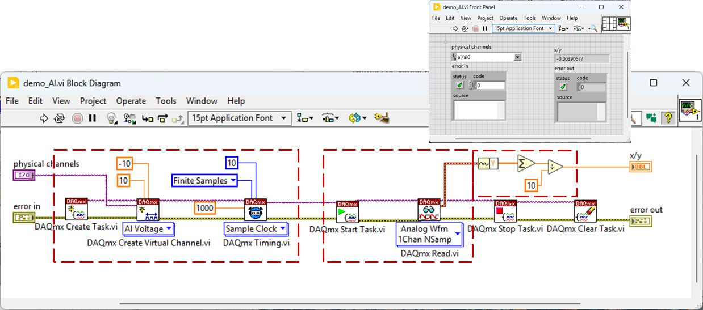
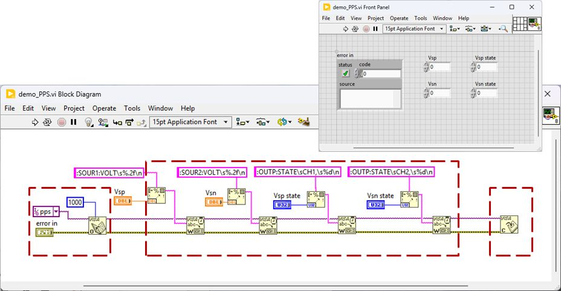
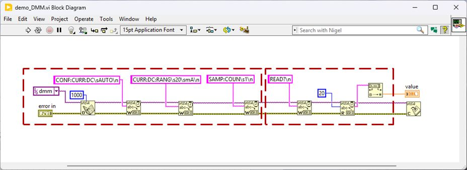

Build a working demo first, preserve it, then extract reusable SubVIs.

### 1. Start with a complete operation

1.1  Define the task as Configure -> Operate or Measure -> Return to safe state -> Release resources.

1.2  Create the complete low-level diagram in one VI. Use the reference figure to identify the required blocks.

1.3  Use physical-channel/resource controls and visible outputs so each device can be checked independently.

### 2. Preserve a working demo before refactoring

2.1  Test normal operation and shutdown on the configured station.

2.2  Save the full working diagram in a demos folder. Keep the filenames used in the following tutorials.

2.3  Create a separate caller copy for refactoring. Do not overwrite the full demo with a diagram made only of SubVI calls.

### 3. Extract one responsibility at a time

3.1  Select a functional region, then use Edit > Create SubVI. Save it in a subvis folder.

3.2  Give each SubVI a clear icon and connector pane: settings/reference/error inputs on the left, measurements/reference/error outputs on the right.

3.3  Keep setup and final cleanup outside repeated read/write calls. Use the same task or VISA session throughout its lifetime.

3.4  Run after each extraction and compare with the saved demo before extracting the next region.

### 4. Keep demos and reusable code together

4.1  Use one LabVIEW project with demos/, subvis/ and callers/ folders. Save all dependencies before closing the project.

4.2  Create driver code on My Computer. Open the Controls/Functions palettes, use Search to locate blocks, and Ctrl+H for terminal help.

4.3  The following pages describe VIs to build in LabVIEW; this guide does not provide executable demo VIs.



## CompactDAQ tutorial 1: Control switch S7 with NI-9477

**Goal:** Build a complete digital-output VI, preserve the demo, then extract initialization, control and cleanup.

{width=100%}

Figure 1. The dashed regions identify channel creation, digital write, and task stop/clear.

### 1. Create the complete demo

1.1  Create a blank VI on My Computer. Add a physical-line control, a Boolean data control, error in and error out.

1.2  Search for **DAQmx Create Virtual Channel**. Select Digital Output and choose the station line wired to S7; confirm the actual module name in NI MAX.

1.3  Add **DAQmx Write**. Select Digital Bool 1Line 1Point and wire the Boolean control to data.

1.4  Add **DAQmx Stop Task** and **DAQmx Clear Task** after Write, as shown. Wire task and error terminals from left to right.

1.5  Use on-demand output with auto start enabled for this one-point write. Do not add sample-clock timing.

### 2. Operate and preserve the demo

2.1  With DUT and AUX supplies off, confirm the relay wiring and active polarity. Start with the Boolean value corresponding to S7 OFF.

2.2  Run once to select S7 ON, check the relay state, then run with S7 OFF. A cleared task does not by itself establish the relay state.

2.3  Add an explicit OFF write before final task cleanup where the demo must finish with S7 OFF. Keep the controllable write and shutdown write distinct.

2.4  Save the working VI as demos/demo_Switch.vi. Keep this complete block diagram as the later troubleshooting reference.



### 3. Extract the three regions

3.1  Save a copy as callers/Switch_SubVI_Test.vi. Make the following edits in this copy, leaving the demo unchanged.

3.2  Select channel creation and choose Edit > Create SubVI. Save it as subvis/switch_init.vi; expose the physical line, task out and error terminals.

3.3  Select only the controllable digital Write. Save it as **switch_ctrl.vi**; expose task in/out and the Boolean state.

3.4  Select **Stop Task** and **Clear Task** together. Save them as **daqmx_stop.vi**. This shared cleanup releases a task; it does not switch an output off.

3.5  Keep the explicit S7 OFF call in the caller before **daqmx_stop**. Keep physical channel configuration in **switch_init**.

### 4. Reconnect and reuse

4.1  Wire **switch_init** -> **switch_ctrl** -> **switch_ctrl**(OFF) -> **daqmx_stop** with the same task reference.

4.2  Run the caller with the same line and state as the demo. Compare relay action and shutdown state.

4.3  For repeated changes, put **switch_ctrl** in the operating loop; initialize once before the loop and release the task once afterward.

4.4  Save the caller and all SubVIs. Never use Run Continuously to repeatedly open hardware resources.

### SubVI interfaces

All SubVIs also have error in/error out. Update/control/read VIs pass through the same reference.

| SubVI | Inputs | Outputs |
| --- | --- | --- |
| **switch_init** | physical line | DAQmx task |
| **switch_ctrl** | task, Boolean state | same task |
| **daqmx_stop** | task | cleanup status |

**Note:** Use the verified station polarity for OFF. Call cleanup for each task that was successfully created, including the error path.



## CompactDAQ tutorial 2: Set the DUT supply with NI-9269

**Goal:** Create a two-channel DC output demo, then separate channel setup from voltage updates.

{width=100%}

Figure 2. Left: create one task with two AO channels. Middle: write a two-element voltage array. Right: stop and clear.

### 1. Create the complete demo

1.1  Create a blank VI. Add controls for the two physical AO channels and a 1D DBL array containing two voltage values.

1.2  Place **DAQmx Create Task**, then two **DAQmx Create Virtual Channel** functions set to AO Voltage. Add both channels to the same task.

1.3  Use the station NI-9269 ao0 and ao1 channels. Match the illustrated 0 to 10 V range only after checking the actual station wiring.

1.4  Add **DAQmx Write** configured as Analog 1D DBL NChan 1Samp. Enable auto start for this on-demand write.

1.5  Wire the array in channel-creation order: element 0 for ao0 and element 1 for ao1. Add **Stop Task** and **Clear Task**, then wire task/error flow.

### 2. Operate and preserve the demo

2.1  Begin with [0, 0] V. Check each output with the fixture disconnected or with the approved station setup.

2.2  Set the approved test voltages and run. For the illustrated fixture, [5, 5] V produces the two DUT rails through its wiring; do not assume ao1 must be -5 V.

2.3  Add a final [0, 0] V write before stopping/clearing the task. Confirm both outputs return to zero.

2.4  Save the complete working VI as demos/demo_AO.vi. Preserve the channel order and output-off code.



### 3. Extract setup and update

3.1  Save a copy as callers/AO_SubVI_Test.vi before selecting any code.

3.2  Select **Create Task** and both **Create Virtual Channel** blocks. Use Edit > Create SubVI and save subvis/ao_init.vi.

3.3  Expose the physical channels and configuration needed by the caller. Return the single task reference.

3.4  Select the voltage Write only and create **ao_update.vi**. Expose task in/out and the two-element voltage array.

3.5  Replace Stop/Clear with the shared **daqmx_stop.vi**. Do not close the task inside **ao_update**.

### 4. Reconnect and reuse

4.1  Wire **ao_init** -> **ao_update**(test values) -> **ao_update**([0, 0]) -> **daqmx_stop**.

4.2  Run with the same channel order and values as demo_AO.vi. Compare measured outputs, including final zero.

4.3  If adding a UI loop, initialize outside it and call only **ao_update** when a value changes.

4.4  Keep output-off handling on Stop and error paths. Save the refactored caller without replacing the original demo.

### SubVI interfaces

All SubVIs also have error in/error out. Update/control/read VIs pass through the same reference.

| SubVI | Inputs | Outputs |
| --- | --- | --- |
| **ao_init** | AO channels, ranges | DAQmx task |
| **ao_update** | task, voltage array [V] | same task |
| **daqmx_stop** | task | cleanup status |

**Note:** The screenshot supplies positive channel values; rail polarity comes from the fixture. Stopping or clearing a task is not an output-zero command.



## CompactDAQ tutorial 3: Read voltage with NI-9239

**Goal:** Acquire a finite voltage block, calculate its mean, then extract setup and measurement SubVIs.

{width=100%}

Figure 3. Left: channel/timing configuration. Middle: start/read. Upper right: extract samples and calculate a mean.

### 1. Create the complete demo

1.1  Create a blank VI with physical-channel, requested-rate, sample-count and timeout controls. Add voltage and error indicators.

1.2  Place **Create Task**, **Create Virtual Channel** (AI Voltage), and **DAQmx Timing** (Sample Clock). Select the station NI-9239 input and approved voltage range.

1.3  Select Finite Samples and begin with 10 samples as illustrated. Use a station-supported rate; the screenshot 1000 Hz is not a guaranteed NI-9239 rate.

1.4  Place **Start Task** and **DAQmx Read** set to Analog Wfm 1Chan NSamp. Wire the sample count and a suitable timeout.

1.5  Extract the waveform Y array and calculate its mean. Use **Mean.vi** or sum divided by **Array Size** instead of a fixed divisor when the count is configurable.

1.6  Add **Stop Task** and **Clear Task** after acquisition. Wire task and error data through the full chain.

### 2. Operate and preserve the demo

2.1  Connect an approved known DC source within the input range. Run and compare the mean with the source or reference meter.

2.2  Inspect the actual DAQmx sample rate and returned sample count. The NI-9239 internal-timebase minimum is about 1.613 kS/s; the driver may coerce a requested rate.

2.3  Check that the displayed number is in volts. Keep fixture scaling outside this raw-voltage demo.

2.4  Save the complete working VI as demos/demo_AI.vi, including configuration, acquisition, averaging and task cleanup.



### 3. Extract setup and measurement

3.1  Save a copy as callers/AI_SubVI_Test.vi. Select task/channel creation and finite timing configuration; create subvis/ai_init.vi.

3.2  Expose channel, requested rate and sample count. Return task out and the actual rate if required.

3.3  Select **Start Task**, Read, sample extraction and mean calculation; create **ai_measure.vi**.

3.4  For repeated finite acquisitions, include **Stop Task** after each read inside **ai_measure**. Keep **Clear Task** in the final **daqmx_stop** call.

3.5  Expose task in/out, sample count and timeout inputs, plus mean voltage output. Return read errors; do not substitute zero for a failed measurement.

### 4. Reconnect and reuse

4.1  Wire **ai_init** -> **ai_measure** -> **daqmx_stop**. Keep the same channel and acquisition settings as the saved demo.

4.2  Compare mean voltage and error behavior with demo_AI.vi. Try a second known source value.

4.3  Call **ai_measure** again using the same configured task to check the finite Start/Read/Stop lifecycle.

4.4  Save the caller. Keep raw TP1 voltage and any later input-referred VOS conversion as separately named values.

### SubVI interfaces

All SubVIs also have error in/error out. Update/control/read VIs pass through the same reference.

| SubVI | Inputs | Outputs |
| --- | --- | --- |
| **ai_init** | channel, rate, count | task, actual rate |
| **ai_measure** | task, count, timeout | task, mean voltage [V] |
| **daqmx_stop** | task | cleanup status |

**Note:** Do not treat TP1 voltage as VOS directly. Confirm fixture gain, sign and settling before applying a conversion.



## VISA tutorial 1: Control the UDP3305S power supply

**Goal:** Build a complete VISA command sequence, then split connection, output control and close operations.

{width=100%}

Figure 4. Left: **VISA Open**. Middle: format voltage/output-state commands and write them. Right: **VISA Close**.

### 1. Create the complete demo

1.1  Find the supply in NI MAX and copy its VISA resource name. Confirm its identity with *IDN? before applying power.

1.2  Create a blank VI with resource, CH1/CH2 voltage, output-enable and timeout controls. Add error in/out.

1.3  Place **VISA Open** and set a station-appropriate timeout. Search for **Format Into String** and **VISA Write**.

1.4  Reproduce the voltage and output-state command sequence in the figure. Match commands to the installed instrument programming manual.

1.5  Set string constants to backslash Codes Display when writing a newline terminator. Use **Format Into String** for voltage and enable values.

1.6  Add **VISA Close** after the command sequence and wire the VISA reference and error chain.

### 2. Operate and preserve the demo

2.1  Start with both channels disabled and the approved station current limits. Check channel selection, mode, wiring and command units.

2.2  Set the approved CH1/CH2 voltages. Enable the intended channels and compare the physical output with the requested settings.

2.3  Add explicit output-OFF commands for both channels before **VISA Close**. Closing a session alone does not disable the supply.

2.4  Save the complete working VI as demos/demo_PPS.vi. Preserve it as the direct SCPI troubleshooting example.



### 3. Extract connection and control

3.1  Save a copy as callers/PPS_SubVI_Test.vi before changing the working diagram.

3.2  Select **VISA Open** and connection/timeout configuration. Create subvis/pps_connect.vi with resource/timeout inputs and VISA session output.

3.3  Select the command-formatting and **VISA Write** blocks. Create **pps_ctrl.vi** with session in/out, two voltage values and output-enable inputs.

3.4  Select **VISA Close** and create **visa_close.vi**. Use the same session type so this close SubVI can also serve the DMM.

3.5  Keep output OFF as an explicit **pps_ctrl** call before **visa_close**. Do not open or close the session inside **pps_ctrl**.

### 4. Reconnect and reuse

4.1  Wire **pps_connect** -> **pps_ctrl**(test settings) -> **pps_ctrl**(outputs OFF) -> **visa_close**.

4.2  Use the same resource and settings as demo_PPS.vi. Compare voltage, enable behavior and shutdown.

4.3  For interactive updates, keep the session open across the operating loop. Run output-OFF and close after the loop.

4.4  Check the error path also attempts output OFF and closes an opened session, while retaining the original error. Save the caller and SubVIs.

### SubVI interfaces

All SubVIs also have error in/error out. Update/control/read VIs pass through the same reference.

| SubVI | Inputs | Outputs |
| --- | --- | --- |
| **pps_connect** | resource, timeout | VISA session |
| **pps_ctrl** | session, voltages [V], enables | same session |
| **visa_close** | session | cleanup status |

**Note:** AUX +/-15 V is produced by the approved dual-channel wiring, not by sending a negative setpoint blindly. Use the instrument manual for exact command syntax.



## VISA tutorial 2: Read DC current with UT8805E

**Goal:** Build an open/configure/query/parse/close VI, then retain the session between measurement calls.

{width=100%}

Figure 5. Left: open/configure DC current. Middle: READ? and **VISA Read**. Right: string-to-number conversion and close.

### 1. Create the complete demo

1.1  Find the DMM in NI MAX and verify *IDN?. Create a blank VI with resource, timeout, current-range and current/error indicators.

1.2  Place **VISA Open**. Reproduce the illustrated DC current configuration, range selection and one-sample command sequence using **VISA Write**.

1.3  Use the station-approved range, with 20 mA as the illustrated current range. Confirm syntax and terminators against the actual DMM manual.

1.4  Write READ?, then call **VISA Read**. Use the instrument response termination and enough buffer space for the complete response; the illustrated byte count is only an example.

1.5  Convert the numeric reply using a suitable string-to-number function. Display the value in A, or explicitly multiply by 1000 and label mA.

1.6  Place **VISA Close** after conversion. Wire the VISA reference and error flow through every communication step.

### 2. Operate and preserve the demo

2.1  With circuit power off, confirm the DMM current terminals and fuse/range. Insert the current path in series through the approved fixture.

2.2  Apply the approved current source or powered fixture, run the VI and compare the display with the instrument front panel.

2.3  Check that a communication/parse failure is reported as an error rather than a valid 0 A result. De-energize the fixture before changing wiring.

2.4  Save the complete working VI as demos/demo_DMM.vi, including initialization, query, parsing and close.



### 3. Extract connection and reading

3.1  Save a copy as callers/DMM_SubVI_Test.vi.

3.2  Select **VISA Open** and the DC-current/range/sample-count configuration. Create subvis/dmm_connect.vi.

3.3  Expose resource, range and timeout settings as needed, with VISA session out and error out.

3.4  Select READ?, **VISA Read** and numeric conversion only. Create **dmm_read.vi** with session in/out and current in A.

3.5  Keep **VISA Close** outside **dmm_read** and replace it with shared **visa_close.vi**. The session must remain valid for another reading.

### 4. Reconnect and reuse

4.1  Wire **dmm_connect** -> **dmm_read** -> **visa_close** using the same session reference.

4.2  Compare the returned current with demo_DMM.vi at the same range and source condition.

4.3  Call **dmm_read** more than once before closing to confirm session reuse. Use the same timeout and numeric units.

4.4  When the demo is part of a powered fixture, disable stimulus before closing resources. Save the caller and SubVIs.

### SubVI interfaces

All SubVIs also have error in/error out. Update/control/read VIs pass through the same reference.

| SubVI | Inputs | Outputs |
| --- | --- | --- |
| **dmm_connect** | resource, range, timeout | VISA session |
| **dmm_read** | session | session, current [A] |
| **visa_close** | session | cleanup status |

**Note:** Do not place a current-mode DMM directly across a supply. Compare engineering units as well as numerical values during refactoring.



## Coordinate the instruments

### 1. Prepare one coordination VI

1.1  Create callers/LM321_Measurement_Demo.vi. Select the station channels and VISA resources through Front Panel controls.

1.2  Call **pps_connect**, **dmm_connect**, **switch_init**, **ao_init** and **ai_init** once. Retain the five references in the caller.

1.3  Before applying power, check the DIB connections and relay states against the Day 2 fixture diagram.

### 2. Use the SubVIs in the measurement order

2.1  Use **pps_ctrl** for the approved AUX supply settings and **ao_update** for the DUT supply settings. Sequence related operations using error/data dependencies.

2.2  Select the measurement path with **switch_ctrl** and allow the fixture to settle before reading.

2.3  Use **ai_measure** for TP1 voltage and **dmm_read** for current under their respective approved fixture configurations.

2.4  Keep TP1 volts, derived VOS volts and current amperes separately named. Apply only the station-verified fixture gain and sign; the reference divider is approximately 1000:1.

2.5  Compare with the original single-device demos before adding limits or automated pass/fail decisions.

### 3. Shut down explicitly

3.1  Disable DUT and AUX outputs and return relays to the station-defined state before releasing references.

3.2  Call **daqmx_stop** for every created DAQmx task and **visa_close** for each opened VISA session.

3.3  Attempt cleanup even when an earlier operation fails: preserve the first error, execute the needed cleanup actions for valid references, then combine/report cleanup errors.

3.4  Do not wire a stale incoming error blindly through output-off code that skips execution on error. Review this behavior in each cleanup path.

3.5  Save the coordination VI and dependencies. Keep all five original demos available for later troubleshooting and Day 3 integration.

## References

Original block figures: Instr_02_cDAQ.md and Instr_03_VISA.md. Figures are unchanged; added shutdown and configurable-count instructions extend the pictured demos.

- [Create and configure a LabVIEW SubVI](https://knowledge.ni.com/KnowledgeArticleDetails?id=kA03q000000YK4VCAW)
- [NI-DAQmx task lifecycle](https://www.ni.com/en/support/documentation/supplemental/06/learn-10-functions-in-ni-daqmx-and-handle-80-percent-of-your-dat.html)
- [NI-9239 supported data rates](https://download.ni.com/support/manuals/375939b_02.pdf)
