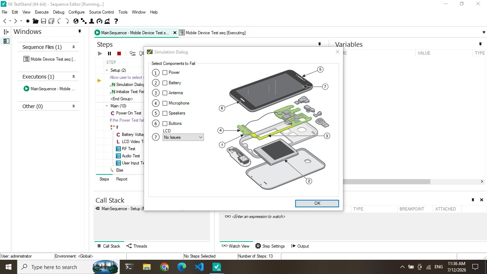
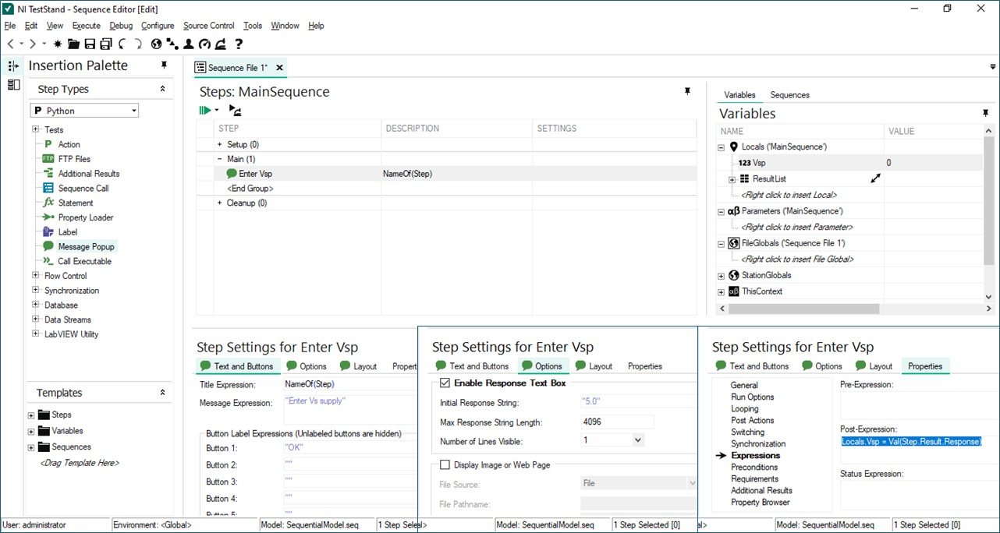
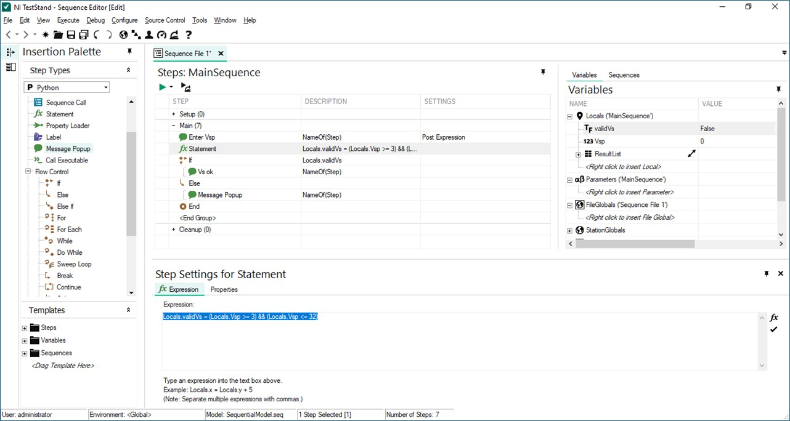
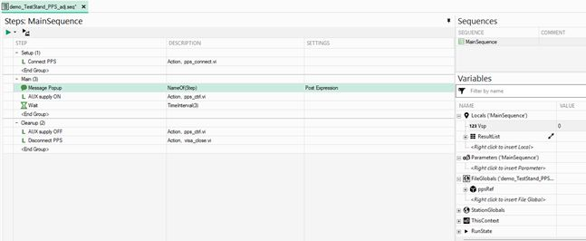
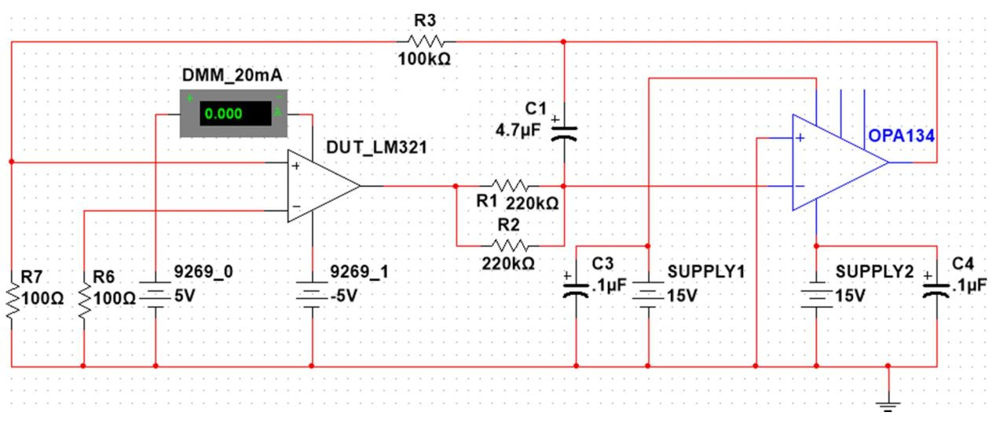
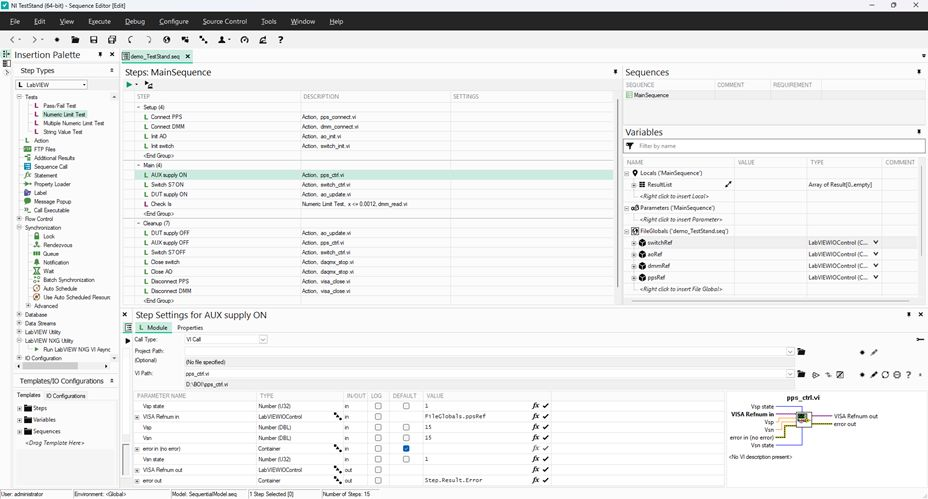
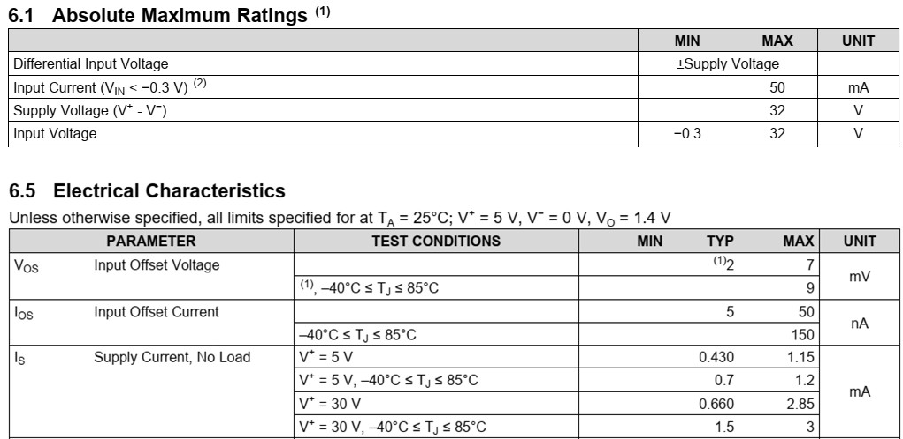
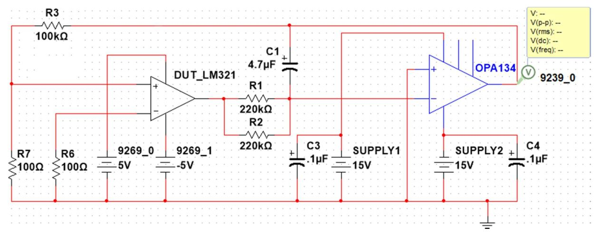

Reuse the Day 2 SubVIs as TestStand code modules. Build the LM321 DC test one sequence at a time, run it after each addition, and keep cleanup in the Cleanup group.

### 1. Before you start

1.1  Open the Day 2 LabVIEW project. Confirm that **pps_connect**, **pps_ctrl**, **dmm_connect**, **dmm_read**, **switch_init**, **switch_ctrl**, **ao_init**, **ao_update**, **ai_init**, **ai_measure**, **daqmx_stop** and **visa_close** run on this station.

1.2  Open NI TestStand 2026 Q1. Under **Configure > Adapters**, select the LabVIEW adapter and the LabVIEW version used for the Day 2 VIs.

1.3  Create a folder for today's work. Save every sequence file (.seq) there and keep the VI paths relative to it.

1.4  Keep the DUT and AUX supplies off until a step asks for them.

### 2. Working rules

2.1  **Setup** opens resources, **Main** applies stimuli and measures, **Cleanup** returns the station to a safe state and releases resources. Cleanup also runs after a failure or Terminate.

2.2  Store instrument references in **FileGlobals** so all sequences in the file can use them. Store measurements and operator inputs in **Locals**.

2.3  Use an **Action** step when no limit is evaluated. Use a **Numeric Limit Test** when a measurement decides PASS/FAIL.

2.4  Run with a breakpoint and **Step Over** after each change. Check variable values in the **Variables** pane.

### 3. Try a ready-made example

3.1  Open **Examples > Demos > Mobile Device Test** and choose **Execute > Run MainSequence**.

3.2  Set a breakpoint on one step, run again, and use **Step Into** and **Step Over**. Note how each step reports its status.

{width=80%}



## Tutorial 1: Accept and validate the supply voltage

**Goal:** Read a value from the operator, store it in a variable and branch on its range.

{width=100%}

Figure 1. A Message Popup with a response text box; the Post-Expression converts the response to a number.

### 1. Read the value

1.1  Create a new sequence file and save it as **Day3_Tutorial1.seq**.

1.2  In **MainSequence > Main**, add a **Message Popup** with the message "Enter Vs supply". Enable **Enable Response Text Box**.

1.3  Add the Number variable **Locals.Vsp**.

1.4  In **Properties > Expressions > Post-Expression**, enter `Locals.Vsp = Val(Step.Result.Response)`.

1.5  Set a breakpoint after the popup. Run, enter 15 and check that `Locals.Vsp` is 15.

{width=100%}

Figure 2. Statement step and If-Else flow control.

### 2. Validate the value

2.1  Add the Boolean variable **Locals.validVs**.

2.2  Add a **Statement** step: `Locals.validVs = (Locals.Vsp >= 3) && (Locals.Vsp <= 32)`.

2.3  Add **If**, **Else** and **End** flow-control steps. Use `Locals.validVs` as the If condition.

2.4  In the True branch, show "Vs OK". In the False branch, show "Vs not in range".

| Input | Expected `Locals.validVs` | Message shown | Observed |
| --- | --- | --- | --- |
| 15 | True | Vs OK | |
| 2 | False | Vs not in range | |
| 40 | False | Vs not in range | |
| abc | | | |

**Question:** What does `Val()` return for "abc", and how should the sequence handle it?



## Tutorial 2: Power the AUX op-amp from TestStand

**Goal:** Call LabVIEW code modules from each step group and pass a VISA reference between them.

{width=100%}

Figure 3. Setup connects the supply, Main applies the voltage for 3 s, Cleanup closes the session.

### 1. Prepare variables

1.1  Save Tutorial 1 as **Day3_Tutorial2.seq**. Keep the popup that sets **Locals.Vsp**.

1.2  Add **FileGlobals.ppsRef**. Use the LabVIEWIOControl type so it can hold a VISA reference.

### 2. Add the code modules

2.1  **Setup:** add an Action step that calls **pps_connect**. Map the VISA reference output to `FileGlobals.ppsRef`.

2.2  **Main:** add an Action step that calls **pps_ctrl**. Map the reference input to `FileGlobals.ppsRef` and the voltage input to `Locals.Vsp`.

2.3  **Main:** add a **Wait** step (Synchronization) of 3 s, then call **pps_ctrl** again with 0 V (output off).

2.4  **Cleanup:** call **visa_close** with `FileGlobals.ppsRef`.

### 3. Run and observe

3.1  With the fixture disconnected or in the approved state, run MainSequence and enter 15.

3.2  Watch the UDP3305S display: output on for about 3 s, then off.

3.3  Run again and press **Terminate** during the Wait. Check that Cleanup still closes the session and the output is off.

| Check | Expected | Observed |
| --- | --- | --- |
| Display during Wait | 15 V, output ON | |
| Display after Main | output OFF | |
| After Terminate | session closed, output OFF | |

**Note:** Cleanup closing a session does not by itself switch the output off. If the output stays on after Terminate, add an explicit output-off call to Cleanup before **visa_close**.



## Tutorial 3: Supply current I~S~ test

**Goal:** Build the full I~S~ test: four instruments in Setup, a Numeric Limit Test in Main, safe shutdown in Cleanup.

{width=90%}

Figure 4. I~S~ measurement: UDP3305S supplies the AUX op-amp, NI-9269 supplies the DUT, NI-9477 controls S7, UT8805E measures current (20 mA range).

### 1. Setup group

| Code module | Function | Output variable |
| --- | --- | --- |
| **pps_connect** | Connect UDP3305S | `FileGlobals.ppsRef` |
| **dmm_connect** | Connect UT8805E | `FileGlobals.dmmRef` |
| **switch_init** | Connect NI-9477 | `FileGlobals.switchRef` |
| **ao_init** | Connect NI-9269 | `FileGlobals.aoRef` |

1.1  Save as **Day3_LM321_DC.seq**. Add the four FileGlobals (LabVIEWIOControl type).

1.2  Add one Action step per row. Map each reference output to its FileGlobal.

### 2. Main group

2.1  **pps_ctrl**: AUX supply ±15 V (CH1 = 15 V, CH2 = 15 V as wired on the fixture).

2.2  **switch_ctrl**: S7 ON.

2.3  **ao_update**: DUT supply \[5, 5\] V on AO0/AO1.

2.4  Add a **Numeric Limit Test** that calls **dmm_read**. Map the current reading to `Step.Result.Numeric`.

2.5  Set the comparison to **LT** with low/high limit 1.2 mA. Use consistent units: if **dmm_read** returns amperes, enter 0.0012.

### 3. Cleanup group

3.1  **ao_update** \[0, 0\] V, then **pps_ctrl** output off, then **switch_ctrl** S7 OFF.

3.2  **daqmx_stop** for the NI-9477 and NI-9269 tasks; **visa_close** for the UDP3305S and UT8805E sessions.

{width=100%}

Figure 5. Reference sequence for the I~S~ test.



### 4. Run and record

4.1  Run **Execute > Single Pass** so a report is generated. Open the report and find the I~S~ step.

| Item | Value | Unit |
| --- | --- | --- |
| Measured I~S~ | | |
| Limit | < 1.2 | mA |
| Step status (Passed/Failed) | | |
| Datasheet typical I~S~ (from Figure 6) | | |

4.2  Lower the limit temporarily below the measured value and run again. Check that the step and the UUT fail, then restore 1.2 mA.

{width=90%}

Figure 6. LM321 specification.



## Tutorial 4: Split the test into sub-sequences

**Goal:** Move each measurement into its own sequence so MainSequence reads as a test plan, and add the V~OS~ test.

### 1. Create the I~S~ sub-sequence

1.1  In **Day3_LM321_DC.seq**, create a new sequence **I_S_test**.

| Group | Code module | Function |
| --- | --- | --- |
| **Setup** | **switch_ctrl** | Turn S7 ON |
| **Main** | Numeric Limit Test (**dmm_read**) | Test I~S~ < 1.2 mA |
| **Cleanup** | **switch_ctrl** | Turn S7 OFF |

1.2  Move the existing steps. The sub-sequence uses the same FileGlobals, so no parameters are needed.

1.3  In MainSequence, replace the moved steps with a **Sequence Call** to **I_S_test**.

### 2. Create the V~OS~ sub-sequence

{width=85%}

Figure 7. V~OS~ null measurement: the NI-9239 reads the scaled offset at TP1.

2.1  Add **ai_init** to MainSequence Setup → `FileGlobals.aiRef`, and its **daqmx_stop** to Cleanup.

2.2  Create a sequence **V_OS_test** with S7 OFF. In Main, add a **Numeric Limit Test** that calls **ai_measure**.

2.3  Convert TP1 volts to V~OS~ with the station-verified fixture gain (about 1000:1) in a Post-Expression, then test |V~OS~| < 7 mV.

2.4  Add a Sequence Call to **V_OS_test** after **I_S_test**.

### 3. Final MainSequence

| Group | Steps |
| --- | --- |
| **Setup** | Connect UDP3305S, UT8805E, NI-9477, NI-9269, NI-9239 |
| **Main** | AUX and DUT supplies ON → Call **I_S_test** → Call **V_OS_test** |
| **Cleanup** | DUT and AUX supplies OFF → S7 OFF → release DAQmx/VISA resources |

### 4. Record

| Test | Measured | Limit | Status |
| --- | --- | --- | --- |
| I~S~ | | < 1.2 mA | |
| V~OS~ | | < 7 mV | |

**Questions:** Why does S7 OFF appear in both I_S_test Cleanup and MainSequence Cleanup? What changes if you run with **Test UUTs** instead of Single Pass?

## Deliverables

- Day3_Tutorial1.seq, Day3_Tutorial2.seq and Day3_LM321_DC.seq with the VIs they call.
- A Single Pass report showing the I~S~ and V~OS~ results.

## References

Original slides: TS_01_TestStand_overview.md, TS_02_TestStand_workflow.md, TS_03_TestStand_practice.md. Figures are unchanged.

- [TestStand Code Module Development Best Practices](https://www.ni.com/en/support/documentation/supplemental/09/teststand-code-module-development-best-practices.html)
- [Passing VISA/DAQmx references with LabVIEWIOControl](https://knowledge.ni.com/KnowledgeArticleDetails?id=kA03q000000YGp8CAG&l=en-TH)
